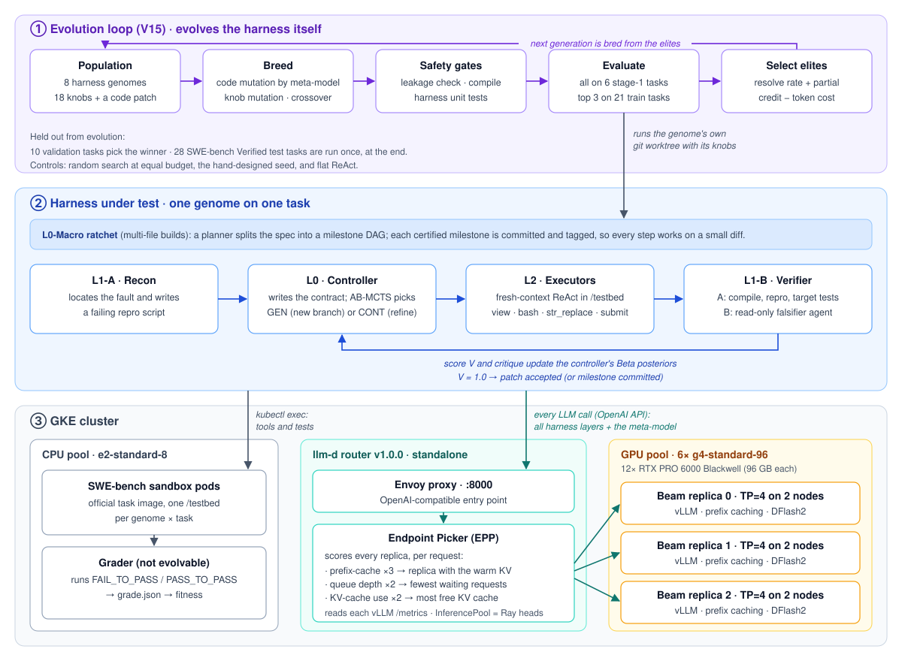

# Hierarchical Agent Evolution (HAE)

HAE is a harness that lets open-weight LLMs fix bugs and build software in real
repositories. A patch is accepted only after it has been proven to work.
Everything runs self-hosted on GKE, and the harness itself is now the thing
being evolved.

- [Overview](#overview)
- [Lessons learned](#lessons-learned)
- [Architecture](#architecture)
- [Roadmap and vision](#roadmap-and-vision)
- [Repository layout and running](#repository-layout-and-running)

---

## Overview

### What the harness does

A single agent working in one long conversation tends to fail in predictable
ways:
- Its context fills up with grep output and test logs.
- It commits to the first plausible fix.
- It "verifies" that fix with a test it wrote itself.

HAE breaks the work into roles, gives each role a fresh, small context, and
lets work move upward only once it can be checked.

| Role | What it does | What it hands back |
| :--- | :--- | :--- |
| **Recon (L1-A)** | Finds where the fault lives and writes a script that reproduces it | A short brief (< 800 tokens) and a failing repro |
| **Controller (L0)** | Writes a contract (invariants, anti-cheat rules) and decides the next move: start a new hypothesis (`GEN`) or refine a near-miss (`CONT`) | A dispatch |
| **Executors (L2)** | Edit code in the task's sandbox with ReAct tools, each starting from a clean git checkpoint | A candidate `git diff` |
| **Verifier (L1-B)** | First runs deterministic checks (compile, repro, target tests). Then a read-only *falsifier* agent tries to break the patch and adds edge-case tests | A score V ∈ [0, 1] and a critique |

The controller treats each git checkpoint as a node in a search tree. It uses
Thompson sampling over Beta posteriors (AB-MCTS) to decide where to spend the
next attempt. A patch is accepted only at V = 1.0.

For work too big for one diff, an outer **milestone ratchet** (L0-Macro) splits
a spec into a DAG of milestones. Each certified milestone is committed and
tagged, and earlier milestones' tests re-run as a regression guard. Every step
therefore works on a small diff, however large the repository grows.

### Why it works

- **Small contexts stay sharp.** Raw transcripts are thrown away at every
  layer boundary. Only artifacts that can be checked move up, so no agent
  reasons over a polluted context.
- **Authors don't grade their own work.** The falsifier never wrote the patch,
  and the deterministic gate can't be argued with. This is where single agents
  most often fool themselves.
- **Search over checkpoints instead of restarts.** A near-miss gets refined
  from where it stood, and a dead end loses probability mass. A single agent
  would instead restart or dig deeper into a wrong idea.
- **Bounded diffs keep review honest.** The ratchet keeps each step small
  enough for the verifier to actually read.

### What the evidence shows so far

| Finding | Evidence | Status |
| :--- | :--- | :--- |
| Small steps beat one big attempt | MiniSQL engine graded by a held-out `sqlite3` oracle: milestone ratchet **15 / 15**, one-shot hierarchical **8 / 15**, flat ReAct **0 / 15** | Holds. Compute not matched (1.80M vs 0.37M tokens) |
| External oracles catch what self-written tests miss | The ratchet's own suites were green, yet the held-out oracle scored 9 / 15 until recovery milestones fixed the rest | Holds |
| Hierarchy vs flat ReAct on SWE-bench | 21 / 28 vs 19 / 28 on unseen Verified tasks, with no task lost | **Not clean**: prompts contained test-task examples. V15 re-runs a cleaned harness |
| **V15: searched harness vs hand design** | 28 unseen Verified tasks, cleaned harness: evolved **17 / 28**, random settings search 16 / 28, hand-designed seed 12 / 28 (evolved vs seed 5 : 0, p = 0.063) | Search beats the seed; **evolution does not beat random search** at matched budget (0 : 4). [Results](results/v15/test_2026-10-28/README.md) |
| **V16: role library + CEO policy evolution** | 28 unseen Verified tasks × 2 runs: V15 champion `A` **16.5 / 28**, static roles `B` 15.5 / 28, dynamic CEO `C` **16.5 / 28** (`[15, 18]`), evolved org `D` 15.5 / 28, random org `E` 16.0 / 28, flat ReAct `V12` **16.5 / 28** | Validation lift (`5.0/10` vs `4.0/10`) did not transfer to test; falsifier false-passes (`29–41%`) and tight turn caps bottlenecked multi-role gains. [Results](experiments/v16/README.md) |

The V14 retrospective explains why the SWE-bench numbers can't be cited yet:
[`experiments/v14/v14_retrospective.md`](experiments/v14/v14_retrospective.md).
V15 is the first run designed to produce a clean, held-out answer
([design](experiments/v15/README.md)).

---

## Lessons learned

Fifteen versions fall into four eras. Per-version details are in
[`experiments/README.md`](experiments/README.md).

### Era 1 · Evolving agent firms (V1–V7)

*Populations of multi-agent "firms" bred and selected on small coding tasks.*

- **An LLM judge is a target, not a measurement.** Judged fitness climbed
  from 25 to 97 while real execution didn't improve at all (correlation
  +0.045). Everything since has been graded by running code.
- **Honest fitness is necessary but not enough.** Held-out unit tests fixed
  the scoring. But the tasks were soon solved by every firm (30 / 30), and
  once everyone passes, selection has nothing to choose between.
- **Isolation has to be tested, not assumed.** In V3, child firms quietly
  inherited their parents' passing code through a workspace bug.
  V4's cross-firm response cache made different firms receive identical
  answers. Both made "independent" samples not independent.
- **Constrain the output format and you save tokens.** Grammar-constrained
  JSON packets cut output tokens per call by 92%.
- **Models can't tell you how confident they should be.** LLM-stated priors
  on hypotheses were uncalibrated. A value head learned from outcomes beat the
  base rate.

### Era 2 · Real GitHub issues, single-layer agents (V8–V12)

*The same ideas on a 30-task SWE-bench dev cohort.*

- **Real repositories need exploration, not plans.** Agents that exchanged
  structured JSON plans stalled at 4–6 / 30. Giving them interactive tools
  (view, bash, edit, run) more than doubled that to 14 / 30.
- **A better search algorithm can't rescue a weak step.** Swapping PUCT for
  AB-MCTS barely moved results until the individual steps got better.
- **Agents believe their own tests.** In V8, 4 of 7 "self-verified" fixes
  failed the real tests. Self-verification needs an independent check.

### Era 3 · Hierarchical verification (V13–V14)

*Context-bounded layers, a falsifier, search over git checkpoints, and the
milestone ratchet.*

- **Pass artifacts, not transcripts.** Fresh small contexts with a brief, a
  diff or a critique outperformed long single conversations.
- **An outside oracle is worth more than more internal tests.** On MiniSQL the
  internal suites passed while the held-out `sqlite3` oracle failed 6 of 15
  checks.
- **Bounded steps beat one big attempt, at a price.** The ratchet reached
  15 / 15 where a single 1,651-line attempt reached 8 / 15, but it used about
  5× the tokens. On SWE-bench the hierarchy cost 1.6× the tokens and 1.5× the
  time of flat ReAct.
- **Benchmark leakage is easy to create and hard to see.** It crept in three
  times:
  - First, as repo-specific hints (3 strings in prompts grew to 25).
  - Then as "generic" detectors that injected the gold fix.
  - Finally, as prompt examples that described specific test tasks.
  
  A grep for repo names didn't catch them. The lesson became code: an
  automated leakage gate now rejects any change that introduces identifiers
  from gold or hidden-test patches.

### Era 4 · Evolving the harness (V15)

*The V14 harness becomes the genome: 18 knobs plus a patch against its source.*

- **Fitness has to discriminate.** The first stage-1 task subset was useless:
  all 8 genomes solved the same task and failed the other five, so ranking
  came down to token cost. It was replaced with near-miss tasks and partial
  credit, before any selection happened.
- **Keep the grader out of the search space.** Genomes can change prompts,
  search and verification, but never the grader, the datasets or the
  evaluator.
- **Name infrastructure accurately.** Until Oct 27 the "llm-d gateway" was a
  custom Python proxy. V15 now runs on the real llm-d router. The old proxy's
  rewrites were audited as no-ops for SWE-bench, so the switch changes speed,
  not agent behavior.

---

## Architecture



The system has three layers that talk to each other:

1. **Evolution loop (V15).** This runs on a coordinator.
   - A population of 8 harness genomes is bred by code mutation (a meta-model
     proposes edits to the harness source), knob mutation and crossover.
   - Every child must pass the leakage gate, compile, and pass the harness
     unit tests before it costs any GPU time.
   - Children are evaluated by successive halving: 6 stage-1 tasks for all,
     21 training tasks for the top 3.
   - Fitness is resolve rate, plus 0.25 × partial `FAIL_TO_PASS` credit,
     minus a small token-cost term.
   - 10 validation tasks pick the final genome. 28 unseen SWE-bench Verified
     tasks are run once, at the end, against random search, the hand-designed
     seed and flat ReAct.
2. **Harness under test.** Each genome runs from its own git worktree with its
   own knobs. The harness drives tools and tests inside a SWE-bench sandbox pod
   through `kubectl exec`. A fixed grader that genomes can't modify runs the
   `FAIL_TO_PASS` and `PASS_TO_PASS` tests and writes `grade.json`.
3. **Serving on GKE.** Every LLM call goes through the llm-d router, both from
   the harness layers and from the meta-model that writes code mutations.
   - The router fronts three replicas of **Beam-1.0-501B-A23B (NVFP4)**.
   - Each replica is vLLM with tensor parallelism 4 across two
     `g4-standard-96` nodes (12× RTX PRO 6000 Blackwell in total).
   - Each replica has prefix caching and DFlash2 speculative decoding.

### How the harness uses llm-d

The harness and llm-d fit together because of how the harness talks to the
model. Every layer starts a *fresh* context, but those contexts share long
prefixes: the system prompt, the contract, the recon brief and the file views.
Evolution then runs many genome × task jobs in parallel.

| llm-d component | Role in HAE |
| :--- | :--- |
| **Envoy proxy** (`:8000`) | One OpenAI-compatible endpoint for every agent layer and for the meta-model |
| **Endpoint Picker (EPP)** | Scores each replica per request, using metrics scraped from each vLLM `/metrics` |
| ↳ prefix-cache scorer (weight 3) | Keeps an episode's calls on the replica that already holds their prefix in KV cache |
| ↳ queue scorer (2) and KV-cache-use scorer (2) | Spread parallel evolution workers across replicas without overloading one |
| **InferencePool** | Points at the Ray head of each TP=4 replica. Set to fail open so a scheduler problem doesn't stall a run |

In a routing check, requests sharing a long prefix all landed on one replica.
The first request took 1.4–2.2 s and follow-ups about 0.25 s. Setup and
values: [`k8s/llm-d/`](k8s/llm-d/README.md). Cluster setup:
[`k8s/README.md`](k8s/README.md).

Deeper specs:
- Inner engine: [`experiments/v13/v13_hierarchical_agentic_ab_mcts_architecture.md`](experiments/v13/v13_hierarchical_agentic_ab_mcts_architecture.md)
- Milestone ratchet: [`experiments/v14/v14_generalized_macro_ratchet_architecture.md`](experiments/v14/v14_generalized_macro_ratchet_architecture.md)
- Evolution: [`experiments/v15/README.md`](experiments/v15/README.md)

---

## Roadmap and vision

**Vision.** We want a self-hosted engineering harness whose design is
*discovered* rather than hand-written. It should be evolved under fitness that
only rewards code that runs, protected against benchmark leakage by
construction, and able to scale from a one-line bug fix to a multi-week build
by ratcheting small, verified steps.

| Horizon | Goal | Done when |
| :--- | :--- | :--- |
| **Done: V15** | Show that evolution beats hand design | Evolved 17/28 vs seed 12/28 vs random 16/28 on held-out test: beats the seed, ties random search ([results](results/v15/test_2026-10-28/README.md)) |
| **Next** | Comparable, trustworthy numbers | SWE-bench Pro (public), ≥ 3 seeds, official `swebench` grading, external baselines at matched budget |
| **Then** | Long-horizon builds | ≥ 10k LoC on a second target with an external oracle, with ratchet settings evolved too |
| **Serving** | Make the harness and llm-d co-designed | Prefix hit rate and latency per layer measured and optimized |

**Follow-ups from V15.**
- Re-grade the final predictions with the official `swebench eval` harness
  (today's grader is approximate), and re-run V12 flat ReAct under the same
  load as the V15 test.
- Evolution only tied random search: run more generations and repeated
  evaluations (≥ 2 seeds per genome) to cut selection noise before claiming
  an evolutionary advantage.

**Next: comparable numbers.**
- Run the selected harness on SWE-bench Pro (public) with at least 3 seeds.
- Compare against mini-SWE-agent and OpenHands on the same Beam endpoint, at
  matched token budgets.
- Run the leakage gate on *every* prompt or harness change, not only on
  evolved patches.

**Then: long-horizon builds.**
- Add a second greenfield target with an external oracle, such as an
  interpreter checked against a reference implementation, and scale to 10k+
  LoC.
- Make the ratchet's settings evolvable too: milestone size, diff caps,
  planner prompts and recovery policy.

**Serving: co-design with llm-d.**
- Measure prefix-cache hit rate and latency per harness layer.
- Order prompts so stable content comes first, and consider making that
  layout an evolvable gene.
- Calibrate llm-d's prefix-cache-affinity filter for Beam on this hardware.
  It's currently off because its saturation threshold is uncalibrated.
- Evaluate prefill/decode disaggregation for the long-prefix, short-output
  calls the falsifier and recon make.

---

## Repository layout and running

```text
hae/
  evolution/      V15: harness genome, mutation (code + knobs), leakage gate, evaluator, evolution loop
  swebench/       L0-Micro hierarchical AB-MCTS (hierarchical_mcts.py), knobs (harness_knobs.py), ReAct engine, runner
  hierarchical/   L0-Macro milestone ratchet and verifier plugins
  epistemic/      Era 1–2 epistemic search, gatekeeper, value heads
  genome/ runtime/ evaluation/ orchestration/   Era 1 firm evolution
  infra/          LLM client (vLLM / OpenAI API), config, telemetry
configs/genomes/  V8–V15 harness genomes (V15 seed: v15_seed_harness_firm_0.json)
data/swebench/    50-task dev pool and the V15 train / validation / test splits
k8s/              GKE serving (Beam-501B, Qwen3.8) and the llm-d router (k8s/llm-d/)
scripts/          SWE-bench batch runner, grader, V15 evolution CLI, ratchet evals
experiments/      per-version design notes, reports and retrospectives
results/          harvested runs: patches, grade.json, records, summaries
tests/            stdlib unittest suite, no network access needed
```

**Tests:**

```bash
PYTHONPATH=. python3 -m unittest discover -s tests -q
```

**Serve Beam-501B behind llm-d.** See [`k8s/README.md`](k8s/README.md) and
[`k8s/llm-d/README.md`](k8s/llm-d/README.md).

```bash
kubectl apply -f k8s/beam-501b-nvfp4-serving.yaml
kubectl apply -f https://github.com/kubernetes-sigs/gateway-api-inference-extension/releases/download/v1.6.2/v1-manifests.yaml
helm install beam-501b-router oci://ghcr.io/llm-d/charts/llm-d-router-standalone --version v1.0.0 \
  -n default -f k8s/llm-d/beam-501b-router.values.yaml
kubectl port-forward svc/beam-501b-router-epp 8000:8000
```

**Evolve the harness (V15):**

```bash
PYTHONPATH=. python3 scripts/v15_evolve.py evolve --mode evolve --out results/v15/my_run --workers 4
PYTHONPATH=. python3 scripts/v15_evolve.py evolve --mode random --out results/v15/my_random --workers 2 \
  --seed-results-from results/v15/my_run
```

**Run one SWE-bench task with the hierarchical harness** (`v13_hier_mcts` policy):

```bash
PYTHONPATH=. python3 -u scripts/swebench_kubectl_batch.py --out-root results/swebench/my_run \
  --policies v13_hier_mcts --vllm-url http://127.0.0.1:8000/v1 \
  --vllm-model reflection/Beam-1.0-501B-A23B-NVFP4 --instances marshmallow-code__marshmallow-1702
```

**Run a milestone build:**

```bash
PYTHONPATH=. python3 -m hae.cli --mode ratchet --workspace-dir /path/to/repo \
  --objective "Build a tokenizer, parser and evaluator with unit tests." --acceptance-cmd "pytest -q" --resume
```

Licensed under Apache-2.0 ([`LICENSE`](LICENSE)).
