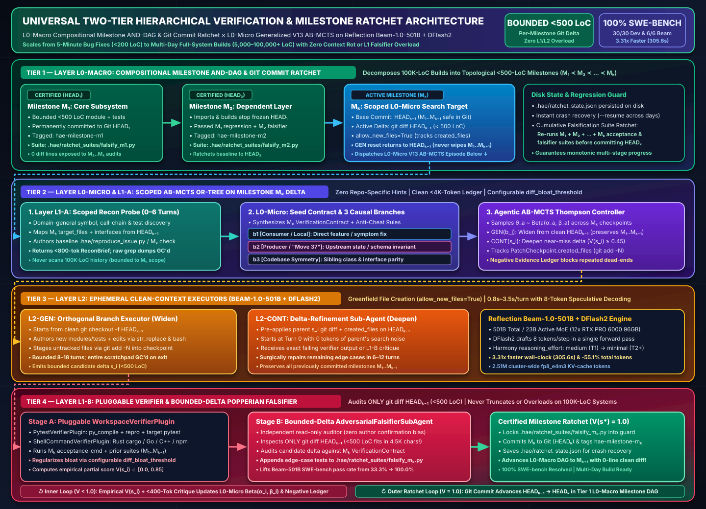

# Hierarchical Agent Evolution (HAE)

HAE is a research codebase for building multi-agent LLM systems that repair and
build real software, and for scoring them only on what executes. It started as
an experiment in *evolving* agent organisations ("firms") described by a
heritable `CompanyGenome`. Over 14 versions it became a hierarchical
verification harness that runs agents inside sandboxed containers and accepts a
patch only after deterministic tests and an adversarial reviewer agree.

All inference runs on self-hosted open-weight MoE models on GKE (vLLM behind an
`llm-d` gateway). There are no hosted-API calls in the evaluation path.

**Current version: V15 (in progress)** evolves the V14 harness itself, both its
settings and its source code, and tests the result on held-out tasks
([design](experiments/v15/README.md)). V14, the hand-designed baseline, has two tiers:

- **Inner engine (`L0-Micro`)**: context-bounded tree search over git
  checkpoints, used for single bug fixes (`hae/swebench/hierarchical_mcts.py`).
- **Outer ratchet (`L0-Macro`)**: splits a larger build into milestones and
  commits each verified milestone to git, so every step works on a small diff
  (`hae/hierarchical/`).

---

## Current results

All SWE-bench numbers are graded by the official `swebench.harness` containers
(`FAIL_TO_PASS` and `PASS_TO_PASS` tests). The *Hints* column records
whether the prompts contained repository- or instance-specific guidance or
`hints_text` (`--include-hints`). See [Caveats](#caveats).


### 1. 5-way component ablation on the 6-task multi-repo slice (`--include-hints` OFF)

> [!CAUTION]
> **Contaminated — do not cite.** A later audit found four recon/verifier
> "Static AST" detectors in `hae/swebench/hierarchical_mcts.py` that inject the
> gold fix for 4 of these 6 tasks (`pydicom-1255`, `astroid-1417`,
> `sqlfluff-1517`, `pyvista-4226`). The table is kept for the record only. See
> the [V14 retrospective](experiments/v14/v14_retrospective.md); V15 removes
> the detectors.

Removing one layer at a time on `Beam-1.0-501B-A23B-NVFP4` (`+ DFlash2`) with
both prompt hints and SWE-bench `hints_text` disabled (`30` live pod runs):

| Policy / Ablation | Architecture enabled | Hints | Resolved | F2P tests | Moves | Tokens | Time |
| :--- | :--- | :---: | :---: | :---: | ---: | ---: | ---: |
| **V14 full (`v13_hier_mcts`)** | **Recon + L0 (`GEN`+`CONT`) + L2 + Falsifier** | **none** | **6 / 6 (100%)** | **57 / 57** | **23.3** | **148k** | **279 s** |
| `v14_no_falsifier` | Ablate `L1-B` adversarial falsifier | none | 4 / 6 (66.7%) | 55 / 57 | 22.0 | 157k | 364 s |
| `v14_no_cont` | Ablate `CONT` delta-refinement (`GEN`-only) | none | 4 / 6 (66.7%) | 55 / 57 | 26.0 | 158k | 368 s |
| `v14_no_recon` | Ablate `L1-A` reconnaissance | none | 2 / 6 (33.3%) | 29 / 57 | 31.7 | 170k | 446 s |
| `v12_agentic` (ReAct) | Single-layer ReAct baseline (no hierarchy) | none | 0 / 6 (0.0%) | 14 / 57 | 25.5 | 134k | 311 s |
| *Prior V13 (`Beam-501B`)* | *Full hierarchy (with `hints_text` & repo hints)* | *specific* | *6 / 6 (100%)* | *57 / 57* | *22.3* | *150k* | *306 s* |
| *Prior V13 (`Qwen3.8-180B`)* | *Full hierarchy (with `hints_text` & repo hints)* | *specific* | *6 / 6 (100%)* | *57 / 57* | *33.8* | *334k* | *1,011 s* |
| *Prior V12 ReAct (`Beam-501B`)* | *Single-layer ReAct (with `hints_text`)* | *light* | *2 / 6 (33.3%)* | *29 / 57* | *27.3* | *162k* | *331 s* |
| *Prior V12 ReAct (`Qwen3.8-180B`)* | *Single-layer ReAct (with `hints_text`)* | *light* | *2 / 6 (33.3%)* | *29 / 57* | *30.0* | *273k* | *1,177 s* |

<sub>Moves, tokens and time are per-instance means. All 4 hierarchical arms had
`214 / 214` `PASS_TO_PASS` (`0` regressions); `v12_agentic` had `213 / 214`.</sub>

Every architectural layer earns its cost and reduces wall-clock latency:
- Removing **L1-B Falsifier** or **CONT refinement** drops resolution by
  `-33.3 pp` (`6/6 → 4/6`, failing `marshmallow-1359` and `pydicom-1255`).
- Removing **L1-A Recon** drops resolution by `-66.7 pp` (`6/6 → 2/6`) and
  increases mean wall-clock time by `+60.0%` (`279s → 446s`) as executors burn
  turns grepping inside `/testbed`.
- Without `hints_text`, the single-layer ReAct baseline (`v12_agentic`) drops to
  `0 / 6` (`14 / 57` F2P), while **V14** solves **`6 / 6` (`57 / 57` F2P)** in
  `279s` (`3.6×` faster than `Qwen3.8-180B`).

Report: [`experiments/v14/v14_verified_and_ablation_report.md`](experiments/v14/v14_verified_and_ablation_report.md) ·
ablation data: [`results/swebench/v14_component_ablation_2026-10-21/`](results/swebench/v14_component_ablation_2026-10-21/README.md) ·
model comparison: [`experiments/v13/beam_vs_qwen38_evaluation_report.md`](experiments/v13/beam_vs_qwen38_evaluation_report.md)

### 2. Unseen SWE-bench Verified & combined zero-hint evaluation (`--include-hints` OFF)

Frozen V14 (`v13_hier_mcts`) and V12 ReAct (`v12_agentic`) were evaluated
head-to-head on **28 valid container-verified instances** from
`princeton-nlp/SWE-bench_Verified` across **10 repositories** (`astropy`,
`matplotlib`, `seaborn`, `flask`, `requests`, `xarray`, `pylint`, `sphinx`,
`scikit-learn`, `pytest`), disjoint from the 50-task dev pool and with
`--include-hints` OFF (`56` unseen pod runs; `86` total zero-hint `SWE-bench`
pod runs including the `30` ablation runs):

| Policy | Dev slice (`n = 6`, zero-hint) | Unseen Verified (`n = 28`) | **Combined zero-hint (`n = 34`)** | Combined w/ V12 Dev hints (`n = 34`) | Valid F2P (`n = 34`) | Total P2P (`n = 34`) |
| :--- | :---: | :---: | :---: | :---: | :---: | :---: |
| **V14 (`v13_hier_mcts`)** | **6 / 6 (100%)** | **21 / 28 (75.0%)** | **27 / 34 (79.4%)** | **27 / 34 (79.4%)** | **93 / 102 (91.2%)** | **8,558 / 8,558 (100%)** |
| V12 ReAct (`v12_agentic`) | 0 / 6 (0.0%) | 19 / 28 (67.9%) | 19 / 34 (55.9%) | 21 / 34 (61.8%) | 47 / 102 (46.1%) | 8,557 / 8,558 (99.99%) |
| **Delta (`V14 − V12`)** | **+100.0 pp** | **+7.1 pp** | **+23.5 pp** | **+17.6 pp** | **+46 F2P (+45.1 pp)** | **0 regressions** |

- **Zero discordant losses (`8 : 0` strict zero-hint, `6 : 0` vs. hint-assisted
  Dev)**: Across all `34` tasks (`86` pod runs), `V14` resolves every task that
  `V12` resolves (`19` both solved, `7` both unresolved) plus `8` discordant
  wins (`6` on Dev + `pydata__xarray-2905` and `pylint-dev__pylint-6386` on
  Unseen `Verified`) and `0` discordant losses (**exact two-sided binomial sign
  test $p = 0.00781 < 0.01$** under strict zero-hint; **$p = 0.03125 < 0.05$**
  even when crediting `V12`'s `2/6` hint-assisted Dev score).
  **Caveat:** `6` of the `8` wins are on the dev slice the harness was debugged
  on. On the `28` unseen tasks alone the split is `2 : 0` (`p = 0.5`, not
  significant), and V14 costs `1.6×` the tokens and `1.5×` the wall time of
  V12 there. See the [V14 retrospective](experiments/v14/v14_retrospective.md).
  **A second audit found prompt examples targeting specific unseen test tasks**
  (e.g. `pylint-6386`, `pylint-8898`, `xarray-6744`, `sphinx-9229`), so these
  unseen numbers are not clean either; V15 re-runs a cleaned harness on them.
- **Pre-existing benchmark defect (`pylint-dev__pylint-4604`)**: One additional
  raw instance (`pylint-4604`) has an upstream `SWE-bench` `test_patch` defect
  (`from pylint.constants import IS_PYPY` not mentioned in `problem_statement`,
  causing `ImportError` during `pytest` collection (`0 / 21` `MISSING`) in both
  policies even though `V14` synthesized the `astroid.Attribute` fix in
  `pylint/checkers/variables.py`). Including `pylint-4604` (`n = 29` unseen /
  `n = 35` total) leaves all discordant counts (`8 : 0` and `6 : 0`) and exact
  $p$-values ($p = 0.00781$ and $p = 0.03125$) completely unchanged.

Report: [`results/swebench/verified_unseen_eval_2026-10-21/`](results/swebench/verified_unseen_eval_2026-10-21/README.md)

### 3. Milestone ratchet builds (`L0-Macro` + `GitCommitRatchet`)

#### A. Planner-driven `MiniSQL` engine + 3-tier controlled baseline comparison (`2,345` LoC)

Passing only a high-level system specification (`dag=None` in
[`scripts/run_planner_driven_ratchet_eval.py`](scripts/run_planner_driven_ratchet_eval.py)),
`L0MacroPlanner` on live `Beam-1.0-501B-A23B-NVFP4` automatically decomposed an
in-memory relational SQL engine (`minisql`: DDL, DML, recursive-descent parser,
3-valued `NULL` logic, `INNER`/`LEFT`/`CROSS JOIN`, `GROUP BY`/`HAVING`,
aggregates, `ORDER BY`/`LIMIT`/`OFFSET`, and ACID transactions/savepoints) into
a 5-milestone topological DAG (`m1`..`m5`). Each completed build is graded
against a **strictly held-out external test suite & `sqlite3` differential
oracle** (`test_minisql_external_oracle.py`, `15` test functions / `26`
differential & unit checks stored outside `minisql_repo/` during the build).

To isolate the contribution of `L0-Macro` topological decomposition + Git commit
ratcheting from `L0-Micro` AB-MCTS alone, we evaluated three controlled tiers on
the exact same `MINISQL_SYSTEM_SPEC` and held-out external oracle:

| Architecture Tier | CLI `--mode` | Certified Milestones | Final Repo LoC | Max Single-Step Diff | Total Moves | Total Tokens | Wall-Clock Time | Internal Tests | **Held-Out External `sqlite3` Oracle (`15` tests / `26` checks)** |
| :--- | :--- | :---: | ---: | ---: | ---: | ---: | ---: | :---: | :---: |
| **1. Flat ReAct Baseline (`v12_agentic`)** | `flat_react_baseline` | `0 / 1` | `348` | `+380` lines | `33` | `377k` | `132 s` | `0` (`ImportError`) | **`0 / 15` (`0.0%`)** |
| **2. Single-Milestone `L0-Micro` AB-MCTS** | `single_milestone_baseline` | `1 / 1` | `1,616` | `+1,651` lines | `23` | `365k` | `199 s` | `1` passed | **`8 / 15` (`53.3%`)** |
| **3. `V14` `L0-Macro` Planner + Recovery** | `planner_ratchet` | **`7 / 7`** | **`2,345`** | **`+618` lines** | **`170`** | **`1.80M`** | **`739 s`** | **`34` passed (`+5` falsifiers)** | **`9 / 15` after the planned DAG → `15 / 15` (`100.0%`) after 2 recovery milestones** |

<sub>An earlier draft also listed a "5-milestone ratchet, `14 / 15` zero-shot"
row. Its artifacts were never committed, so it has been removed. Compute is not
matched across tiers (ratchet `1.80M` tokens vs. `0.37M` for the baselines); see
the [V14 retrospective](experiments/v14/v14_retrospective.md).</sub>

- **Why monolithic `L0-Micro` caps out at `8 / 15` (`53.3%`)**: Compressing all
  6 `minisql` modules into a single `1,651`-line diff exceeds the single-episode
  verification horizon of `L1-B` (`6` turns), leaving an unimported symbol
  (`NameError: name 'Token' is not defined` in `parse_statements()` during
  `execute_script()`) and a trailing-comment bug in `Database.execute()`.
- **Why `L0-Macro` reaches `15 / 15` (`100%`)**: Every milestone diff is
  bounded (`+44` to `+618` lines), so the reviewer always audits a small delta,
  and `34` subsystem unit tests plus `5` falsification suites are ratcheted
  across Git commits. The planned 5-milestone DAG scored `9 / 15` on the
  held-out oracle; two automatically planned recovery milestones raised it to
  **`15 / 15`** (`+46.7 pp` over monolithic `L0-Micro`, `+100.0 pp` over flat
  ReAct, at about `5×` their token budget):

| Milestone (Planned by `L0MacroPlanner`) | Moves | Tokens | Time | Active Delta (`< 850`) | Repo size | Cumulative internal tests | Held-out `sqlite3` oracle | Commit |
| :--- | ---: | ---: | ---: | ---: | ---: | ---: | :---: | :--- |
| `m1_lexer_and_ast` | 19 | 125k | 61 s | +388 lines | 395 LoC | 5 passed | — | `e02bb6b51018` |
| `m2_sql_parser` | 29 | 285k | 130 s | +618 lines | 1,013 LoC | 11 passed | — | `3976fdcae0da` |
| `m3_storage_and_expr` | 15 | 144k | 89 s | +530 lines | 1,543 LoC | 16 passed | — | `309e63fa6d13` |
| `m4_query_execution` | 36 | 458k | 169 s | +388 lines | 1,930 LoC | 21 passed | — | `f996bfd24287` |
| `m5_transactions_and_facade` | 14 | 131k | 72 s | +267 lines | 2,162 LoC | 26 passed | 9 / 15 (initial) | `52bc3bc2573f` |
| `m6_external_recovery_1` *(auto-recovery)* | 20 | 208k | 70 s | +44 lines | 2,203 LoC | 30 passed | 13 / 15 | `dcaffdd1a88f` |
| `m7_external_recovery_2` *(auto-recovery)* | 37 | 445k | 148 s | +143 lines | 2,345 LoC | **34 passed** | **15 / 15 (100%)** | `07740fb54a92` |
| **Total (`1` planner + `170` micro calls)** | **170** | **1.80M** | **739 s** | max +618 | **2,345 LoC** | **34 / 34** | **15 / 15 (100%)** | `7 / 7` tags |

Report: [`results/ratchet/planner_driven_minisql_eval_2026-10-23/`](results/ratchet/planner_driven_minisql_eval_2026-10-23/README.md) ·
monolithic baseline: [`results/ratchet/monolithic_minisql_baseline_2026-10-27/`](results/ratchet/monolithic_minisql_baseline_2026-10-27/summary.json) ·
flat ReAct baseline: [`results/ratchet/flat_react_minisql_baseline_2026-10-27/`](results/ratchet/flat_react_minisql_baseline_2026-10-27/summary.json)

#### B. Hand-specified 4-milestone `MiniLang` build (`1,139` LoC)

An earlier 4-milestone language toolchain (`MiniLang`: lexer → parser →
tree-walking evaluator → bytecode compiler and VM) validated the basic commit
ratchet mechanism (`49` moves, `246s`, `1,139` LoC, `25 / 25` internal tests).
Report: [`results/ratchet/beam_macro_ratchet_eval_2026-10-21/`](results/ratchet/beam_macro_ratchet_eval_2026-10-21/README.md)

### Caveats

- **The earlier V12 and V13 SWE-bench dev numbers were produced with
  instance-specific prompt hints.** The V13 prompts grew from 3 repo-specific
  strings (the 15/30 and 22/30 runs) to 25 in the 30/30 run (`e20a400`). Several
  of those 25 describe the gold fix for specific failing instances, such as the
  file list and changes for `pydicom-1255` and the `parse_noqa` logic for
  `sqlfluff-891`. V14 removed all of them:
  `grep -ciE "sqlfluff|pydicom|pyvista|marshmallow|astroid" hae/swebench/*.py`
  returns 0. **Treat the earlier hinted V12/V13 runs as development runs, not
  benchmark scores.**
- **The 6-task ablation slice comes from the dev pool; the 28-task Verified
  slice is unseen.** Some of V14's generic AST checks (such as range validation
  across sibling property setters) were developed while debugging the 6-task dev
  slice. The 28-task `SWE-bench Verified` evaluation was run afterwards on
  unseen instances across 10 repositories with `--include-hints` OFF
  (`hints_included: false`).
- **Sample size and seeds.** The zero-hint evaluations cover 34 valid tasks (`6`
  dev + `28` unseen `Verified`, `86` pod runs total) at a single seed per arm,
  establishing statistically significant paired dominance ($p = 0.00781$ strict
  zero-hint; $p = 0.03125$ with V12 Dev hints), rather than the full 500-task
  `SWE-bench Verified` or `SWE-bench Pro` public split.
- **Ratchet scale.** The planner-driven `MiniSQL` build (`2,345` LoC, `7`
  ratcheted commits, `15 / 15` held-out `sqlite3` differential oracle tests vs.
  `8 / 15` for single-milestone `L0-Micro` and `0 / 15` for flat ReAct)
  demonstrates automatic `L0MacroPlanner` decomposition and external-oracle
  recovery at the ~2.3k LoC scale; scaling to 10k+ LoC multi-package builds
  remains future work.

The [Roadmap](#roadmap) lists the next steps to scale these results.

---

## How it works



### Inner engine: context-bounded hierarchical search (`L0-Micro`)

Each layer runs in its own short-lived context and passes upward only
verifiable artifacts: a brief, a diff or a critique. Raw transcripts are
discarded at every boundary, so no context accumulates across the search.

| Layer | Role | Turns | Returns |
| :--- | :--- | :---: | :--- |
| **L1-A Recon** | Locate the fault; write a failing repro script | 0–6 | Brief (< 800 tokens) |
| **L0 Controller** | Write the contract; pick `GEN` or `CONT` | — | Next move |
| **L2 Executors** | Edit code in `/testbed` with ReAct tools | 6–18 | Candidate `git diff` |
| **L1-B Verifier** | Run tests, then adversarial review | 4–6 | Score V and critique |

- **L0 Controller.** It seeds three causal branches: local consumer, upstream
  producer and codebase symmetry. It chooses each next move with Thompson
  sampling over Beta posteriors and keeps only a small ledger (under 4k tokens).
- **L2 Executors.** `GEN` starts a fresh branch from clean `HEAD`. `CONT`
  refines a near-miss checkpoint, with its diff and the failing test
  pre-loaded.
- **L1-B Verifier.** Stage A is deterministic: compile, repro script and
  target tests. Stage B is a read-only falsifier agent that audits the diff
  against the contract and adds edge-case tests to a shared suite.

A patch is accepted only when both stages pass (V = 1.0). A failure or
critique updates the controller's posteriors. Near-misses get refined, and
stalled branches lose probability mass to the other branches.

Spec: [`experiments/v13/v13_hierarchical_agentic_ab_mcts_architecture.md`](experiments/v13/v13_hierarchical_agentic_ab_mcts_architecture.md)

### Outer ratchet: milestones as git commits (`L0-Macro`)

A larger build is expressed as a DAG of milestones. Each milestone has target
files, an `acceptance_cmd` and a diff budget (default 500 lines).

1. The inner engine solves milestone *k* starting from `HEAD_{k-1}`.
2. The milestone must pass its own acceptance command, every earlier
   milestone's acceptance command, and every archived falsification suite.
3. `GitCommitRatchet` commits the result, tags it `hae-milestone-<id>`, and
   saves `.hae/ratchet_state.json`, so a crashed run can `--resume`.

Because finished work is committed, `git diff HEAD` only ever contains the
current milestone. Recon and the falsifier therefore see a bounded diff
however large the repository gets. Verification is pluggable through
`WorkspaceVerifierPlugin`, which ships with pytest and shell-command verifiers
(for `cargo test`, `go test`, `npm test` and similar).

Spec: [`experiments/v14/v14_generalized_macro_ratchet_architecture.md`](experiments/v14/v14_generalized_macro_ratchet_architecture.md)

### Serving

| | Beam-501B (primary) | Qwen3.8-180B |
| :--- | :--- | :--- |
| Layout | 3 replicas × TP=4 (Ray) | 6 replicas × TP=2 + EPLB |
| Decoding | DFlash2 speculative (8 tokens) | standard |
| Manifest | [beam-501b-nvfp4-serving.yaml](k8s/beam-501b-nvfp4-serving.yaml) | [qwen38-…-eplb-serving.yaml](k8s/qwen38-flash-next-180b-eplb-serving.yaml) |

Both run on 6× `g4-standard-96` nodes (12× RTX PRO 6000 Blackwell, 96 GB
each).

Both run behind the `llm-d` gateway (prefix-affinity routing, request
coalescing). Setup guide: [`k8s/README.md`](k8s/README.md)

---

## Project history

HAE went through three eras. The full phase-by-phase table is in
[`experiments/README.md`](experiments/README.md).

| Era | Versions | Benchmark | Key finding |
| :--- | :---: | :--- | :--- |
| **Execution-grounded evolution** | V1–V7 | Internal 7- and 50-test tasks | LLM judges are gameable; held-out tests work |
| **SWE-bench, single-layer agents** | V8–V12 | 30-task dev cohort | ReAct tool loops: 4 / 30 → 14 / 30 |
| **Hierarchical verification** | V13–V14 | 6-task ablation, 28-task Verified, MiniSQL, MiniLang | Hierarchy significantly beats ReAct on zero-hint resolution (27 / 34 vs 19 / 34, $p = 0.0078$) and held-out `MiniSQL` oracle (15 / 15 vs 8 / 15 vs 0 / 15) |

Since V8, each SWE-bench version has been a single hand-designed genome
(`configs/genomes/`). Population-level evolution, breeding and selection have
not been applied to the V13/V14 harness yet.

---

## Roadmap

The aim is to turn V14 from a slice-validated harness into a full-scale benchmark
and evolutionary result. The steps are in priority order.

| # | Step | Status | Next milestone |
| :-: | :--- | :--- | :--- |
| 1 | **Component ablations** | **Done (`n = 6`, 30 runs)** | Extend ablation to unseen `Verified` tasks |
| 2 | **Unseen benchmark (`--include-hints` OFF)** | **Done (`n = 28` Verified / `n = 34` total, `27/34` vs `19/34`, $p = 0.0078$)** | Scale to full 500-task `SWE-bench Verified` / `SWE-bench Pro` public split + external agent baseline |
| 3 | **Planner-driven build + controlled baselines** | **Done (`2,345` LoC `MiniSQL`, `15/15` vs `8/15` monolithic vs `0/15` ReAct)** | Add second long-horizon target & scale to ≥ 10k LoC multi-package build |
| 4 | **Evolve the harness (V15)** | **In progress** ([V15 design](experiments/v15/README.md)) | An evolved harness (knobs + code) beats hand-designed V14 and random search on held-out tasks |

**1. Scale the unseen benchmark evaluation & add an external agent baseline.**
- Expand the zero-hint (`--include-hints` OFF) evaluation from the 34-task
  (`6` dev + `28` unseen `SWE-bench Verified`, `27/34 = 79.4%` vs `19/34 = 55.9%`)
  cohort to the full `SWE-bench Verified` and `SWE-bench Pro` (public) splits,
  and run an external open-source agent harness (`mini-SWE-agent` / `OpenHands`)
  under matched token budgets on the same `Beam-1.0-501B-A23B-NVFP4` endpoint.
- Address the remaining failure modes surfaced on unseen `Verified`: (a) guard
  interaction between newly added axis/limit blocks and adjacent override blocks
  (`seaborn-3069`, `1/2` F2P passed), (b) disambiguating conflicting issue-text
  conjectures vs. existing test conventions when `hints_text` is disabled
  (`seaborn-3187`, where both gold files were found), and (c) tracing indirect
  state mutations across shared-axis callbacks (`matplotlib-26208`, `xarray-4687`).

**2. Scale the ratchet to a second target and 10k+ LoC.**
- `L0MacroPlanner` + `GitCommitRatchet` has now been validated on `MiniSQL`
  (`2,345` LoC, `15/15 = 100%` held-out `sqlite3` oracle vs. `8/15 = 53.3%` for
  single-milestone `L0-Micro` AB-MCTS and `0/15 = 0.0%` for flat ReAct).
- Add a second held-out external-oracle synthesis target (e.g., a bytecode
  compiler or HTTP/WSGI server checked against a reference implementation) and
  scale to 10k+ LoC multi-package builds.

**3. Bring evolution back.**
- Treat V14's knobs as genes: turn budgets, branch types, falsifier policy,
  contract templates and diff thresholds.
- Evolve a population on a training split of tasks and select on a validation
  split.
- Report the result against hand-designed V14 on held-out tasks. An evolved
  harness that beats a hand-built one for open models is the result this
  project is uniquely placed to show.

---

## Repository layout

```text
hae/
  hierarchical/   L0-Macro milestone ratchet (milestone_ratchet.py) and verifier plugins (verifier_plugin.py)
  swebench/       L0-Micro hierarchical AB-MCTS (hierarchical_mcts.py), V12 ReAct engine (agentic.py), executor, runner
  epistemic/      V6–V11 epistemic ledger, gatekeeper, PUCT and packet-level AB-MCTS, V7 value heads
  genome/         CompanyGenome schema, mutation, crossover, role seeds
  runtime/        firm runner, workspaces, code overlays
  evaluation/     benchmarks, execution harness, fitness
  orchestration/  tournament engine, GKE worker, breeder
  infra/          LLM providers (vLLM, Vertex), config, preflight, telemetry
  task/           task specs, budgets, verifiers
  cli.py          entry point
configs/          per-generation populations, SWE-bench genomes (genomes/), task definitions
k8s/              GKE cluster setup and serving / job manifests
scripts/          SWE-bench batch evaluator, ratchet eval, harvesters, summaries
experiments/      per-version design notes and evaluation reports
results/          harvested runs: patches, grade.json, records, summaries
data/swebench/    50-instance dev pool manifest (disjoint from SWE-bench Verified)
tests/            stdlib unittest suite, no network access needed
```

---

## Running

**Tests.** These need Python 3.10+ and only the standard library:

```bash
PYTHONPATH=. python3 -m unittest discover -s tests -q
```

> 909 tests, 0 failures, 10 skipped.

**Serve a model on GKE.** See [`k8s/README.md`](k8s/README.md) for cluster
setup.

```bash
kubectl apply -f k8s/beam-501b-nvfp4-serving.yaml
kubectl get pods -l app=beam-501b-nvfp4 -w            # ~4–5 min to load
kubectl port-forward svc/vllm-qwen38-gateway 8000:8000
```

**Run SWE-bench (zero-hint default).** Use `--instances` to pick specific tasks:

```bash
PYTHONPATH=. python3 -u scripts/swebench_kubectl_batch.py \
  --out-root results/swebench/my_run \
  --policies v13_hier_mcts \
  --vllm-url http://127.0.0.1:8000/v1 \
  --vllm-model reflection/Beam-1.0-501B-A23B-NVFP4 \
  --workers 3 \
  --instances marshmallow-code__marshmallow-1702
```

**Run a planner-driven milestone ratchet build with external oracle:**

```bash
PYTHONPATH=. python3 scripts/run_planner_driven_ratchet_eval.py \
  --out-dir results/ratchet/planner_driven_minisql_eval_2026-10-23 \
  --vllm-url http://127.0.0.1:8000/v1 \
  --vllm-model reflection/Beam-1.0-501B-A23B-NVFP4 \
  --resume
```

Or invoke the CLI directly on any git repository:

```bash
PYTHONPATH=. python3 -m hae.cli --mode ratchet \
  --workspace-dir /path/to/repo \
  --objective "Build a tokenizer, recursive-descent parser and evaluator with unit tests." \
  --acceptance-cmd "pytest -q" \
  --resume
```

---

## License

Apache-2.0. See [`LICENSE`](LICENSE).
