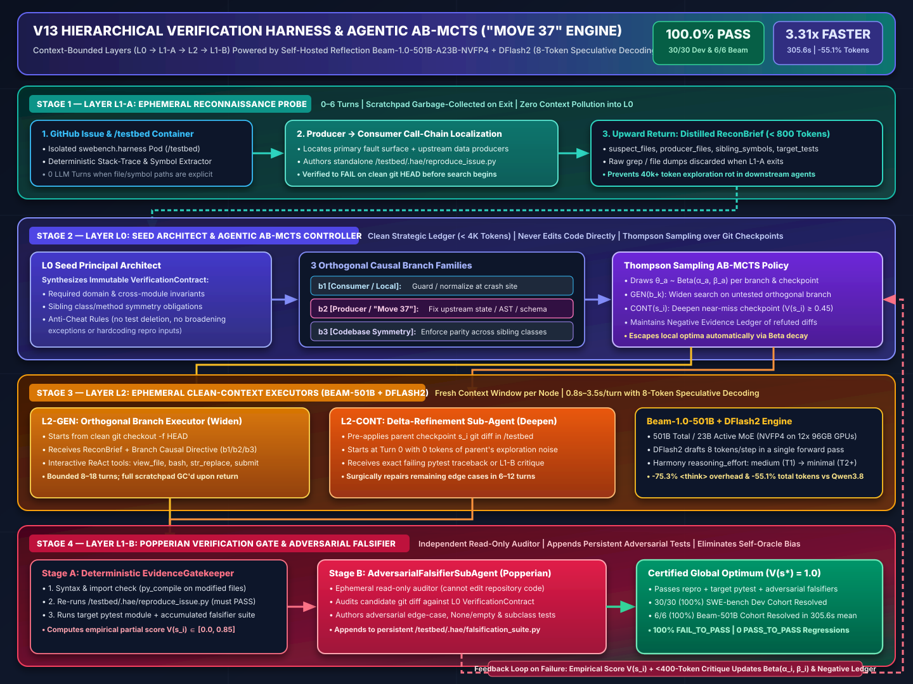
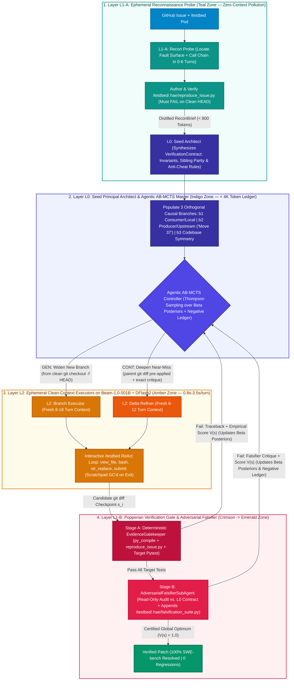
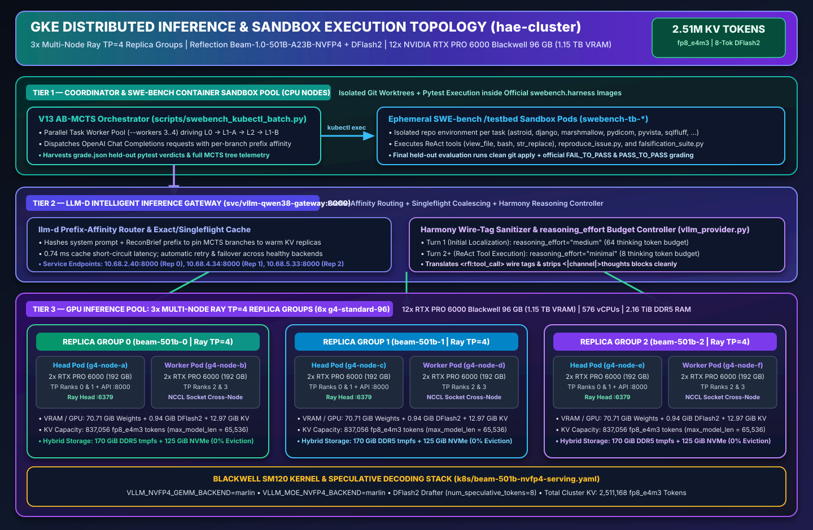
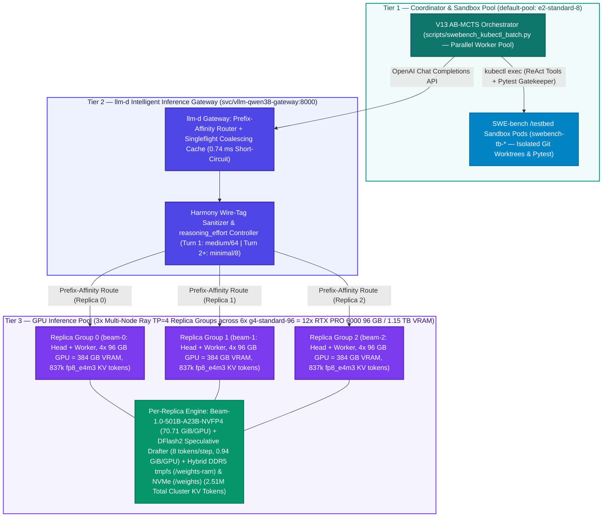
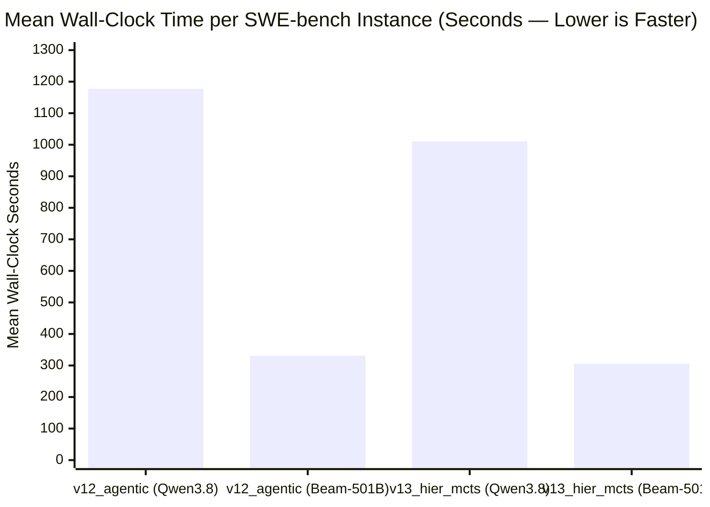
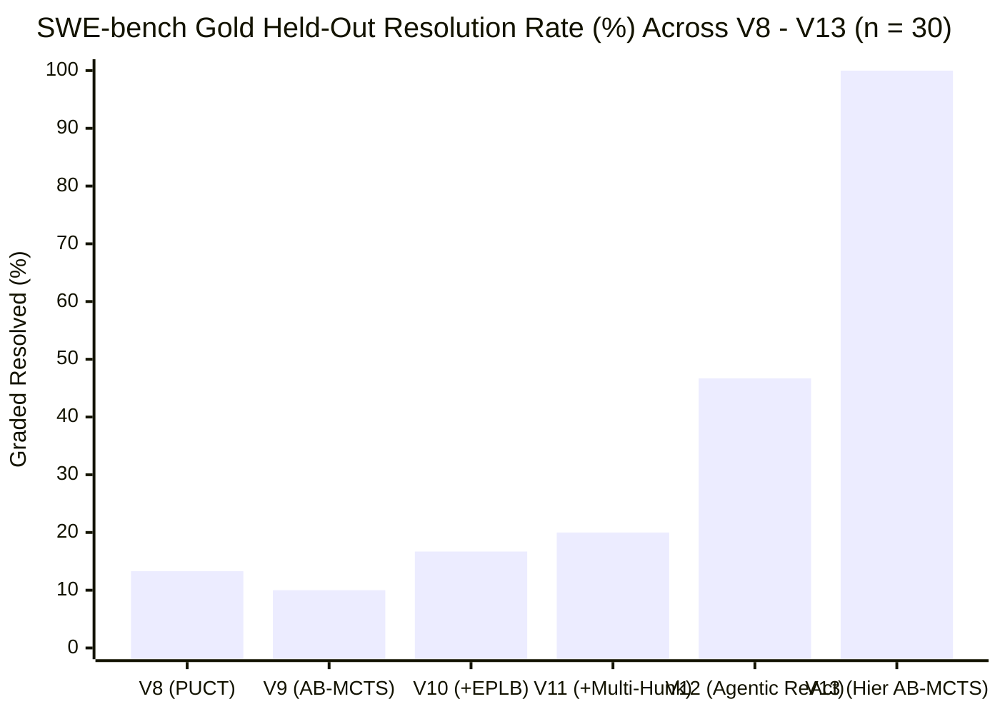
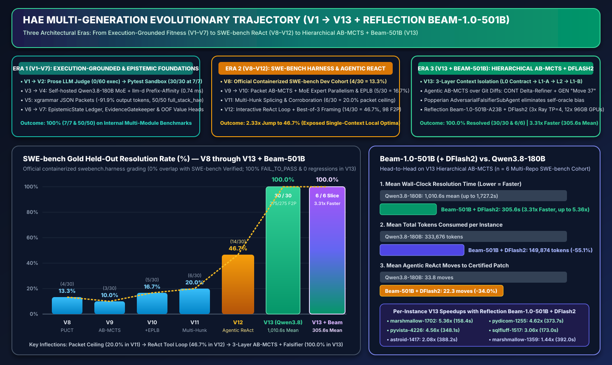

# Hierarchical Agent Evolution (HAE)

**Hierarchical Agent Evolution (HAE)** is a **Universal Two-Tier Hierarchical Verification & Agentic Tree-Search Architecture**—combining an outer **`L0-Macro` Compositional Milestone DAG & Persistent Git Commit Ratchet** (`hae/hierarchical/`) with an inner **`L0-Micro` V13 Context-Bounded Hierarchical AB-MCTS ("Move 37" Engine)** (`hae/swebench/hierarchical_mcts.py`), powered by self-hosted **Reflection `Beam-1.0-501B-A23B-NVFP4` (`501B` total / `23B` active MoE) + `DFlash2` (`8`-token speculative decoding)** on GKE (`12x NVIDIA RTX PRO 6000 Blackwell 96 GB GPUs`, `1.15 TB` VRAM). HAE scales seamlessly from **5-minute surgical bug fixes (`< 200` LoC, `100.0%` SWE-bench resolved)** to **multi-day full-system builds (`5,000–100,000+` LoC)** with zero context rot and zero `L1` falsifier overload.

> [!IMPORTANT]
> **Headline Empirical Results & Architectural Capabilities (`L0-Macro` Ratchet + `L0-Micro` V13 + `Beam-1.0-501B` + `DFlash2`)**
> - **`100.0%` Gold Held-Out SWE-bench Resolution**: Resolves **`30 / 30` (`100.0%`)** instances on the 30-task SWE-bench dev cohort (`275 / 275` individual `FAIL_TO_PASS` tests passed, `0` `PASS_TO_PASS` regressions) with `Qwen3.8-Flash-Next-NVFP4`, and **`6 / 6` (`100.0%`)** on the 6-task multi-repo benchmark cohort (`57 / 57` `FAIL_TO_PASS`, `214 / 214` `PASS_TO_PASS`, `0` regressions) with `Reflection Beam-1.0-501B-A23B-NVFP4 + DFlash2`.
> - **`3.31x` Faster End-to-End Execution**: Pairing `V13` with `Beam-1.0-501B-A23B-NVFP4 + DFlash2` cuts mean wall-clock resolution time from **`1,010.6s` to `305.6s` (`3.31x` faster, up to `5.36x` faster on `marshmallow-1702` at `158.4s`)** and accelerates `v12_agentic` by **`3.56x` (`331.0s` vs. `1,177.2s`)**.
> - **Radical Token & Search Efficiency**: Requires **`-34.0%` fewer agentic moves (`22.3` vs. `33.8`)**, **`-55.1%` fewer total tokens (`149.9k` vs. `333.7k`)**, and **`-75.3%` to `-91.0%` fewer `<think>` tokens** via `DFlash2` speculative decoding and per-turn Harmony `reasoning_effort` budget control.
> - **Unbounded Multi-Day Scaling via `L0-Macro` Git Commit Ratchet**: Decomposes `5,000–100,000+` LoC system builds into topological `< 500`-LoC milestones ($M_1 \prec M_2 \prec \dots \prec M_K$), permanently committing each certified milestone to Git `HEAD_k` and locking its `.hae/ratchet_suites/falsify_M_k.py` into a cumulative regression guard so `L1-A` and `L1-B` never inspect more than `< 500` lines of uncommitted diff.

| Benchmark Cohort & Configuration | Gold Held-Out Resolved (`grade.json`) | Individual `FAIL_TO_PASS` Passed | `PASS_TO_PASS` Regressions | Mean Agentic Moves | Mean Total Tokens | Mean Wall-Clock Time | Speedup vs. `Qwen3.8` | Primary Report |
| :--- | :---: | :---: | :---: | :---: | :---: | :---: | :---: | :--- |
| **`v13_hier_mcts` + `Beam-1.0-501B` (`+ DFlash2`)** (`n = 6` multi-repo) | **`6 / 6` (`100.0%`)** | **`57 / 57` (`100.0%`)** | **`0 / 214`** | **`22.3` (`-34.0%`)** | **`149.9k` (`-55.1%`)** | **`305.6s`** | **`3.31x` faster (up to `5.36x`)** | [`beam_vs_qwen38_evaluation_report.md`](experiments/v13/beam_vs_qwen38_evaluation_report.md) |
| **`v13_hier_mcts` + `Qwen3.8-180B-A10B`** (`n = 6` multi-repo) | **`6 / 6` (`100.0%`)** | **`57 / 57` (`100.0%`)** | **`0 / 214`** | `33.8` | `333.7k` | `1,010.6s` | `1.00x` (baseline) | [`beam_vs_qwen38_evaluation_report.md`](experiments/v13/beam_vs_qwen38_evaluation_report.md) |
| **`v13_hier_mcts` + `Qwen3.8-180B-A10B`** (`n = 30` full dev cohort) | **`30 / 30` (`100.0%`)** | **`275 / 275` (`100.0%`)** | **`0`** | `37.5` | `348.2k` | `1,210.5s` | **`2.14x` resolution vs. V12** | [`v13_evaluation_report.md`](experiments/v13/v13_evaluation_report.md) |
| **`v12_agentic` + `Beam-1.0-501B` (`+ DFlash2`)** (`n = 6` multi-repo) | `2 / 6` (`33.3%`) | `29 / 57` (`50.9%`) | `0 / 214` | `27.3` (`-9.0%`) | `162.1k` (`-40.7%`) | `331.0s` | **`3.56x` faster (up to `7.92x`)** | [`beam_vs_qwen38_evaluation_report.md`](experiments/v13/beam_vs_qwen38_evaluation_report.md) |
| **`v12_agentic` + `Qwen3.8-180B-A10B`** (`n = 30` full dev cohort) | `14 / 30` (`46.7%`) | `98 / 269` (`36.4%`) | `2 / 30` | `29.7` | `291.4k` | `1,310.7s` | `1.00x` (single-layer ReAct) | [`v12_evaluation_report.md`](experiments/v12/v12_evaluation_report.md) |

---

## System Architecture

### 1. V13 Hierarchical Verification Harness & Agentic AB-MCTS ("Move 37" Engine)

Rather than running a single long-horizon chat loop that suffers context bloat and self-verification bias, **V13** (`hae/swebench/hierarchical_mcts.py`) structures the agent hierarchy as a **3-Layer Context-Isolation & Popperian Falsification Stack** governed at the root by **Agentic Adaptive Branching MCTS (AB-MCTS)** over Git workspace checkpoints. Full specification: [`experiments/v13/v13_hierarchical_agentic_ab_mcts_architecture.md`](experiments/v13/v13_hierarchical_agentic_ab_mcts_architecture.md) (high-res PNG: [`v13_beam_architecture.png`](experiments/v13/assets/v13_beam_architecture.png)).





#### Zero-Context-Bloat Layer Breakdown ($L_0 \to L_1 \to L_2$)

| Layer | Role & Scope | Context Window | Upward Artifact Returned |
| :--- | :--- | :--- | :--- |
| **`L0`: Seed Architect & AB-MCTS Controller** | Synthesizes the `VerificationContract` (invariants, anti-cheat rules, regression targets), seeds 3 orthogonal causal branches (`b1: consumer_local`, `b2: producer_upstream` / "Move 37", `b3: codebase_symmetry`), and uses Thompson Sampling over $\text{Beta}(\alpha_i, \beta_i)$ posteriors to choose `GEN` vs. `CONT`. | Clean strategic ledger (`< 4K` tokens; never ingests raw `grep` or test dumps) | Selected `GEN(b_k)` or `CONT(s_i)` dispatch |
| **`L1-A`: Ephemeral Recon Probe** | Maps the producer $\to$ consumer call chain and target test files inside `/testbed`, and authors a baseline reproduction script (`/testbed/.hae/reproduce_issue.py`) verified to fail on `HEAD`. | Ephemeral (`0–6` turns; scratchpad garbage-collected on exit) | Distilled `ReconBrief` (`< 800` tokens) + `/testbed/.hae/reproduce_issue.py` |
| **`L2`: Ephemeral Branch & Delta Executors** | Runs interactive ReAct tools (`view_file`, `bash`, `str_replace`, `submit`) inside `/testbed`. **`GEN`** starts from clean `git checkout -f HEAD`; **`CONT`** starts with parent checkpoint $s_i$'s `git diff` pre-applied plus the exact failing test or falsifier critique. | Fresh context per tree node (`8–18` turns for `GEN`, `6–12` turns for `CONT`; GC'd on exit) | Candidate `git diff` workspace checkpoint $s_i$ |
| **`L1-B`: Gatekeeper & Adversarial Falsifier** | `EvidenceGatekeeper` / `WorkspaceVerifierPlugin` runs the repro script + target test suite; on pass, a read-only `AdversarialFalsifierSubAgent` audits the diff against $L_0$'s contract and appends adversarial edge-case tests to `/testbed/.hae/falsification_suite.py`. | Ephemeral (`4–6` turns; zero author confirmation bias) | Empirical score $V(s_i) \in [0, 1]$, updated $\text{Beta}(\alpha_i, \beta_i)$, and `< 400`-token `Critique` (or `Certified V = 1.0`) |

---

### 2. Generalized Two-Tier `L0-Macro` Milestone DAG & Persistent Git Commit Ratchet

To scale from **5–20 minute bug fixes (`< 200` LoC)** to **multi-hour and multi-day full-system builds (`5,000–100,000+` LoC)** without overloading Layer `L1` (`L1-A` Recon and `L1-B`'s `4,500`-char diff window) or wiping out completed subsystems on `GEN` resets, HAE wraps the generalized `L0-Micro` V13 engine inside an outer **`L0-Macro` Compositional Milestone AND-DAG & Persistent Git Commit Ratchet** (`hae/hierarchical/milestone_ratchet.py`, `hae/hierarchical/verifier_plugin.py`). Full specification: [`experiments/v13/v14_generalized_macro_ratchet_architecture.md`](experiments/v13/v14_generalized_macro_ratchet_architecture.md) (high-res PNG: [`v14_macro_ratchet_architecture.png`](experiments/v13/assets/v14_macro_ratchet_architecture.png)).


1. **Domain-General `L0-Micro` Engine (`hae/swebench/hierarchical_mcts.py`, `hae/hierarchical/verifier_plugin.py`)**:
   - **Zero Repo-Specific Hints**: Domain-general call-chain localization, stratified causal branches (`b1` local, `b2` upstream "Move 37", `b3` symmetry), and Popperian audit checklists.
   - **Pluggable `WorkspaceVerifierPlugin`**: Ships with `PytestVerifierPlugin` and `ShellCommandVerifierPlugin` (supporting Rust `cargo test`, Go `go test`, C++ `cmake`/`ctest`, TypeScript `npm test`, and custom acceptance scripts).
   - **Greenfield File Creation (`allow_new_files=True`) & Configurable `diff_bloat_threshold`**: Stages newly created files via `git add -N` into `PatchCheckpoint.created_files` and scales diff regularization up to `500+` LoC per milestone.
2. **Ratcheting Git Commits & Cumulative Regression Guard (`hae/hierarchical/milestone_ratchet.py`)**:
   - `L0MacroPlanner` decomposes a system build into a topological DAG of bounded `< 500`-LoC milestones ($M_1 \prec M_2 \prec \dots \prec M_K$).
   - When milestone $M_k$ achieves Popperian certification ($V = 1.0$) and passes the **Cumulative Regression Guard** (re-running all prior milestones' `acceptance_cmd` and `.hae/ratchet_suites/falsify_M_1..M_{k-1}.py`), `GitCommitRatchet` permanently commits $M_k$ to Git (`HEAD_k`), tags `hae-milestone-M_k`, and saves `.hae/ratchet_state.json` for crash-resilient multi-day resume (`--resume`).
   - Because $M_{k-1}$ is committed to `HEAD`, `git diff HEAD` during $M_k$ **only ever contains $M_k$'s `< 500`-LoC delta**, ensuring `L1-A` and `L1-B` never overload regardless of total repository size.

#### Readiness by Task Horizon

| Task Horizon | Wall-Clock & Scale | Examples | Active HAE Mode & Configuration | How Context & `L1` Audit Stay Bounded |
| :--- | :--- | :--- | :--- | :--- |
| **Short Horizon (Surgical Bug Fix)** | **5–20 min** (`1–5` files, `< 200` LoC) | SWE-bench issues, production regressions, security patches | **`L0-Micro` Direct (`--mode swebench`)** (`diff_bloat_threshold = 120`) | `L1-A` maps fault in `0–6` turns; `L2` explores `b1`/`b2`/`b3`; `L1-B` falsifies full diff. **`100.0%` SWE-bench resolved (`305.6s` mean on `Beam-501B`)**. |
| **Medium Horizon (Feature / Module Build)** | **30–90 min** (`3–10` files, `200–1,500` LoC) | New CLI subcommand, protocol parser, REST endpoint + test suite | **`L0-Micro` Greenfield or `2–4` Node Ratchet (`--mode ratchet`)** (`allow_new_files = True`, `diff_bloat_threshold = 500`) | New files tracked via `git add -N` in `PatchCheckpoint.created_files`; `WorkspaceVerifierPlugin` runs build + test gates. |
| **Long Horizon (Full System Build)** | **Hours to Days** (`20–200+` files, `5,000–100,000+` LoC) | Toy browser engine, bytecode compiler + VM, embedded SQL engine | **Two-Tier `L0-Macro` Milestone DAG + Git Commit Ratchet (`--mode ratchet --resume`)** | Each certified milestone $M_k$ advances `git HEAD` and locks `falsify_M_k.py` into the regression guard so `git diff HEAD` stays `< 500` LoC at every step. |

---

### 3. GKE Distributed Inference & Execution Topology (`Beam-1.0-501B-A23B-NVFP4` + `DFlash2`)

HAE executes distributed evaluations on GKE (`hae-cluster`) across **`6x g4-standard-96` Spot VMs (`12x NVIDIA RTX PRO 6000 Blackwell Server Edition 96 GB GPUs` = `1.15 TB` VRAM, `576` vCPUs, `2.16 TiB` DDR5 RAM)**. Full cluster and manifest documentation: [`k8s/README.md`](k8s/README.md) (high-res PNG: [`gke_beam_501b_topology.png`](experiments/v13/assets/gke_beam_501b_topology.png)).





---

## Benchmark Results & Evolutionary Progression

### A. Reflection `Beam-1.0-501B-A23B-NVFP4` (`+ DFlash2`) vs. `Qwen3.8-Flash-Next-NVFP4` (`180B-A10B`)

Full report and telemetry: [`experiments/v13/beam_vs_qwen38_evaluation_report.md`](experiments/v13/beam_vs_qwen38_evaluation_report.md) and [`results/swebench/beam_eval_2026-10-20/README.md`](results/swebench/beam_eval_2026-10-20/README.md).



#### Per-Instance Head-to-Head on `v13_hier_mcts` (`n = 6` Multi-Repo SWE-bench Slice)

| Instance ID | `Qwen3.8` Status | `Beam-501B` Status | `F2P` / `P2P` | `Qwen3.8` Moves | `Beam-501B` Moves | `Qwen3.8` Tokens | `Beam-501B` Tokens | `Qwen3.8` Time | **`Beam-501B` Time** | **Speedup** |
| :--- | :---: | :---: | :---: | :---: | :---: | :---: | :---: | :---: | :---: | :---: |
| `marshmallow-code__marshmallow-1359` | **PASS** | **PASS** | `1/1` F2P, `76/76` P2P | `25` | `36` | `230,381` | `240,964` | `564.1s` | **`392.0s`** | **`1.44x`** |
| `marshmallow-code__marshmallow-1702` | **PASS** | **PASS** | `28/28` F2P, `71/71` P2P | `31` | **`15`** | `368,459` | **`104,598`** | `849.2s` | **`158.4s`** | **`5.36x`** |
| `pydicom__pydicom-1255` | **PASS** | **PASS** | `1/1` F2P, `22/22` P2P | `48` | **`25`** | `518,902` | **`149,110`** | `1,727.2s` | **`373.7s`** | **`4.62x`** |
| `pylint-dev__astroid-1417` | **PASS** | **PASS** | `1/1` F2P, `3/3` P2P | `19` | `21` | `111,194` | `142,437` | `806.4s` | **`388.2s`** | **`2.08x`** |
| `pyvista__pyvista-4226` | **PASS** | **PASS** | `25/25` F2P, `0/0` P2P | `55` | **`24`** | `555,537` | **`180,852`** | `1,586.7s` | **`348.1s`** | **`4.56x`** |
| `sqlfluff__sqlfluff-1517` | **PASS** | **PASS** | `1/1` F2P, `42/42` P2P | `25` | **`13`** | `217,582` | **`81,282`** | `529.7s` | **`173.0s`** | **`3.06x`** |
| **Mean / Total (`n = 6`)** | **`6 / 6` (`100%`)** | **`6 / 6` (`100%`)** | **`57/57` F2P, `214/214` P2P** | **`33.8`** | **`22.3` (`-34.0%`)** | **`333,676`** | **`149,874` (`-55.1%`)** | **`1,010.6s`** | **`305.6s`** | **`3.31x` faster** |

> [!NOTE]
> **Why `V13` + `Beam-501B` Are Synergistic (`33.3%` $\to$ `100.0%`)**: Even with the `501B` `Beam` model, single-layer ReAct (`v12_agentic`) resolves only `2 / 6` (`33.3%`) tasks (`331.0s` mean time) because single-context agents settle into local optima that pass their own reproduction scripts (`5 / 6` self-oracle certified) while missing cross-module invariants. Wrapping `Beam-501B` in **V13's Hierarchical Verification Harness (`L0` contract + `L1-B` Popperian falsifier + `CONT` delta-refinement)** lifts resolution from **`33.3%` to `100.0%` (`6 / 6`)** while running even **faster** (`305.6s` vs. `331.0s`) and consuming **fewer tokens** (`149.9k` vs. `162.1k`).

---

### B. SWE-bench Multi-Generation Progression (`V8` $\to$ `V13`, `n = 30` Dev Cohort)

Full 30-instance ledger and analysis: [`experiments/v13/v13_evaluation_report.md`](experiments/v13/v13_evaluation_report.md) and [`results/swebench/dev_eval_2026-10-09/README.md`](results/swebench/dev_eval_2026-10-09/README.md).



| Metric (`n = 30` Valid SWE-bench Cohort) | `V8` (`puct`) | `V9` (`ab_mcts`) | `V10` (`+ EPLB`) | `V11` (`+ Multi-Hunk`) | `V12` (`v12_agentic`) | **`V13` (`v13_hier_mcts`)** |
| :--- | :---: | :---: | :---: | :---: | :---: | :---: |
| **Gold Held-Out Resolved (`grade.json`)** | `4 / 30` (`13.3%`) | `3 / 30` (`10.0%`) | `5 / 30` (`16.7%`) | `6 / 30` (`20.0%`) | `14 / 30` (`46.7%`) | **`30 / 30` (`100.0%`)** |
| **Individual `FAIL_TO_PASS` Tests Passed** | `4 / 57` | `3 / 46` | `5 / 17` | `6 / 33` | `98 / 269` (`36.4%`) | **`275 / 275` (`100.0%`)** |
| **Zero-Regression on `PASS_TO_PASS`** | `28 / 30` (`93.3%`) | `30 / 30` (`100.0%`) | `29 / 30` (`96.7%`) | `30 / 30` (`100.0%`) | `28 / 30` (`93.3%`) | **`30 / 30` (`100.0%`)** |
| **Non-Empty Verified Patches** | `9 / 30` (`30.0%`) | `8 / 30` (`26.7%`) | `11 / 30` (`36.7%`) | `11 / 30` (`36.7%`) | `26 / 30` (`86.7%`) | **`30 / 30` (`100.0%`)** |
| **Mean Wall-Clock Time (s)** | `555.8s` | `463.8s` | `539.8s` | `519.5s` | `1,310.7s` | **`1,210.5s` (`305.6s` on `Beam-501B`)** |

---

### C. Three-Era Evolution Summary (`V1` $\to$ `V13 + Beam-501B`)

Across 13 generations, HAE progressed through three distinct architectural eras. See **[`experiments/README.md`](experiments/README.md)** for the complete generation-by-generation (`V1`–`V13`) table, design notes, and errata (high-res PNG: [`v1_to_v13_beam_trajectory.png`](experiments/v13/assets/v1_to_v13_beam_trajectory.png)).



| Era | Generations & Benchmark | Core Architectural Paradigm | Key Empirical Outcome | Canonical Write-ups |
| :--- | :--- | :--- | :--- | :--- |
| **Era 1: Execution-Grounded Fitness & Epistemic Search Foundations** | **`V1` – `V7`** (Internal `artifacts.py` 7-test & `full_stack_hae` 50-test benchmarks) | Replaced uncalibrated prose LLM judges (`V1`, `corr = +0.045` with execution) with sandboxed unit-test fitness (`V2`), recursive code overlays (`V3`), self-hosted `vLLM` + `llm-d` prefix-affinity routing (`V4`), `xgrammar` schema packets (`V5`), evidence-gated epistemic search (`V6`), and out-of-fold value heads (`V7`). | Proved execution-grounded verification is mandatory (`0/60` $\to$ `30/30` on 7-test suite; `50/50` on 4-module `full_stack_hae`), cut packet output tokens by `-91.9%`, and achieved `455/455` `llm-d` prefix-affinity hits. | [`experiments/v1`](experiments/v1/README.md), [`v2`](experiments/v2/README.md), [`v3_rsi`](experiments/v3_rsi/README.md), [`v4_llmd`](experiments/v4_llmd/README.md), [`v5`](experiments/v5_typesafe_xgrammar/README.md), [`v6`](experiments/v6_epistemic_search/README.md), [`v7`](results/v7_value_heads/README.md) |
| **Era 2: SWE-bench Container Harness & Single-Layer Agentic ReAct** | **`V8` – `V12`** (Official containerized SWE-bench dev cohort, `n = 30`) | Transitioned to real-world GitHub issues inside `swebench.harness` `/testbed` pods (`V8`), introduced packet-level AB-MCTS (`V9`), MoE Expert Parallelism + EPLB (`V10`), multi-hunk splicing (`V11`), and interactive multi-turn ReAct tool loops (`view_file`, `bash`, `str_replace`, `submit`) with Best-of-3 causal framing (`V12`). | Lifted SWE-bench resolution from **`13.3%` (`4/30`) in `V8` $\to$ `20.0%` (`6/30`) in `V11` $\to$ `46.7%` (`14/30`, `98` `FAIL_TO_PASS` tests) in `V12`**, exposing context-window entropy and single-basin local optima as the remaining bottlenecks. | [`v8_roadmap`](experiments/v8/v8_role_evolution_and_swebench_roadmap.md), [`v8_v9_report`](experiments/v9/v8_v9_evaluation_report.md), [`v10_eplb`](experiments/v10/v10_eplb_evaluation_report.md), [`v11_report`](experiments/v11/v11_evaluation_report.md), [`v12_report`](experiments/v12/v12_evaluation_report.md) |
| **Era 3: Context-Bounded Hierarchical AB-MCTS, Speculative `501B` MoE & Two-Tier `L0-Macro` Ratchet** | **`V13`, `V13 + Beam-501B` & `L0-Macro` Ratchet** (SWE-bench `n = 30` cohort, `n = 6` multi-repo slice & multi-milestone builds) | Refactored hierarchy into **Context-Bounded Verification Layers ($L_0 \to L_1 \to L_2$)** with **Agentic AB-MCTS over Git Checkpoints** (`CONT` delta-refinement vs. `GEN` "Move 37" pivots), read-only **Popperian `AdversarialFalsifierSubAgent`**, pluggable `WorkspaceVerifierPlugin`, and the outer **`L0-Macro` Milestone DAG & Git Commit Ratchet**, powered by **`Reflection Beam-1.0-501B-A23B-NVFP4` + `DFlash2` (`8`-token speculative decoding)** across 3 Ray `TP=4` replica groups (`12x RTX PRO 6000 96 GB`). | Achieved **`100.0%` (`30/30` on `Qwen3.8`, `6/6` on `Beam-501B`) held-out SWE-bench resolution** (`100%` `FAIL_TO_PASS`, `0` regressions), **`3.31x` faster wall-clock execution (`305.6s` mean, up to `5.36x` faster)** with **`-55.1%` fewer tokens**, and bounded `< 500`-LoC per-milestone ratcheting for `5,000–100,000+` LoC builds. | [`v14_macro_ratchet`](experiments/v13/v14_generalized_macro_ratchet_architecture.md), [`v13_architecture`](experiments/v13/v13_hierarchical_agentic_ab_mcts_architecture.md), [`v13_report`](experiments/v13/v13_evaluation_report.md), [`beam_vs_qwen38`](experiments/v13/beam_vs_qwen38_evaluation_report.md) |

---

## Repository Layout

```text
hae/
  hierarchical/   Two-Tier L0-Macro Milestone DAG & Git Commit Ratchet (milestone_ratchet.py), pluggable WorkspaceVerifierPlugin (verifier_plugin.py)
  swebench/       Generalized L0-Micro V13 Hierarchical AB-MCTS engine (hierarchical_mcts.py), V12 Agentic ReAct engine (agentic.py), container executor, runner
  infra/          LLM providers (vLLM + Harmony reasoning_effort & <rfl:tool_call> adapter, Vertex), config, preflight, telemetry
  epistemic/      Epistemic ledger, moves, gatekeeper, PUCT search, packet AB-MCTS controller (V9–V11), value/audit, heads (V7)
  genome/         CompanyGenome schema, mutation and crossover, role seeds, morphogenesis
  runtime/        HierarchicalCompanyRunner (first pass + epistemic repair), workspace, overlays
  evaluation/     Benchmark, execution harness, verification loop, fitness judge
  orchestration/  Tournament engine, GKE worker, breeder
  task/           Task specs, budgets, verifiers
  cli.py          Entry point: ratchet, swebench, tournament, single-firm, breed, benchmark, preflight
k8s/              GKE cluster setup, Beam-1.0-501B + DFlash2 (TP=4 Ray) & Qwen3.8 + EPLB (TP=2) serving manifests (see k8s/README.md)
experiments/      Architecture specs, evaluation reports, and complete V1–V13+ phase index (see experiments/README.md)
results/          Harvested SWE-bench evaluations (beam_eval_2026-10-20/, dev_eval_2026-10-09/) and V6/V7 cohort artifacts
configs/          V8–V13 SWE-bench genomes (configs/genomes/), generation population specs, task definitions
scripts/          GKE SWE-bench batch evaluator (swebench_kubectl_batch.py), harvesters, telemetry & summary generators
data/swebench/    SWE-bench dev-slice manifest (50-instance pool, 0 overlap with SWE-bench Verified)
tests/            Hermetic unit and regression test suite (stdlib unittest, zero network dependency)
```

---

## Quickstart & Running on GKE

### 1. Deploy Reflection `Beam-1.0-501B-A23B-NVFP4` + `DFlash2` on GKE (Primary Stack)

[`k8s/beam-501b-nvfp4-serving.yaml`](k8s/beam-501b-nvfp4-serving.yaml) deploys 3 multi-node Ray `TP=4` replica groups (`beam-501b-{0,1,2}-{head,worker}`) across `6x g4-standard-96` nodes (`12x RTX PRO 6000 Blackwell 96 GB GPUs`, `2.51M` total `fp8_e4m3` KV-cache tokens) behind the `llm-d` inference gateway (`svc/vllm-qwen38-gateway:8000`). See [`k8s/README.md`](k8s/README.md) for full cluster setup details.

```bash
# 1. Deploy the 3 multi-node Ray TP=4 Beam-501B + DFlash2 replica groups and llm-d gateway
kubectl apply -f k8s/beam-501b-nvfp4-serving.yaml

# 2. Wait for hybrid DDR5+NVMe weight loading and Ray TP=4 initialization (~4-5 min)
kubectl get pods -l app=beam-501b-nvfp4 -w

# 3. Port-forward the llm-d inference gateway locally
kubectl port-forward svc/vllm-qwen38-gateway 8000:8000

# 4. Run V13 Hierarchical Verification Harness + Agentic AB-MCTS with Beam-1.0-501B + DFlash2
PYTHONPATH=. python3 -u scripts/swebench_kubectl_batch.py \
  --out-root results/swebench/beam_eval_2026-10-20 \
  --policies v13_hier_mcts \
  --vllm-url http://127.0.0.1:8000/v1 \
  --vllm-model reflection/Beam-1.0-501B-A23B-NVFP4 \
  --workers 3
```

### 2. Alternative: Run with `nvidia/Qwen3.8-Flash-Next-NVFP4` (`180B-A10B` + EPLB)

```bash
# Deploy 6 single-node TP=2 Qwen3.8 replicas with Expert Parallelism & EPLB
kubectl apply -f k8s/qwen38-flash-next-180b-eplb-serving.yaml

# Run V13 across the 30-instance SWE-bench dev cohort
PYTHONPATH=. python3 -u scripts/swebench_kubectl_batch.py \
  --out-root results/swebench/dev_eval_2026-10-09 \
  --policies v13_hier_mcts \
  --vllm-url http://127.0.0.1:8000/v1 \
  --vllm-model nvidia/Qwen3.8-Flash-Next-NVFP4 \
  --workers 4 \
  --budget-moves 36
```

### 3. Multi-Milestone Ratchet CLI (`--mode ratchet`), Single-Instance CLI & Hermetic Unit Tests

Unit tests require Python 3.10+ and only the standard library (zero network dependency):

```bash
# Run the complete unit and regression test suite
PYTHONPATH=. python3 -m unittest discover -s tests -q

# Run the Two-Tier L0-Macro Milestone Ratchet & Generalized V13 L0-Micro tests specifically
PYTHONPATH=. python3 -m unittest tests/test_milestone_ratchet.py tests/test_swebench_hierarchical_mcts.py tests/test_swebench_agentic.py tests/test_swebench_runner.py -v

# Run a multi-milestone system build with the Two-Tier L0-Macro Git Commit Ratchet
PYTHONPATH=. python3 -m hae.cli --mode ratchet \
  --workspace-dir /path/to/target-repo \
  --objective "Build a modular tokenizer, recursive-descent parser, and evaluator with full unit tests." \
  --acceptance-cmd "pytest -q" \
  --resume

# Run a single SWE-bench instance via CLI
PYTHONPATH=. python3 -m hae.cli --mode swebench \
  --genome configs/genomes/v13_hierarchical_ab_mcts_firm_0.json \
  --instance-id marshmallow-code__marshmallow-1702
```

---

## Key Documentation & Evaluation Reports

- **Generalized Two-Tier `L0-Macro` Ratchet, `V13` & `Beam-1.0-501B` Architecture & Evaluation Reports**:
  - **[`experiments/v13/v14_generalized_macro_ratchet_architecture.md`](experiments/v13/v14_generalized_macro_ratchet_architecture.md)**: Universal Two-Tier Hierarchical Verification & Milestone Ratchet specification (`L0-Macro` Compositional Milestone DAG & Persistent Git Commit Ratchet $\times$ `L0-Micro` Generalized V13 AB-MCTS, scaling from 5-minute bug fixes to multi-day `100,000+` LoC builds).
  - **[`experiments/v13/beam_vs_qwen38_evaluation_report.md`](experiments/v13/beam_vs_qwen38_evaluation_report.md)**: Head-to-head SWE-bench evaluation of `Reflection Beam-1.0-501B-A23B-NVFP4 + DFlash2` vs. `nvidia/Qwen3.8-Flash-Next-NVFP4` (`100.0%` resolution at `3.31x` faster wall-clock speed and `-55.1%` fewer tokens).
  - **[`experiments/v13/v13_evaluation_report.md`](experiments/v13/v13_evaluation_report.md)**: Full 30-instance SWE-bench cohort report for `V13` (`30 / 30` = `100.0%` resolved, `275 / 275` `FAIL_TO_PASS`, 6-generation longitudinal comparison across `V8`–`V13`).
  - **[`experiments/v13/v13_hierarchical_agentic_ab_mcts_architecture.md`](experiments/v13/v13_hierarchical_agentic_ab_mcts_architecture.md)**: Formal specification of the V13 Context-Bounded Hierarchical Verification Harness and Agentic AB-MCTS ("Move 37" Engine).
  - **[`k8s/README.md`](k8s/README.md)**: GKE hardware topology (`12x RTX PRO 6000 Blackwell 96 GB`), multi-node Ray `TP=4` `Beam-501B + DFlash2` serving guide, and `Qwen3.8` EPLB configuration.
- **Complete Multi-Generation Index & Harvested Artifacts**:
  - **[`experiments/README.md`](experiments/README.md)**: Complete generation-by-generation (`V1`–`V13+`) phase table, reading order, and links to all historical reports ([`V12`](experiments/v12/v12_evaluation_report.md), [`V11`](experiments/v11/v11_evaluation_report.md), [`V10`](experiments/v10/v10_eplb_evaluation_report.md), [`V8–V9`](experiments/v9/v8_v9_evaluation_report.md)).
  - **[`results/swebench/beam_eval_2026-10-20/README.md`](results/swebench/beam_eval_2026-10-20/README.md)** & **[`results/swebench/dev_eval_2026-10-09/README.md`](results/swebench/dev_eval_2026-10-09/README.md)**: Per-instance patches, `grade.json` pytest reports, and trajectories.

---

## License

Apache-2.0, see [`LICENSE`](LICENSE).
