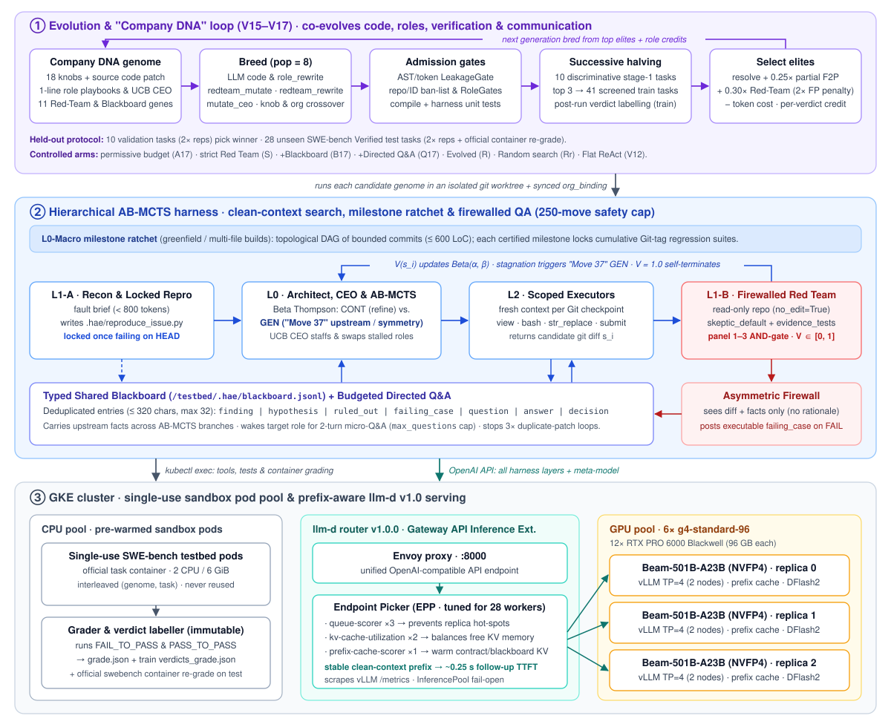

# Hierarchical Agent Evolution (HAE)

**HAE** is a self-hosted, evolutionary multi-agent software engineering harness running open-weight models (`Beam-1.0-501B-A23B` NVFP4 on vLLM + `llm-d` v1.0) and isolated container sandboxes on Google Kubernetes Engine (GKE). Rather than hand-tuning a static prompt pipeline, HAE treats **the engineering organization itself—its search policy, one-line specialist role playbooks ("Company DNA"), independent Red-Team verification rules, and inter-agent blackboard bandwidth—as a declarative genome evolved empirically against real container execution.**

- [Industry direction: why the harness matters *more* as models improve](#industry-direction-why-the-harness-matters-more-as-models-improve)
- [How HAE works](#how-hae-works)
- [Key empirical findings (V14 to V17)](#key-empirical-findings-v14-to-v17)
- [Related research and industry foundations](#related-research-and-industry-foundations)
- [Lessons learned across 17 iterations](#lessons-learned-across-17-iterations)
- [Kubernetes and `llm-d` co-design](#kubernetes-and-llm-d-co-design)
- [Roadmap](#roadmap)
- [Repository layout and quickstart](#repository-layout-and-quickstart)

---

## Industry direction: why the harness matters *more* as models improve

As foundation models double in coding capability and context length, a natural question arises: *will agent harnesses become thin wrappers that get competed away?* Across both frontier labs and open-weight production systems, empirical evidence points to the opposite conclusion:

$$\text{Agentic Reliability} = \text{Model} \times \text{Harness}$$

Model progress **shifts where the harness creates leverage** rather than eliminating it:

1. **Inference-Time Search Unlocks *"Move 37"* Beyond Linear Model Priors:** Left in a single linear ReAct loop, even 500B+ models overwhelmingly anchor on the immediate symptom site in a stack trace (**`86%`**—`508 / 590`—of best-branch attempts in our V15 logs targeted `consumer_local` crash sites) and pile on local guards when edge cases fail. Wrapping models in **Adaptive Branching Monte Carlo Tree Search (`AB-MCTS`) over Git checkpoints** forces deliberate exploration of non-obvious upstream structural fixes (*"Move 37"*) whenever symptom patches stagnate.
2. **Scaffolding Shrinks, Independent Verification Compounds (*"Improvement by Subtraction"*):** Early harnesses compensated for weak models with rigid JSON step-planners and tight artificial turn caps. Stronger models thrive when artificial step ceilings are lifted (`68 → 250` moves in V17) so agents self-terminate on proof—yet **firewalled Red-Team verification and immutable test contracts become *more* critical**, because stronger models are also far better at rationalizing subtle edge-case discrepancies (`68.5%` false-`PASS` rate in V16 before Red-Team hardening) or weakening self-written tests.
3. **Clean Contexts, Typed Blackboards & Git Ratchets Beat Raw Context Windows:** Even with 200k–1M token contexts, single-session loops and free-chatting multi-agent swarms degrade through *context rot*, *conversational sycophancy*, and *one-shot diff collapse*. Passing **compact typed artifacts** across garbage-collected episodes and **ratcheting verified Git commits** keeps reasoning sharp, reviewers cold and independent, and KV-cache prefixes warm.
4. **From Hand-Crafted Prompts to Evolvable "Company DNA" on Kubernetes:** Every new model generation changes optimal turn budgets, branch breadth, specialist roles, and communication bandwidth. Encoding **who is on the team, how strict QA is, and how much agents talk** as a compact genome evolved on Kubernetes turns harness design into a continuous, leakage-gated empirical loop.

---

## How HAE works



HAE combines five mechanisms across clean-context episodes inside each task's sandbox Pod:

| Layer / Mechanism | Role in the Harness | Handoff Artifact / Invariant |
| :--- | :--- | :--- |
| **`L0-Macro` Milestone Ratchet** | Splits greenfield or large multi-file specs into a topological DAG of bounded commits (`≤ 600` LoC) | Certified Git tags whose test suites lock permanently as cumulative regression guards |
| **`L1-A` Recon & Locked Repro** | Localizes fault candidates and writes `/testbed/.hae/reproduce_issue.py` | `< 800`-token `ReconBrief` + **immutable** reproduction script locked once failing on `HEAD` |
| **`L0` Architect, CEO & `AB-MCTS`** | Writes invariants; uses **Beta Thompson sampling** over empirical checkpoint values $V(s_i) \in [0, 1]$ to arbitrate **deeper refinement (`CONT`)** vs. **wider causal branching (`GEN`)**; UCB CEO staffs 1-line specialist playbooks & swaps stalled roles | Branch dispatch across 4 causal loci: `consumer_local`, **`producer_upstream` (*"Move 37"*)**, `codebase_symmetry`, and Negative-Ledger **`counterfactual_move37`** |
| **Typed Blackboard & Budgeted Q&A (`V17`)** | Coordinates episodes & parallel branches via deduplicated `/testbed/.hae/blackboard.jsonl` (`≤ 320` chars/entry, `≤ 32` entries) + budgeted 2-turn micro-Q&A (`max_questions` cap) | Typed `finding`, `hypothesis`, `ruled_out`, `failing_case`, `question`, `answer`, `decision` (stops re-grepping & 3× duplicate-patch loops) |
| **`L2` Executors & Refiners** | Execute interactive ReAct tools (`view`, `bash`, `str_replace`, `submit`) from a clean Git checkpoint in a fresh context window | Candidate `git diff` checkpoint $s_i$ (raw grep/bash logs are garbage-collected on return) |
| **Firewalled `L1-B` Red Team (`V17`)** | Runs deterministic compile/repro/module tests (`evidence_tests`), followed by `panel_size` (`1–3`) read-only adversarial reviewers (`no_edit=True`, `skeptic_default=True`) | Sees `git diff` + objective blackboard facts **only** (never builder `hypothesis` prose); returns $V(s_i)$ + executable `failing_case` reproducers (`V = 1.0` self-terminates) |

### Unlocking *"Move 37"* with Clean-Context `AB-MCTS`

Adapted from Sakana AI's [AB-MCTS](https://arxiv.org/abs/2503.04412), `L0` models each Git checkpoint $s_i$ with a $\text{Beta}(\alpha_i, \beta_i)$ posterior updated strictly from container execution signals (`compile_ok`, `repro_ok`, `repo_tests_ok`, `falsifier_ok`, minus diff bloat). When a `CONT` delta-refinement fails to improve its parent ($V(s_{\text{child}}) \le V(s_{\text{parent}}) + 0.02$), backpropagation penalizes $\beta \mathrel{+}= 2.5$ and boosts `gen_alpha`—automatically pivoting compute away from dead-end local symptom guards toward **`producer_upstream`** (fixing the upstream parser/builder/AST invariant where bad state originated), **`codebase_symmetry`** (enforcing parity across sibling implementations), or **`counterfactual_move37`** (synthesizing a fresh structural hypothesis from a Negative Evidence Ledger of all prior failures).

### "Company DNA": One-Line Evolvable Organizational Genomes (`V16–V17`)

Instead of brittle multi-page prompts, an HAE engineering organization is encoded as compact, human-readable primitives:
- **1-Line Specialist Goal + 3–8 Imperative 1-Line Playbook Steps (`RoleAllele`):** Refreshed from redacted failure digests (`15` roles: `5` zero-token byte-identical generalists + `10` failure-mode specialists such as *Cross-File Impact Architect*, *Root-Cause Locus Architect*, *Multi-File Parity Executor*, *Critique-Driven Refiner*, and *Sibling Parity Falsifier*; see [`experiments/v16/role_refresh_report.md`](experiments/v16/role_refresh_report.md)).
- **UCB + Locus-Aware CEO Policy (`CEOPolicyGene`):** Hires specialists only when empirical $\Delta V$ quality $\times$ tag overlap + UCB exploration beats the generalist, routes matching executors to *"Move 37"* branches, swaps stalled roles mid-run, and (in `V17`) staffs Red-Team panelists by measured confusion-matrix accuracy.
- **Automated Anti-Leakage Gate (`LeakageGate` + `RoleGates`):** Every evolved code diff and role mutation is deterministically checked against AST/token identifiers extracted from all train, validation, and test patches plus a repository/instance-ID ban list before any Pod is scheduled.

---

## Key empirical findings (V14 to V17)

| Experiment / Question | Benchmark & Controls | Headline Result | Status & Reference |
| :--- | :--- | :--- | :--- |
| **Git Milestone Ratchet vs. one-shot builds (`V14`)** | Greenfield `MiniSQL` engine (`2,345` LoC) graded by a **15-suite held-out `sqlite3` differential oracle** | **`15 / 15` (`100%`)** with 7-commit `L0-Macro` ratchet vs. **`8 / 15` (`53%`)** monolithic `AB-MCTS` (`+1,651`-line diff) vs. **`0 / 15` (`0%`)** flat ReAct | **Holds cleanly** (not compute-matched: `1.80M` vs `0.37M` tokens). [Results](results/ratchet/planner_driven_minisql_eval_2026-10-23/README.md) |
| **Linear symptom tunnel vision (`V15` trace audit)** | `590` training & validation runs across candidate harnesses | **`86%` (`508 / 590`)** of initial attempts targeted `consumer_local` symptom sites; `45%` passed self-checks while failing hidden edge/sibling tests | **Holds** — motivates `AB-MCTS` *"Move 37"* branching & specialist roles. [Audit](experiments/v16/role_refresh_report.md) |
| **Evolved harness vs. hand-designed seed (`V15`)** | **28 unseen `SWE-bench Verified` tasks** (zero hints, `LeakageGate` active, single pass) | Evolved **`17 / 28` (`60.7%`)** vs. hand-designed seed **`12 / 28` (`42.9%`)** (`5 : 0` discordant wins, $p = 0.063$); matched-budget random knob search **`16 / 28`** | **Complete:** Search beats hand design; 1-rep 21-task selection tied random search. [Results](results/v15/test_2026-10-28/README.md) |
| **"Company DNA" roles & dynamic CEO (`V16`)** | 6-gen train (`21` tasks) → **2-replicate validation (`10` tasks)** → **2-replicate unseen Verified test (`28` tasks)** | **Train:** `A/B/C = 4/21` → top `D/E = 6/21`.<br>**2×10 Val:** Dynamic org `C` **`5.0 / 10` mean** (**`5 / 10` majority**, **`1.00` agreement**) vs. `A` `4.0 / 10` mean (`3 / 10` majority); evolved `D2` **`5.0 / 10` mean** vs. random `E1` `4.0 / 10` | **Train & Val complete; 2×28 Test + `V12` + official container re-grade actively running.** [V16 README](experiments/v16/README.md) |
| **Permissive LLM QA rubber-stamping (`V16 → V17`)** | Audit of **`670` falsifier-certified (`PASS`) training runs** in V16 | Only **`211 / 670` (`31.5%`)** passed hidden tests (`68.5%` false `PASS`), alongside 3× blind duplicate-patch loops under pure isolation | **Diagnostic complete** — directly motivates V17's firewalled Red Team & Blackboard. [V16 README](experiments/v16/README.md) |
| **Firewalled Red Team + Typed Blackboard + `250`-move autonomy (`V17`)** | `41` container-screened train tasks (`10` discriminative `stage1`), `2×10` val, `2×28` unseen Verified tasks (`A17`, `S`, `B17`, `Q17`, `R`, `Rr`, `V12`) | Evaluates strict read-only QA (`2×` FP verdict fitness), `/testbed/.hae/blackboard.jsonl` + budgeted 2-turn Q&A, duplicate-patch rate, and self-terminating `250`-move budgets | **Staged (`v17-redteam`)** — launches immediately after V16 test finishes. [V17 Plan](experiments/v17/README.md) |

> **Note on Scientific Hygiene & Earlier V14 Numbers:** Our Oct 27 audit ([`experiments/v14/v14_retrospective.md`](experiments/v14/v14_retrospective.md)) discovered that V14's SWE-bench scripts contained 4 gold-fix AST detectors and test-task prompt examples; those V14 SWE-bench scores are retired and never cited as clean generalization. All `V15+` runs strip every hint/detector and enforce `LeakageGate`. In `V17`, expanding the training pool with 20 disjoint `SWE-bench Verified` tasks makes the 28-task final evaluation **"unseen tasks"** (sharing upstream repositories, strictly disjoint by instance ID) rather than V15/V16's *"unseen benchmark"*.

---

## Related research and industry foundations

HAE does not invent standalone agent primitives in a vacuum; it builds directly upon foundational work across the open research and engineering community, integrating and co-evolving them on a Kubernetes + `llm-d` substrate:

| Project / Group | Reference | Foundation We Build Upon |
| :--- | :--- | :--- |
| **Princeton NLP (`SWE-agent`)** | [Yang et al., NeurIPS 2024](https://arxiv.org/abs/2405.15793) · [swebench.com](https://www.swebench.com/) | **Agent-Computer Interfaces (ACI):** compact, syntax-guarded file viewing, search, and editing primitives inside containerized repositories. |
| **Sakana AI (`AB-MCTS` & `DGM`)** | [AB-MCTS (2025)](https://arxiv.org/abs/2503.04412) · [Darwin Gödel Machine (2025)](https://arxiv.org/abs/2505.22954) | **Adaptive Branching MCTS** (Thompson sampling over `GEN` vs. `CONT` posteriors) and **open-ended evolution of self-modifying coding agents** against execution benchmarks. |
| **UIUC (`Agentless`)** | [Xia et al., 2024](https://arxiv.org/abs/2407.01489) · [GitHub](https://github.com/OpenAutoCoder/Agentless) | **Execution-gated localization & reproduction filtering:** separating fault localization, reproduction scripting, and regression testing. |
| **All Hands AI (`OpenHands`)** | [Wang et al., ICLR 2025](https://arxiv.org/abs/2407.16741) · [GitHub](https://github.com/All-Hands-AI/OpenHands) | **Containerized sandbox execution** and Git-checkpointed iterative tool loops at scale. |
| **Aider** | [Architect / Editor Benchmarks (2024)](https://aider.chat/2024/09/26/architect.html) | **Architect / Editor separation:** decoupling high-level causal design (`L0`) from surgical diff application (`L2`). |
| **MetaGPT & UC Berkeley (`MAST`)** | [MetaGPT (ICLR 2024)](https://arxiv.org/abs/2308.00352) · [MAST (2025)](https://arxiv.org/abs/2503.13657) | **Typed artifact SOPs over free-form chat** and empirical failure taxonomies of role drift, chat misalignment, and weak verification in multi-agent LLM systems. |
| **OpenAI, LangChain & Thoughtworks** | [SWE-bench Verified](https://openai.com/index/introducing-swe-bench-verified/) · [Context Engineering](https://blog.langchain.com/context-engineering-for-agents/) · [Fowler / Böckeler](https://martinfowler.com/articles/exploring-gen-ai.html) | **Human-validated container oracles**, **harness improvement by subtraction** as models strengthen, and repo-level memory artifacts. |
| **Anthropic Engineering** | [Building Effective Agents](https://www.anthropic.com/research/building-effective-agents) · [Effective Harnesses (2025)](https://www.anthropic.com/research/effective-harnesses-for-long-running-agents) · [Long-Running Apps (2026)](https://www.anthropic.com/research/harness-design-long-running-apps) | **Immutable test contracts**, clean Git shift handoffs, **strict builder/evaluator separation with log-calibrated QA skepticism**, and testing continuous vs. sprint-reset builds. |

---

## Lessons learned across 17 iterations

Per-version protocols, raw logs, and retrospectives are indexed in [`experiments/README.md`](experiments/README.md).

- **Era 1 · Execution-Grounded Firms (`V1–V7`):** *An LLM judge is Goodhart's target, not a metric* (`V1` judge scores climbed `25 → 97` with `+0.045` execution correlation; every version since `V2` grades strictly by running code). Grammar-constrained outputs cut output tokens by `92%` (`V5`), outcome-trained value heads beat uncalibrated LLM confidence priors (`V7`), and workspace/cache bugs proved that **isolation must be verified, never assumed** (`V3–V4`).
- **Era 2 · Single-Layer SWE-bench Agents (`V8–V12`):** *Real repositories require interactive exploration, not static JSON plans* (`4–6 / 30` with packet plans → `14 / 30` once interactive ReAct tools landed in `V12`), and stronger tree search (`PUCT → AB-MCTS` in `V9`) could not rescue weak per-node execution or `4 / 7` false self-verifications.
- **Era 3 · Clean-Context Hierarchy & Ratchets (`V13–V14`):** *Pass verified artifacts, never raw transcripts*; external differential oracles (`sqlite3` on `MiniSQL`) catch subtle gaps that green self-authored tests miss (`9 / 15 → 15 / 15` after recovery milestones); and **benchmark leakage creeps in silently** unless blocked deterministically by AST/token gates ([`v14_retrospective.md`](experiments/v14/v14_retrospective.md)).
- **Era 4 · Co-Evolving Code, "Company DNA", Red Teams & Blackboards (`V15–V17`):** *Fitness must discriminate* (replacing flat stage-1 tasks with intermediate-variance tasks + partial `FAIL_TO_PASS` + Red-Team confusion-matrix accuracy); *strict QA needs generous step budgets* (`250` moves) so rejections trigger repairs rather than timeouts; and *typed blackboards + asymmetric firewalls* resolve blind duplicate-patch loops without sacrificing cold reviewer independence.

---

## Kubernetes and `llm-d` co-design

HAE's harness architecture and GKE serving layer are co-designed around how multi-branch search interacts with distributed KV caches:

- **GPU Serving Pool (`k8s/beam-501b-nvfp4-serving.yaml`):** Three replicas of **`Beam-1.0-501B-A23B` (NVFP4)**, each running multi-node vLLM (`TP=4` across two `g4-standard-96` nodes; `12×` NVIDIA RTX PRO 6000 Blackwell `96 GB` GPUs total) with prefix caching and **`DFlash2`** speculative decoding.
- **Why Clean Contexts + Typed Blackboards Fit `llm-d` v1.0 (`k8s/llm-d/`):** Free-form multi-agent chat creates diverging conversation histories that bust KV caches. In HAE, parallel `AB-MCTS` episodes share a deterministic system prefix, verification contract, and deduplicated blackboard digest—cutting warm-prefix follow-up TTFT from **`1.4–2.2 s` to `~0.25 s`**.
- **Endpoint Picker (EPP) Tuning Under Evolutionary Load:** Fronted by **`llm-d` standalone router v1.0.0** (`Gateway API Inference Extension v1.6.2`), re-weighting the EPP scorers to **`queue-scorer: 3`, `kv-cache-utilization-scorer: 2`, `prefix-cache-scorer: 1`** eliminated single-replica hot-spotting at 28-way worker concurrency with zero infrastructure discards.
- **Single-Use Pre-Warmed Sandbox Pods:** Official `SWE-bench` task containers (`2 CPU / 6 GiB` on `e2-standard-8` CPU pools) are pre-warmed asynchronously, scheduled in interleaved `(genome, task)` order so all arms experience identical cluster load, and **used once then destroyed** so side effects outside `/testbed` can never leak across runs.

Setup & manifests: [`k8s/README.md`](k8s/README.md) · [`k8s/llm-d/README.md`](k8s/llm-d/README.md).

---

## Roadmap

| Horizon | Milestone | Success Criteria & Current State |
| :--- | :--- | :--- |
| **Done · `V15`** | Clean harness code + knob evolution | Evolved **`17 / 28`** vs. seed **`12 / 28`** and random **`16 / 28`** on unseen `SWE-bench Verified` under `LeakageGate` ([results](results/v15/test_2026-10-28/README.md)) |
| **Running · `V16`** | "Company DNA" 1-line role playbooks & dynamic UCB CEO | Train & `2×10` validation complete (`Arm C` `5.0/10` mean, `1.00` agreement; `D2` `5.0/10` mean); **`2×28` unseen Verified test + official `swebench` re-grade in progress** ([V16](experiments/v16/README.md)) |
| **Staged · `V17`** | Firewalled Red Team, Typed Blackboard (`.hae/blackboard.jsonl`) & `250`-move self-terminating budgets | Code & 41-task screened splits ready on `v17-redteam`; launches immediately post-V16 across `A17`, `S`, `B17`, `Q17`, `R`, `Rr`, `V12` ([V17 plan](experiments/v17/README.md)) |
| **Next** | Standardized external comparisons | `SWE-bench Pro` (public) with `≥ 3` seeds, official `swebench` grading, and matched-token comparisons vs. `mini-SWE-agent` & `OpenHands` on the identical Beam endpoint |
| **Long-Horizon & Serving** | `10k+` LoC ratcheted synthesis & deeper `llm-d` co-optimization | Second `10k+` LoC greenfield target with external differential oracle + evolving ratchet/prompt-prefix layout + per-layer KV-cache telemetry & prefill/decode disaggregation |

---

## Repository layout and quickstart

```text
hae/
  evolution/      Harness genome, code/knob/org/Red-Team mutation, AST/token LeakageGate, RoleGates, evaluator
  swebench/       Hierarchical AB-MCTS ("Move 37" loci), external org/Red-Team/Blackboard binding, knobs, ReAct loop
  hierarchical/   L0-Macro Git milestone ratchet planner, cumulative tag regression engine & verifier plugins
  epistemic/      Era 1–2 epistemic search, gatekeeper, learned value heads
  genome/ runtime/ evaluation/ orchestration/   RoleAllele, CEOPolicyGene & Era 1 firm evolution
  infra/          OpenAI/vLLM client with transport retries, config, telemetry
configs/
  genomes/        Seed & baseline harness genomes (V8–V16, V12 flat ReAct control)
  roles/          Refreshed V16/V17 "Company DNA" 15-role library (5 generalists + 10 specialists)
data/swebench/    50-task dev pool plus V15/V16 and V17 (41-train / 10-val / 28-test) splits
k8s/              GKE manifests for Beam-501B NVFP4 multi-node vLLM & llm-d v1.0 router (k8s/llm-d/)
scripts/          Experiment runners (v15_evolve.py, v16_experiment.py, v17_experiment.py), pod grader, reports
experiments/      V1–V17 design specs, role refresh reports, evaluation analyses & retrospectives
results/          Harvested runs: candidate diffs, grade.json, verdicts_grade.json, telemetry summaries
tests/            Hermetic stdlib unittest suite (leakage gates, org binding, Red Team, blackboard)
```

**Run hermetic unit tests:**

```bash
PYTHONPATH=. python3 -m unittest discover -s tests -q
```

**Deploy `Beam-1.0-501B-A23B` (NVFP4) behind `llm-d` v1.0 on GKE** (details in [`k8s/README.md`](k8s/README.md) & [`k8s/llm-d/README.md`](k8s/llm-d/README.md)):

```bash
kubectl apply -f k8s/beam-501b-nvfp4-serving.yaml
kubectl apply -f https://github.com/kubernetes-sigs/gateway-api-inference-extension/releases/download/v1.6.2/v1-manifests.yaml
helm install beam-501b-router oci://ghcr.io/llm-d/charts/llm-d-router-standalone --version v1.0.0 \
  -n default -f k8s/llm-d/beam-501b-router.values.yaml
kubectl port-forward svc/beam-501b-router-epp 8000:8000
```

**Run a single SWE-bench task with the hierarchical `AB-MCTS` harness:**

```bash
PYTHONPATH=. python3 -u scripts/swebench_kubectl_batch.py --out-root results/swebench/my_run \
  --policies v13_hier_mcts --vllm-url http://127.0.0.1:8000/v1 \
  --vllm-model reflection/Beam-1.0-501B-A23B-NVFP4 --instances marshmallow-code__marshmallow-1702
```

**Run an `L0-Macro` Git Milestone Ratchet build:**

```bash
PYTHONPATH=. python3 -m hae.cli --mode ratchet --workspace-dir /path/to/repo \
  --objective "Build a tokenizer, parser and evaluator with unit tests." --acceptance-cmd "pytest -q" --resume
```

**Run harness & Company DNA evolution (`V15` on `main`; `V16` / `V17` experiment suites):**

```bash
# V15 code + knob evolution
PYTHONPATH=. python3 scripts/v15_evolve.py evolve --mode evolve --out results/v15/my_run --workers 4

# V17 Red-Team + Typed Blackboard + Company DNA arms & evolution (v17-redteam branch)
PYTHONPATH=. python3 -u scripts/v17_experiment.py arms --split val --arms A17 S B17 Q17 --runs 2 --out results/v17/val
PYTHONPATH=. python3 -u scripts/v17_experiment.py evolve --mode evolve --seed-arm Q17 --out results/v17/evolve
```

Licensed under Apache-2.0 ([`LICENSE`](LICENSE)).
