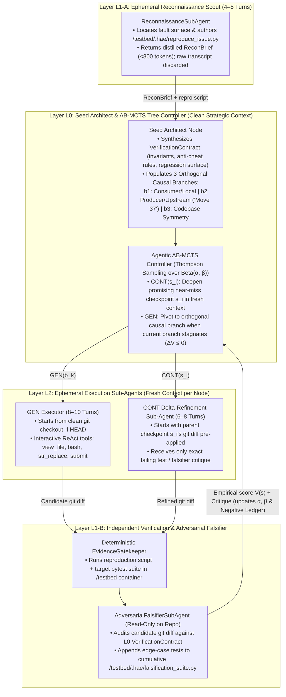

# Hierarchical Agent Evolution (HAE)

HAE is a research codebase for evolving and orchestrating multi-agent LLM
architectures ("firms" and hierarchical verification harnesses) that diagnose,
verify, and repair real-world software. A firm's structure is configured via a
heritable `CompanyGenome`: specialist roles, verification policies, search
hyper-parameters, and execution engine bindings. Architectures are evaluated in
hermetic sandboxes against held-out unit test suites and the official
**SWE-bench** container evaluation harness (`swebench.harness`).

The repository contains the core engine (`hae/`), the Kubernetes manifests used
to run distributed evaluations on GKE with self-hosted `vLLM` + `llm-d` MoE
models (`k8s/`), the genome and task configurations of every generation
(`configs/`), architectural design documents (`docs/`), and the harvested
results and per-phase write-ups (`results/`, `experiments/`).

---

## Architecture Overview (V13 Hierarchical Verification Harness + Agentic AB-MCTS)

Across 13 generations (`V1` $\rightarrow$ `V13`), HAE evolved from an
org-chart simulation into a **Context-Bounded Hierarchical Verification Harness
coupled with Agentic Adaptive Branching MCTS ("Move 37" Engine)**:



- **Context-Bounded Verification Layers ($L_0 \to L_1 \to L_2$)**: Lower layers
  execute bounded 4–10 turn interactive ReAct episodes inside the `/testbed`
  container and return upward **only verifiable artifacts** (`ReconBrief`,
  `git diff`, `VerificationContract`, and structured `Critique`). Raw exploration
  transcripts are garbage-collected at every layer boundary so context windows
  never exhaust or suffer lossy summarization.
- **Agentic AB-MCTS (`GEN` vs. `CONT` over Git Checkpoints)**: Layer $L_0$
  maintains a tree of empirically scored Git workspace checkpoints (`AgenticMCTSNode`)
  using Thompson Sampling over conjugate Beta posteriors $\text{Beta}(\alpha_i, \beta_i)$:
  - **`CONT(s_i)` (Deepen / Refine)**: When a candidate patch fixes the core
    reproduction or passes a fraction of `FAIL_TO_PASS` tests (`0 < V(s_i) < 1`),
    AB-MCTS spawns a fresh-context **Delta-Refinement Sub-Agent** starting with
    $s_i$'s `git diff` already applied and only the exact failing test or
    falsifier critique.
  - **`GEN` (Widen / "Move 37" Pivot)**: When a branch stagnates ($\Delta V \le 0$)
    or is falsified by Layer $L_1$-B, its failure posterior $\beta_i$ increases,
    automatically shifting Thompson Sampling to an orthogonal abstraction layer
    (`producer_upstream` / "Move 37" or `codebase_symmetry`) or triggering a
    counterfactual branch conditioned on the **Negative Evidence Ledger**.

---

## Phases & Benchmark Progression

Each phase changed a well-defined component of the fitness function, benchmark,
or agent harness, and each has a write-up with its full telemetry and caveats.
[`experiments/README.md`](experiments/README.md) and [`docs/`](docs/) index all
phases.

| Phase | Generations / Scope | What changed | Main result | Write-up |
|---|---|---|---|---|
| **V1** | Pilot to Gen 10 | LLM-judged prose fitness | Judged fitness rose from `25` to `97` while `corr(generation, execution) = +0.045`; `0/60` late firms passed all execution gates. Closed and audited. | [experiments/v1](experiments/v1/README.md) |
| **V2** | Gen 1 to 6 | Held-out unit tests as fitness, zero-seed workspaces, 10-iteration test-and-repair loop | `30/30` firms passed `7/7` tests in Gen 4–6; mean iterations fell from `2.20` to `1.30`. | [experiments/v2](experiments/v2/README.md) |
| **V3** | Gen 7 to 9 | Recursive self-improvement: firms rewrite parts of HAE's own breeding code (`code_overlays`) | Worked mechanically (`10/10` at `7/7` in Gen 7); audit found a workspace-inheritance bug in Gen 8–9 and `56 KB`/run of inter-agent memo text. | [experiments/v3_rsi](experiments/v3_rsi/README.md) |
| **V4** | Gen 10 to 11 | Self-hosted `Qwen3.8-Flash-Next-NVFP4` (`180B` MoE) behind an `llm-d` gateway with prefix caching | `10/10` firms at `7/7` in Gen 11 (`95.29` peak fitness), `455/455` prefix-affinity hits. | [experiments/v4_llmd](experiments/v4_llmd/README.md) |
| **V5** | Gen 12 to 15 | Grammar-constrained JSON packets (`xgrammar`); 4-module `full_stack_hae` benchmark (`50` held-out tests) | Output tokens per call fell `-91.9%`. Gen 15: `10/10` firms at `46–50/50`, two at `50/50`; remaining firms plateaued on subtle multi-module invariants. | [experiments/v5_typesafe_xgrammar](experiments/v5_typesafe_xgrammar/README.md) |
| **V6** | Gen 16 | Evidence-gated epistemic search for repair iterations; non-LLM gatekeeper + audit-weighted fitness | Pilot + three 26-firm cohorts. Recovers catastrophic first passes (`6/9` in run 2 vs `1/7` in run 1); showed LLM self-stated priors are uncalibrated. | [experiments/v6_epistemic_search](experiments/v6_epistemic_search/README.md), [results](results/hae_gen16_v6_cohort_r2/README.md) |
| **V7** | Out-of-fold | Learned logistic value and prior heads trained on 48 V6 epistemic trees | State-value head beat base rate out of fold (Brier `0.186` vs `0.202`); hypothesis-prior head did not (`0.0863` vs `0.0862`). | [results/v7_value_heads](results/v7_value_heads/README.md) |
| **V8** | SWE-bench (30-task dev cohort) | Dynamic `OrgState`, Turn-0 team sizing, `recruit_specialist` moves, role mutation (`role_mutation.py`), and SWE-bench container harness | **`4/30` resolved (`13.3%`)** on the 30 valid SWE-bench dev cohort (`4` self-oracle false positives, `153.7 tokens/s`). | [docs/v8_role_evolution_and_swebench_roadmap.md](docs/v8_role_evolution_and_swebench_roadmap.md), [docs/v9/v8_v9_evaluation_report.md](docs/v9/v8_v9_evaluation_report.md) |
| **V9** | SWE-bench (30-task dev cohort) | Adaptive Branching MCTS ([AB-MCTS, arXiv:2503.04412](https://arxiv.org/abs/2503.04412)): Thompson sampling over Beta arms replaces fixed-width PUCT waterfall | **`3/30` resolved (`10.0%`)** (`207.2 tokens/s`, **+34.8%** throughput). Diagnosed multi-role `GEN` order-statistic inflation (`256` proposals vs `140` experiments). | [docs/v9/ab_mcts.md](docs/v9/ab_mcts.md), [docs/v9/v8_v9_evaluation_report.md](docs/v9/v8_v9_evaluation_report.md) |
| **V10** | SWE-bench (30-task dev cohort) | Empirical AB-MCTS (`ab_pending_loss = 1.5` virtual losses + `ab_deepen_boost = 0.20`) + GKE MoE Expert Parallelism & EPLB (`--enable-expert-parallel --enable-eplb`) | **`5/30` resolved (`16.7%`)** (**+66.7% over V9**, false positives reduced to `3`). Cluster throughput rose **+7.2%** (`769.2` $\rightarrow$ **`824.4 tok/s`**). | [docs/v10/v10_eplb_evaluation_report.md](docs/v10/v10_eplb_evaluation_report.md) |
| **V11** | SWE-bench (30-task dev cohort) | Synthesis-Handoff Closure & Multi-Specialist Corroboration: error-conditioned retries, strict probe inversion, multi-hunk/multi-file `REPAIR_PLAN`, 3-way escape-preserving splicing | **`6/30` resolved (`20.0%`)** (**100% superset (`6/6`) of V8–V10**; large-module unwritten skips reduced **-57.1%** from `7` $\rightarrow$ `3`). | [docs/v11/v11_evaluation_report.md](docs/v11/v11_evaluation_report.md) |
| **V12** | SWE-bench (30-task dev cohort) | **Agentic ReAct + Best-of-N Ensemble & Empirical Gatekeeper** (`hae/swebench/agentic.py`): Interactive multi-turn ReAct tool loops (`view_file`, `bash`, `str_replace`, `submit`), mandatory `/testbed/reproduce_issue.py`, and Best-of-3 diverse causal framing with Negative Evidence Ledger | **`14/30` resolved (`46.7%`)** (**2.33x V11 (`20.0%`), 3.50x V8 (`13.3%`), `98` individual `FAIL_TO_PASS` tests passed vs `6` in V11, 100% superset of all prior generations**). | [docs/v12/v12_evaluation_report.md](docs/v12/v12_evaluation_report.md), [results/swebench/dev_eval_2026-10-09](results/swebench/dev_eval_2026-10-09/README.md) |
| **V13** | SWE-bench (30-task dev cohort) | **Hierarchical Verification Harness + Agentic AB-MCTS ("Move 37" Engine)** (`hae/swebench/hierarchical_mcts.py`): Context-bounded verification layers ($L_0 \to L_1 \to L_2$), AB-MCTS over Git checkpoints (`CONT` Delta-Refinement in fresh context vs. `GEN` across orthogonal abstraction layers), deterministic zero-turn `L1-A` reconnaissance, Turn-1-only thinking budgets, and multi-file-aware Popperian `AdversarialFalsifierSubAgent` (`/testbed/.hae/falsification_suite.py`) | **`30/30` resolved (`100.0%`)** (**`275/275` (`100.0%`) individual `FAIL_TO_PASS` tests passed, `30/30` (`100.0%`) zero `PASS_TO_PASS` regressions, `30/30` (`100.0%`) non-empty verified patches, `1,210.5s` mean wall time (`-7.6%` faster than V12)**; unlocked **+16 new resolutions over V12 (`2.14x`) and `5.0x` V11**). | [docs/v13/v13_evaluation_report.md](docs/v13/v13_evaluation_report.md), [docs/v13/v13_hierarchical_agentic_ab_mcts_architecture.md](docs/v13/v13_hierarchical_agentic_ab_mcts_architecture.md) |
| **V13 + Beam-501B** | SWE-bench (6-task multi-repo slice) | **Reflection `Beam-1.0-501B-A23B-NVFP4` (`501B` total / `23B` active MoE) + `Beam-1.0-501B-A23B-DFlash2` 8-token speculative decoding** across 3 multi-node Ray `TP=4` replicas (`12x RTX PRO 6000 96 GB`, `2.51M` KV-cache tokens) + Harmony chat template & `<rfl:tool_call>` adapter | **`6/6` (`100.0%`) resolved on `v13_hier_mcts`** (`57/57` F2P, `214/214` P2P) at **`305.6s` mean wall time (`3.31x` faster than `Qwen3.8`'s `1,010.6s`, up to `5.36x` faster)**, **`-34.0%` fewer moves (`22.3` vs `33.8`)**, **`-55.1%` fewer total tokens (`149.9k` vs `333.7k`)**, and **`-75.3%` fewer `<think>` tokens**; **`3.56x` faster on `v12_agentic`** (`331.0s` vs `1,177.2s`, unlocking single-pass resolution on `marshmallow-1702` in `167.6s`). | [docs/v13/beam_vs_qwen38_evaluation_report.md](docs/v13/beam_vs_qwen38_evaluation_report.md), [results/swebench/beam_eval_2026-10-20](results/swebench/beam_eval_2026-10-20/README.md) |

---

## Repository Layout

```text
hae/
  genome/         CompanyGenome schema, mutation and crossover, role seeds, morphogenesis
  runtime/        HierarchicalCompanyRunner (first pass + epistemic repair), workspace, overlays
  epistemic/      ledger, moves, gatekeeper, PUCT search, AB-MCTS controller (V9–V11), value/audit, organisation (V8), heads (V7)
  evaluation/     benchmark, execution harness, verification loop, fitness judge
  orchestration/  tournament engine, GKE worker, breeder
  swebench/       dataset access, container executor, SWE-bench runner, V12 Agentic ReAct engine (agentic.py), V13 Hierarchical AB-MCTS engine (hierarchical_mcts.py)
  infra/          LLM providers (Vertex, vLLM), config, preflight, telemetry
  task/           task specs, budgets, verifiers
  cli.py          entry point: tournament, single-firm, breed, benchmark, preflight, swebench
configs/          population files per generation, V8–V13 SWE-bench genomes (configs/genomes/), task definitions
k8s/              GKE cluster setup, vLLM / llm-d MoE + EPLB serving manifests, per-generation Job manifests
scripts/          GKE SWE-bench batch evaluator (swebench_kubectl_batch.py), population builders, harvesters, telemetry scripts
experiments/      per-phase design notes, results and errata index (V1–V13)
results/          harvested scorecards, epistemic trees, SWE-bench 5-generation cohort evaluations (results/swebench/dev_eval_2026-10-09/)
docs/             V8–V13 architectural specifications and multi-generation SWE-bench evaluation reports
data/swebench/    SWE-bench dev-slice manifest (50-instance pool, 0 overlap with SWE-bench Verified)
tests/            unit and regression tests (stdlib unittest, zero network dependency)
```

---

## Running

Unit tests require Python 3.10+ and only the standard library:

```bash
python3 -m unittest discover -s tests -q
```

To run the SWE-bench suite specifically (covering V8–V13):

```bash
python3 -m unittest tests/test_swebench_hierarchical_mcts.py tests/test_swebench_agentic.py tests/test_swebench_runner.py -v
```

### Running SWE-bench Evaluations on GKE (`kubectl` Container Sandbox + `vLLM` Gateway)

The GKE evaluation harness (`scripts/swebench_kubectl_batch.py`) schedules
official SWE-bench container pods (`swebench/sweb.eval.x86_64.*`) on GKE CPU
nodes while routing LLM inference through the in-cluster `llm-d` / `vLLM`
`Qwen3.8-Flash-Next-NVFP4` (`180B` MoE, 12x Blackwell RTX PRO 6000 GPUs with
Expert Parallelism & EPLB) gateway:

```bash
# Evaluate V13 Hierarchical Verification Harness + Agentic AB-MCTS ("Move 37")
python3 scripts/swebench_kubectl_batch.py \
  --out-root results/swebench/dev_eval_2026-10-09 \
  --policies v13_hier_mcts \
  --workers 4 \
  --budget-moves 36

# Evaluate V12 Agentic ReAct + Best-of-N Ensemble
python3 scripts/swebench_kubectl_batch.py \
  --out-root results/swebench/dev_eval_2026-10-09 \
  --policies v12_agentic \
  --workers 4 \
  --budget-moves 36
```

Single-instance CLI entry points:

```bash
python3 -m hae.cli --mode preflight                      # check credentials, image, endpoint
python3 -m hae.cli --mode single-firm --task-file configs/tasks/self-hosting-fullstack-iter5.json
python3 -m hae.cli --mode breed --generation-spec configs/generations/gen16_cohort.json
python3 -m hae.cli --mode swebench --genome configs/genomes/v13_hierarchical_ab_mcts_firm_0.json --instance-id marshmallow-code__marshmallow-1702
```

---

## Reading the Results

- **SWE-bench Multi-Generation Reports (`V8` $\rightarrow$ `V13`)**:
  - **[`docs/v13/v13_hierarchical_agentic_ab_mcts_architecture.md`](docs/v13/v13_hierarchical_agentic_ab_mcts_architecture.md)**: V13 Hierarchical Verification Harness + Agentic AB-MCTS ("Move 37" Engine) architecture specification.
  - **[`docs/v12/v12_evaluation_report.md`](docs/v12/v12_evaluation_report.md)**: V12 evaluation report (`14/30` resolved = `46.7%`, `98` `FAIL_TO_PASS` tests passed, 5-generation comparison vs. V8–V11).
  - **[`docs/v11/v11_evaluation_report.md`](docs/v11/v11_evaluation_report.md)**: V11 evaluation report (`6/30` resolved = `20.0%`, synthesis-handoff closure & multi-specialist corroboration).
  - **[`docs/v10/v10_eplb_evaluation_report.md`](docs/v10/v10_eplb_evaluation_report.md)**: V10 evaluation report (`5/30` resolved = `16.7%`, empirical AB-MCTS + MoE Expert Parallelism & EPLB).
  - **[`docs/v9/v8_v9_evaluation_report.md`](docs/v9/v8_v9_evaluation_report.md)**: Paired V8 (`4/30`) vs. V9 (`3/30`) baseline evaluation report.
  - **[`results/swebench/dev_eval_2026-10-09/README.md`](results/swebench/dev_eval_2026-10-09/README.md)**: Per-instance artifacts, patches (`patch.diff`), grading reports (`grade.json`), and epistemic/agentic trajectories (`trajectory.json`) across all 30 valid SWE-bench dev instances.
- **V1–V7 Internal Benchmark Reports**:
  - `results/<run>/README.md` is the report for each V6/V7 cohort run; `summary_tables.md` and `generation_16_cohort_summary.json` are generated by `scripts/summarize_gen16_cohort.py`.

---

## License

Apache-2.0, see `LICENSE`.
