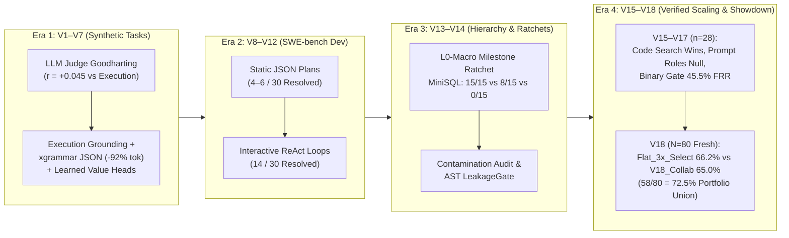

# Final Conclusion, Empirical Learnings (V1 → V18) & Future Roadmap

> **Program Status (November 2026):** **Paused at `v18-final` (`400` container runs on the fresh $N = 80$ `SWE-bench Verified` benchmark complete; all GKE GPU/CPU clusters torn down and verified at zero billing instances; all code, genome configs, predictions, and container grades archived in Git).**

---

## 1. Executive Summary

Over 18 iterative versions (`V1 → V18`), the **Hierarchical Agent Evolution (HAE)** program investigated three coupled questions using self-hosted open-weight models (`Qwen3-Coder-32B`, `Qwen3.8-Flash-Next-180B-MoE`, and `Beam-1.0-501B-A23B-NVFP4` behind `llm-d` on GKE):

1. **Verification & Grounding:** Can multi-agent hierarchies with context isolation and adversarial verification overcome the self-delusion of single-agent coding loops?
2. **Test-Time Compute Scaling:** At matched token budgets, does structured multi-agent collaboration (Recon, Architect, parallel Executors, synthesis roundtables, firewalled Red Team) beat simple parallel sampling plus selection (`3× Flat ReAct + Selector`)?
3. **Evolutionary Harness Discovery:** Which parts of an agentic harness (code, numeric search knobs, verifier ranking weights, or specialist prompt personas) genuinely improve under evolutionary search versus overfitting to noisy finite-sample fitness?

After more than **3,500 container-isolated evaluation runs**, our conclusions are clear and sober:

- **Where hierarchy wins decisively:** On **long-horizon, multi-milestone software construction** (`MiniSQL`, `2,345` LoC across 15 sequential milestones graded by an external `sqlite3` oracle), the **L0-Macro Milestone Ratchet** achieved **`15 / 15` (`100%`)**, compared to **`8 / 15` (`53.3%`)** for monolithic `AB-MCTS` and **`0 / 15` (`0%`)** for single-agent flat ReAct.
- **Where parallel sampling matches hierarchy at lower cost:** On **localized single-issue bug fixing** (`N = 80` fresh, offline-screened `SWE-bench Verified` tasks), compute-matched **`Flat_3x_Select`** (`3×` independent flat ReAct rollouts + consensus/Red-Team ranker) reached **`53 / 80` (`66.2%`)** at **`442.2k` tokens/task** (`1.50` Resolved/MTok, capturing **`98.1%`** of the `Pass@3` oracle ceiling of `54 / 80 = 67.5%`), statistically tying collaborative hierarchy **`V18_Collab`** (**`52 / 80` = `65.0%`** at `555.3k` tokens/task, exact McNemar $p = 1.00$). Single-run **`Flat_1x_V18`** reached **`50.0 / 80` (`62.5%`, `[51, 49, 50]`)** at **`147.4k` tokens/task** (`4.24` Resolved/MTok).
- **Complementary strengths (`72.5%` combined union):** Even though `Flat_3x_Select` (`53/80`) and `V18_Collab` (`52/80`) tie in aggregate, their failure modes are complementary. On **4 tasks** (`matplotlib__matplotlib-23299`, `pytest-dev__pytest-6197`, `scikit-learn__scikit-learn-14629`, `sphinx-doc__sphinx-8551`), all 3 independent flat rollouts failed (`0 / 3`, `Pass@3 = 0`), while `V18_Collab` solved them via Pre-Edit Builder Huddle contract overrides and Post-Prototype Synthesis Roundtables (`b_synth`). Combining the `Flat_3x` pool with `V18_Collab` lifts the portfolio ceiling to **`58 / 80` (`72.5%`)**.
- **Where evolution works vs. fails:** Evolving **substrate code and continuous verifier ranking weights** produced real, transferable gains (`+5` tasks over the hand-designed seed in V15; `+8.4 pp` top-1 selection accuracy across $n = 2,525$ graded checkpoints in V18). By contrast, evolving **prompt-level specialist personas and organizational roles** failed to beat random search or generalist prompts three times in a row (`V16`, `V17`, and `V18_Evolved` at `48 / 80 = 60.0%` vs. `V18_Collab` at `52 / 80 = 65.0%`).

---

## 2. Consolidated Trajectory Across Four Eras (`V1 → V18`)

| Era & Versions | Benchmark / Task Scope | Key Architectural Question | Empirical Result & Enduring Lesson |
| :--- | :--- | :--- | :--- |
| **Era 1 (`V1–V7`)** | Synthetic coding tasks (`7`-test & `50`-test suites) | Can populations of multi-agent firms evolve under LLM-judge or execution fitness? | LLM-judge scores rose `25 → 97` while real execution correlation was **$r = +0.045$** (`0/60` late firms passed). Switching to execution tests (`V2`), grammar-constrained JSON (`V5`, **`-92%` output tokens**), and learned value heads (`V7`, **$r = +0.31$**) fixed grounding. |
| **Era 2 (`V8–V12`)** | `30`-task `SWE-bench` dev cohort | Do structured multi-agent JSON plans transfer to real GitHub repositories? | Static multi-agent plans stalled at **`4–6 / 30`**. Giving agents interactive ReAct bash/file tools (`V12`) more than doubled resolve rate to **`14 / 30`**. Search (`PUCT` / `AB-MCTS`) cannot rescue a non-interactive inner loop. |
| **Era 3 (`V13–V14`)** | Greenfield `MiniSQL` (`2,345` LoC) & `SWE-bench` audit | Does hierarchical decomposition help on long-horizon builds, and are prompts leak-free? | **Clean long-horizon win:** `L0-Macro` Milestone Ratchet scored **`15 / 15` (`100%`)** on held-out `sqlite3` differential tests vs. **`8 / 15`** monolithic `AB-MCTS` and **`0 / 15`** flat ReAct. **Hygiene audit:** Discovered and stripped 4 AST gold-fix detectors and test-task prompt examples, motivating the automated `LeakageGate`. |
| **Era 4a (`V15–V17`)** | `28`-task unseen `SWE-bench Verified` (`2` replicates, `1,116` V17 runs) | Do evolved harnesses, specialist prompt roles (`V16`), and binary Red-Team gates (`V17`) beat flat ReAct? | In `V15`, code/knob search (**`17 / 28`**) beat the hand-designed seed (**`12 / 28`**, $p = 0.063$) but tied random search (`16 / 28`). Across `V16–V17`, every arm landed in a tight **`15.5–17.5 / 28`** band (`55.4%–62.5%`) at `2.2×–3.4×` token cost, while `V17`'s binary Red-Team gate rejected **`45.5%`** of valid candidate patches (`332 FN`). |
| **Era 4b (`V18`)** | **Fresh `N = 80` `SWE-bench Verified`** (`400` runs; all 81 V14–V17 tasks retired) | Does collaborative synthesis (`V18_Collab`) beat compute-matched `3×` parallel sampling (`Flat_3x_Select`), and does candidate-pool ranking fix binary gating? | **Verifier calibration ($n = 2,525$):** Continuous pool ranker cut false rejections from `45.5% → 0%` and lifted resolvable-run top-1 accuracy from **`87.6% → 96.0%`**. **Showdown ($N = 80$):** `Flat_1x_V18` **`50.0 / 80` (`62.5%`, `147k` tok)**, `Flat_3x_Select` **`53 / 80` (`66.2%`, `442k` tok)**, `V18_Collab` **`52 / 80` (`65.0%`, `555k` tok)**, `V18_Evolved` **`48 / 80` (`60.0%`, `577k` tok)**. Combined `Flat_3x + V18_Collab` union reaches **`58 / 80` (`72.5%`)**. |

---

## 3. Six Core Scientific Learnings

### Learning 1: On Localized Repository Bug Fixes, Parallel Sampling + Selection (`Flat_3x_Select`) Matches Multi-Agent Hierarchy at Lower Token Cost

A central critique of multi-agent architectures is that they rarely compare against compute-matched parallel sampling (`Pass@k` + selector). V18 ran that exact test on 80 fresh tasks:

- **Single-Run Baseline (`Flat_1x_V18`):** **`50.00 / 80` (`62.5%`)** across 3 independent seeds (`51, 49, 50 / 80`) at **`147,399` tokens/task** (**`4.24` Resolved/MTok**).
- **Compute-Matched Parallel Sampling (`Flat_3x_Select`):** **`53.00 / 80` (`66.2%`)** at **`442,196` tokens/task** (**`1.50` Resolved/MTok**), capturing **`53 / 54` (`98.1%`)** of the `Flat_3x_PassAt3` oracle ceiling (`54 / 80 = 67.5%`).
- **Collaborative Hierarchy (`V18_Collab`):** **`52.00 / 80` (`65.0%`)** at **`555,277` tokens/task** (**`1.17` Resolved/MTok**, exact McNemar $p = 1.00$ vs. `Flat_3x_Select`).

**Why:** Most single-issue `SWE-bench Verified` bugs are localized to 1–2 functions once found. Running 3 fully independent flat ReAct rollouts guarantees **uncorrelated exploration paths** from Turn 1, and a strong post-hoc selector (combining test pass signals, diff minimality, and normalized-diff medoid consensus) extracts 98.1% of the `Pass@3` ceiling without inter-agent coordination overhead.

### Learning 2: Hierarchy and Parallel Flat Rollouts Exhibit Complementary Failure Modes (`58 / 80 = 72.5%` Union)

Although `Flat_3x_Select` (`53 / 80`) and `V18_Collab` (`52 / 80`) tie in aggregate score, task-by-task discordant analysis reveals two distinct regimes:

1. **Where `V18_Collab` Wins (`4` Tasks Where All 3 Flat Rollouts Scored `0 / 3`):**
   - `matplotlib__matplotlib-23299`, `pytest-dev__pytest-6197`, `scikit-learn__scikit-learn-14629`, and `sphinx-doc__sphinx-8551`.
   - On these multi-constraint issues, every independent flat rollout fell into the same local attractor (fixing the symptom while breaking a sibling class or caller invariant). In `V18_Collab`, the **Pre-Edit Builder Huddle** explicitly overrode narrow `L0` contracts (`74` overrides across 80 tasks) and the **Post-Prototype Synthesis Roundtable (`b_synth`)** merged complementary branch insights (`30` synthesis merges across 80 tasks).
2. **Where `Flat_3x_Select` Wins (`5` Tasks Where `V18_Collab` Scored `0 / 1`):**
   - `django__django-11149`, `matplotlib__matplotlib-20826`, `scikit-learn__scikit-learn-13439`, `sympy__sympy-13877`, and `sympy__sympy-18199`.
   - Sharing a single `#recon-map` across all builders inside `V18_Collab` occasionally **correlated both execution branches (`b1`, `b2`)** onto the same plausible-but-incomplete localization, whereas at least one of the 3 independent `Flat_1x_V18` seeds explored an alternate code path and succeeded.

### Learning 3: Continuous Candidate-Pool Ranking Strictly Dominates Binary Red-Team Gating

In V17, tightening the firewalled Red Team into a hard binary gate (`V == 1.0`) lowered the training false-pass rate from `51.2%` to `28.1%`, but retrospective container grading of all **`n = 2,525` intermediate candidate patches** across `1,385` V17 runs exposed the hidden cost:

- **Binary Gating (`V17`):** Rejected **`45.5%`** of genuinely passing candidate patches (`332 FN` vs. `397 TP`, `Recall = 54.5%`), forcing agents into expensive extra search episodes after they had already written a valid fix.
- **Candidate-Pool Ranker (`V18`):** Retaining every patch that passes `.hae/reproduce_issue.py` + local `pytest` in a non-destructive candidate pool and scoring candidates continuously via $S_{\text{rank}}$ eliminated pool discards (**`100.0%` pool recall**) and raised top-1 selection accuracy on resolvable runs ($n = 453$) from **`87.6%` (`397 / 453`) to `96.0%` (`435 / 453`, `+8.4 pp`)**.

### Learning 4: Evolving Prompt Personas Repeatedly Fails to Generalize; Substrate & Verifier Engineering Transfers

Across four evolutionary experiments (`V15`, `V16`, `V17`, `V18`), the surface being mutated determined whether gains transferred to held-out tasks:

| Mutation Surface | Experiments Tested | Held-Out Outcome | Verdict |
| :--- | :--- | :--- | :--- |
| **Substrate Code & Turn Grammar** | `V15` (3 code edits), `V18` (compound turns, `</rfl:parameter>` strip, Q&A bash fix) | `V15`: `17/28` vs `12/28` seed (`+17.8 pp`); `V18` flat ReAct: `62.5%` vs `58.9%` (`+3.6 pp`) | **Transfers reliably** across splits and repositories. |
| **Continuous Verifier & Consensus Ranker** | `V18` (`ranker_calibration.json` on $n = 2,525$ patches + medoid tie-break) | Resolvable-run top-1 accuracy `87.6% → 96.0%`; `Flat_3x_Select` captures `53/54` (`98.1%`) of `Pass@3` | **High signal density** (`thousands` of checkpoint labels vs. `20–40` noisy task outcomes). |
| **Specialist Prompt Personas & Org Roles** | `V16` (`D`), `V17` (`R`/`S`), `V18` (`V18_Evolved`) | `V16`: `15.5/28` vs `16.5/28`; `V17`: `17.5/28` vs `17.0/28` random; `V18`: **`48/80` (`60.0%`) vs `52/80` (`65.0%`) generalist** (`-5.0 pp`) | **Consistently null or negative** on held-out sets; narrow persona prompts over-constrain exploration. |

### Learning 5: Fault Localization Is Solved (`95.5%`); Self-Reproduction Fidelity (`77.3%` False Self-Pass) Is the Remaining Bottleneck

Diagnostic analysis of the **`22 / 80` tasks where all 5 V18 runs scored `0 / 5`** shows why the remaining ~27–35% of `SWE-bench Verified` tasks fail:

- **Agents almost always edit the right file:** On **`21 / 22` (`95.5%`)** of the universally unsolved tasks, `V18_Collab` modified the exact gold file(s) (`14 / 22 = 63.6%` exact file-set match; `7 / 22 = 31.8%` partial overlap; only `1 / 22 = 4.5%` wrong file).
- **Weak self-written reproduction scripts cause premature victory:** On **`17 / 22` (`77.3%`)** of those unsolved tasks, the agent's patch **passed its own `.hae/reproduce_issue.py` and existing local unit tests (`self_oracle = True`)**—so both the agent and the candidate ranker believed the bug was fixed—yet the patch failed the hidden official `FAIL_TO_PASS` test because `.hae/reproduce_issue.py` tested only the literal example in the issue description rather than the underlying invariant.

### Learning 6: Hierarchy's Uncontested Advantage Is Long-Horizon Multi-Milestone Construction (`L0-Macro` Ratchet)

Comparing `SWE-bench Verified` (`V15–V18`) with `MiniSQL` (`V14`) clarifies where architectural hierarchy is essential versus optional:

- When a task fits inside a single `150k`-token exploration trajectory (`1–2` files, `< 50` LoC diff), a single ReAct loop or `3×` parallel sampling is sufficient and token-efficient.
- When a task requires building or refactoring **thousands of lines of code across 10–15 interdependent milestones** (`MiniSQL`, `2,345` LoC), a single conversation window drowns in accumulated context (`0 / 15` flat ReAct), and unratcheted tree search regresses earlier features while implementing later ones (`8 / 15` monolithic `AB-MCTS`). Only the **L0-Macro Milestone Ratchet**—which commits each verified milestone as an immutable Git tag and runs all prior milestone suites as a cumulative regression ratchet—completed **`15 / 15` (`100%`)** against the external `sqlite3` oracle.

---

## 4. Roadmap of Future Directions

With the infrastructure, leakage-prevention tooling, and V1–V18 empirical record archived cleanly, any future continuation of this research should pursue four high-leverage directions:

### Direction 1: Adaptive Compute Routing (`1× Flat → 3× Consensus → Collaborative Synthesis`)
Instead of spending `442k–555k` tokens uniformly on every issue, combine the efficiency of `Flat_1x_V18` (`147k` tokens, `62.5%`) with the complementary `58 / 80` (`72.5%`) union of `Flat_3x_Select` and `V18_Collab`:
1. **Stage 1 (`~147k` tokens):** Run a single `Flat_1x_V18` rollout and evaluate with the Red-Team verifier. If the patch passes `.hae/reproduce_issue.py`, full target `pytest`, and zero Red-Team falsification assertions with a clean minimal diff (~55% of tasks), accept immediately.
2. **Stage 2 (`+295k` tokens on uncertain tasks):** Spawn 2 additional independent flat rollouts. If 2+ rollouts converge on the same normalized diff medoid, select the consensus patch.
3. **Stage 3 (`+150k` tokens on 3-way divergent tasks):** Feed the 3 divergent flat diffs and tracebacks directly into `V18_Collab`'s **Post-Prototype Synthesis Roundtable (`b_synth`)** to merge their complementary insights without re-running reconnaissance.
- **Expected payoff:** Captures the **`72.5%` (`58 / 80`)** portfolio ceiling at an average budget of **`~260k–290k` tokens/task** (`~45–50%` compute reduction vs. uniform `V18_Collab`).

### Direction 2: Differential Test Synthesis to Close the `77.3%` Self-Oracle Gap
Because `17 / 22` (`77.3%`) of unsolved tasks fail due to incomplete self-authored reproduction scripts (`.hae/reproduce_issue.py`) rather than wrong file localization (`95.5%` hit the gold file):
- Require the verifier/falsifier to synthesize **discriminating inputs (`x_diff`)** whenever two candidate patches (`b1` vs. `b2`, or `r0` vs. `r1`) both pass the initial `.hae/reproduce_issue.py` yet modify different AST expressions.
- Execute both candidate patches against the generated `x_diff` test suite and expose the behavioral divergence before final selection or synthesis.

### Direction 3: Compute-Matched Long-Horizon Milestone Ratchet Benchmark
Since `SWE-bench Verified` is predominantly single-hunk bug fixing, the highest-value domain for HAE's hierarchical architecture is **long-horizon software construction with external reference oracles**:
- Expand the `MiniSQL` benchmark (`15 / 15` against `sqlite3`) into a **5-target Long-Horizon Ratchet Suite** (`2,000–10,000` LoC each), where every target has an existing battle-tested external oracle:
  1. `MiniSQL` (`sqlite3` differential oracle — completed in V14).
  2. `MiniGit` (content-addressable object store, packfiles, merge/rebase graded against `git` CLI).
  3. `MiniJQ` (streaming JSON filter/compiler graded against `jq`).
  4. `MiniRegex` (NFA/DFA engine graded against Python `re` / PCRE).
  5. `MiniHTTP2` (HPACK header compression + frame state machine graded against `h2` reference vectors).
- Evaluate `L0-Macro Ratchet` vs. compute-matched `k× Flat ReAct` and `Monolithic AB-MCTS` at an identical **`1.8M`-token budget per target**.

### Direction 4: Dense-Signal Verifier Training & Staged Cascade Evolution (`10 → 50 → 150`)
If evolutionary search is resumed:
- **Stop evolving role/persona prompts.** Restrict the mutation space to executable middleware, deterministic static-analysis checks, and verifier/ranker features.
- **Train on the `n = 2,925+` container-graded patch archive:** Combining V17 (`2,525` graded checkpoints) and V18 (`400` graded runs + intermediate pool candidates) provides nearly 3,000 labeled `(patch, test_log, falsifier_trace, container_grade)` tuples for offline verifier optimization.
- **Enforce `10 → 50 → 150` staged evaluation cascades** with `>= 3` seeds on finalists so selection noise can never again mask true generalization.

---

## 5. Archival & Reproducibility Checklist (`v18-final`)

All code, configurations, split manifests, and raw evaluation artifacts are checked into this repository:

- **Complete V18 Results & Analysis:** [`docs/V18_RESULTS.md`](V18_RESULTS.md), [`results/v18/showdown_2026-11-02/report_80.md`](../results/v18/showdown_2026-11-02/report_80.md), [`results/v18/showdown_2026-11-02/report_24.md`](../results/v18/showdown_2026-11-02/report_24.md)
- **V18 Raw State, Genome Configs & Per-Task Predictions/Grades (`400 / 400` runs):**
  - [`results/v18/showdown_2026-11-02/state.json`](../results/v18/showdown_2026-11-02/state.json)
  - [`results/v18/showdown_2026-11-02/genome_configs/`](../results/v18/showdown_2026-11-02/genome_configs/)
  - [`results/v18/showdown_2026-11-02/evals/`](../results/v18/showdown_2026-11-02/evals/) (`prediction.json` & `grade.json` for every arm and task)
  - [`results/v18/ranker_calibration.json`](../results/v18/ranker_calibration.json) (`n = 2,525` checkpoint calibration)
- **V15–V17 Archives:** [`results/v15/`](../results/v15/), [`results/v16/`](../results/v16/), [`results/v17/`](../results/v17/) (including `verdicts_grade.json`, `genome_configs/`, and all `392` test `prediction.json` / `grade.json` files)
- **V14 Long-Horizon Milestone Ratchet (`MiniSQL`):** [`results/ratchet/`](../results/ratchet/)
- **Benchmark Split Manifests & Leakage Gate:** [`data/swebench/v18_splits.json`](../data/swebench/v18_splits.json), [`hae/evolution/leakage_gate.py`](../hae/evolution/leakage_gate.py)
- **Cluster Teardown Verification:** [`k8s/teardown.sh`](../k8s/teardown.sh) executed against `chavoshi-v6-cohort` (`gemle-gke-dev / us-central1-b`); cluster and all GPU/CPU node pools deleted.
