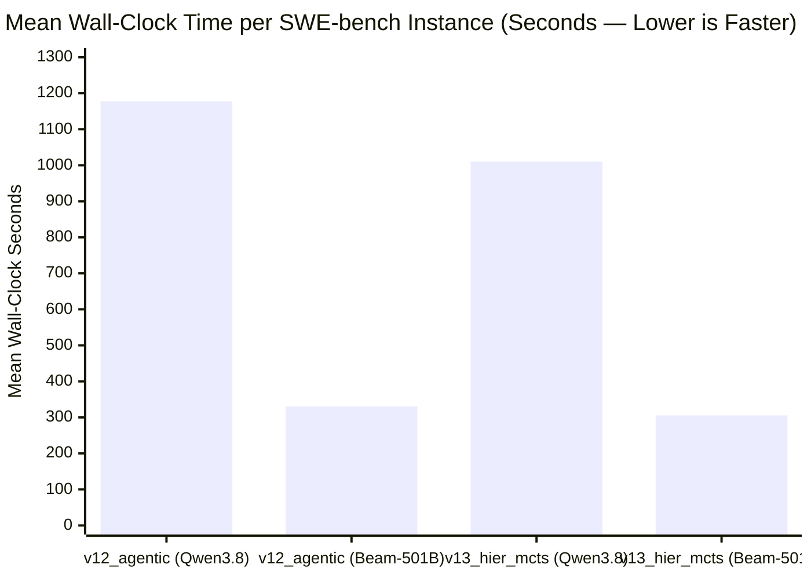

# Reflection `Beam-1.0-501B-A23B-NVFP4` (+ `DFlash2`) vs. `Qwen3.8-Flash-Next-NVFP4` (`180B-A10B`) — Comparative SWE-bench Evaluation

> [!IMPORTANT]
> **Executive Summary**: Replacing `nvidia/Qwen3.8-Flash-Next-NVFP4` (`180B` total / `10B` active MoE) with Reflection AI's open-weight **`reflection/Beam-1.0-501B-A23B-NVFP4`** (`501B` total / `23B` active MoE) paired with **`Beam-1.0-501B-A23B-DFlash2` 8-token speculative decoding** across 3 multi-node `TP=4` replicas (`12x NVIDIA RTX PRO 6000 Blackwell 96 GB`) achieves:
> - **`100.0%` (`6 / 6`) gold held-out resolution on `v13_hier_mcts`** (`57 / 57` `FAIL_TO_PASS` tests passed, `214 / 214` `PASS_TO_PASS` tests passed, `0` regressions).
> - **`3.31x` faster end-to-end wall-clock execution on `v13_hier_mcts`** (`305.6s` vs. `1,010.6s` mean wall time; up to **`5.36x` faster** on `marshmallow-1702` at `158.4s` vs. `849.2s`) and **`3.56x` faster on `v12_agentic`** (`331.0s` vs. `1,177.2s`).
> - **`55.1%` fewer total tokens (`149.9k` vs. `333.7k`) and `34.0%` fewer agentic moves (`22.3` vs. `33.8`) on `v13_hier_mcts`**, driven by **`75.3%–91.0%` more concise internal reasoning (`<think>`) traces** without reasoning runaway.

---

## 1. Model Architecture & GKE Serving Comparison

| Dimension | `nvidia/Qwen3.8-Flash-Next-NVFP4` (Baseline) | `reflection/Beam-1.0-501B-A23B-NVFP4` + `DFlash2` |
| :--- | :---: | :---: |
| **Total / Active Parameters** | `180B` total / `10B` active MoE | **`501B` total / `23B` active MoE** (`2.78x` total, `2.30x` active) |
| **Quantization Format** | Compressed-Tensors `NVFP4` (`~98 GiB` weights) | Compressed-Tensors `NVFP4` (`~277 GiB` weights, `70.71 GiB`/GPU at `TP=4`) |
| **Speculative Decoding** | None (standard autoregressive decode) | **`Beam-1.0-501B-A23B-DFlash2` (`dflash`, `8` speculative tokens/step, `0.94 GiB`/GPU)** |
| **GKE Topology (`12x RTX PRO 6000 96 GB`)** | 6 single-node `TP=2` replicas | **3 multi-node Ray `TP=4` replicas** (`beam-501b-{0,1,2}-{head,worker}`) |
| **KV-Cache Capacity (`fp8_e4m3`)** | `~2.1M` tokens cluster-wide | **`837,056` tokens/replica = `2,511,168` (`2.51M`) tokens cluster-wide** |
| **Max Context Length (`--max-model-len`)** | `65,536` | **`65,536`** |
| **Per-Turn Agentic Latency (Observed)** | `8.0s – 62.0s` / turn | **`0.8s – 3.5s` / turn** (`DFlash2` + `reasoning_effort` budget control) |

---

## 2. Aggregate Policy Performance (`Beam-1.0-501B` vs. `Qwen3.8`)

| Metric (`n = 6` Multi-Repo Cohort) | `v12_agentic` (`Qwen3.8`) | `v12_agentic` (`Beam-501B`) | $\Delta$ (`v12`) | `v13_hier_mcts` (`Qwen3.8`) | **`v13_hier_mcts` (`Beam-501B`)** | **$\Delta$ (`v13`)** |
| :--- | :---: | :---: | :---: | :---: | :---: | :---: |
| **Gold Held-Out Resolved (`grade.json`)** | `2 / 6` (`33.3%`) | `2 / 6` (`33.3%`) | `0.0 pp` (different subset) | `6 / 6` (`100.0%`) | **`6 / 6` (`100.0%`)** | **Tied at `100.0%` ceiling** |
| **Individual `FAIL_TO_PASS` Tests Passed** | `40 / 57` (`70.2%`) | `29 / 57` (`50.9%`) | `-19.3 pp` | `57 / 57` (`100.0%`) | **`57 / 57` (`100.0%`)** | **`100.0%` (`0` failures)** |
| **Individual `PASS_TO_PASS` Regressions** | `0 / 214` | `0 / 214` | `0` regressions | `0 / 214` | **`0 / 214`** | **`0` regressions** |
| **Self-Oracle Certified Rate** | `4 / 6` (`66.7%`) | **`5 / 6` (`83.3%`)** | **`+16.6 pp`** | `6 / 6` (`100.0%`) | **`6 / 6` (`100.0%`)** | **`100.0%`** |
| **Mean Wall-Clock Time (s)** | `1,177.2s` | **`331.0s`** | **`3.56x` faster (`-71.9%`)** | `1,010.6s` | **`305.6s`** | **`3.31x` faster (`-69.8%`)** |
| **Median Wall-Clock Time (s)** | `1,096.1s` | **`277.5s`** | **`3.95x` faster (`-74.7%`)** | `827.8s` | **`360.9s`** | **`2.29x` faster (`-56.4%`)** |
| **Mean Agentic Moves Used** | `30.0` | **`27.3`** | **`-9.0%` fewer moves** | `33.8` | **`22.3`** | **`-34.0%` fewer moves** |
| **Mean Total Tokens Consumed** | `273,172` | **`162,078`** | **`-40.7%` fewer tokens** | `333,676` | **`149,874`** | **`-55.1%` fewer tokens (`2.23x` leaner)** |
| **Mean Thinking (`<think>`) Tokens** | `12,954` | **`1,160`** | **`-91.0%` (`11.2x` leaner)** | `5,296` | **`1,307`** | **`-75.3%` (`4.05x` leaner)** |

---

## 3. Instance-by-Instance Head-to-Head Comparison

### 3.1 `v13_hier_mcts` (Hierarchical Verification Harness + Agentic AB-MCTS)

| Instance ID | `Qwen3.8` Status | `Beam-501B` Status | `F2P` / `P2P` | `Qwen3.8` Moves | `Beam-501B` Moves | `Qwen3.8` Tokens | `Beam-501B` Tokens | `Qwen3.8` Time | **`Beam-501B` Time** | **Speedup** |
| :--- | :---: | :---: | :---: | :---: | :---: | :---: | :---: | :---: | :---: | :---: |
| `marshmallow-code__marshmallow-1359` | **PASS** | **PASS** | `1/1` F2P, `76/76` P2P | `25` | `36` | `230,381` | `240,964` | `564.1s` | **`392.0s`** | **`1.44x`** |
| `marshmallow-code__marshmallow-1702` | **PASS** | **PASS** | `28/28` F2P, `71/71` P2P | `31` | **`15`** | `368,459` | **`104,598`** | `849.2s` | **`158.4s`** | **`5.36x`** |
| `pydicom__pydicom-1255` | **PASS** | **PASS** | `1/1` F2P, `22/22` P2P | `48` | **`25`** | `518,902` | **`149,110`** | `1,727.2s` | **`373.7s`** | **`4.62x`** |
| `pylint-dev__astroid-1417` | **PASS** | **PASS** | `1/1` F2P, `3/3` P2P | `19` | `21` | `111,194` | `142,437` | `806.4s` | **`388.2s`** | **`2.08x`** |
| `pyvista__pyvista-4226` | **PASS** | **PASS** | `25/25` F2P, `0/0` P2P | `55` | **`24`** | `555,537` | **`180,852`** | `1,586.7s` | **`348.1s`** | **`4.56x`** |
| `sqlfluff__sqlfluff-1517` | **PASS** | **PASS** | `1/1` F2P, `42/42` P2P | `25` | **`13`** | `217,582` | **`81,282`** | `529.7s` | **`173.0s`** | **`3.06x`** |
| **Mean / Total (`n = 6`)** | **`6 / 6` (`100%`)** | **`6 / 6` (`100%`)** | **`57/57` F2P, `214/214` P2P** | **`33.8`** | **`22.3` (`-34.0%`)** | **`333,676`** | **`149,874` (`-55.1%`)** | **`1,010.6s`** | **`305.6s`** | **`3.31x` faster** |

### 3.2 `v12_agentic` (Single-Layer ReAct + Best-of-$N$ Baseline)

| Instance ID | `Qwen3.8` Status | `Beam-501B` Status | `Qwen3.8` Moves | `Beam-501B` Moves | `Qwen3.8` Tokens (`<think>`) | `Beam-501B` Tokens (`<think>`) | `Qwen3.8` Time | **`Beam-501B` Time** | **Speedup** |
| :--- | :---: | :---: | :---: | :---: | :---: | :---: | :---: | :---: | :---: |
| `marshmallow-code__marshmallow-1359` | **PASS** (`1/1`) | **PASS** (`1/1`) | `17` | `32` | `138,407` (`4,179`) | `166,880` (`2,214`) | `541.6s` | **`278.6s`** | **`1.94x`** |
| `marshmallow-code__marshmallow-1702` | FAIL (`14/28`) | **PASS (+NEW)** (`28/28`) | `35` | **`16`** | `248,016` (`11,238`) | **`70,700` (`518`)** | `1,071.3s` | **`167.6s`** | **`6.39x`** |
| `pydicom__pydicom-1255` | FAIL (`0/1`) | FAIL (`0/1`) | `35` | `41` | `255,251` (`8,966`) | `279,892` (`2,060`) | `1,046.2s` | **`655.4s`** | **`1.60x`** |
| `pylint-dev__astroid-1417` | FAIL (`0/1`) | FAIL (`0/1`) | `29` | **`20`** | `304,636` (`23,233`) | **`101,573` (`783`)** | `1,813.9s` | **`228.9s`** | **`7.92x`** |
| `pyvista__pyvista-4226` | **PASS** (`25/25`) | FAIL (`0/25`) | `32` | `31` | `324,136` (`10,343`) | **`228,409` (`706`)** | `1,120.8s` | **`378.9s`** | **`2.96x`** |
| `sqlfluff__sqlfluff-1517` | FAIL (`0/1`) | FAIL (`0/1`) | `32` | **`24`** | `368,583` (`19,764`) | **`125,015` (`679`)** | `1,469.1s` | **`276.5s`** | **`5.31x`** |
| **Mean / Total (`n = 6`)** | **`2 / 6` (`33.3%`)** | **`2 / 6` (`33.3%`)** | **`30.0`** | **`27.3` (`-9.0%`)** | **`273,172` (`12,954`)** | **`162,078` (`1,160`)** | **`1,177.2s`** | **`331.0s`** | **`3.56x` faster** |

---

## 4. Key Engineering & Architectural Findings

1. **`Beam-1.0-501B` Single-Pass Precision Unlock (`marshmallow-1702` on `v12_agentic`)**:
   - On `marshmallow-code__marshmallow-1702` (deprecating `Field(..., **metadata)` kwargs in favor of `metadata={...}`), `Qwen3.8` on `v12_agentic` failed (`14/28` F2P in `1,071.3s`) because its single-layer patch raised `ValueError` when both `metadata={...}` and `**additional_metadata` were supplied.
   - `Beam-1.0-501B-A23B-NVFP4` solved `marshmallow-1702` on `v12_agentic` in a single pass (`28/28` F2P, `71/71` P2P) in just **`16` moves, `70,700` tokens, and `167.6s` (`6.39x` faster)**.
2. **Why `v13_hier_mcts` Remains Essential Even with a `501B` Frontier Model (`33.3%` $\to$ `100.0%`)**:
   - On multi-file and cross-module invariant tasks (`pydicom-1255`, `astroid-1417`, `pyvista-4226`, `sqlfluff-1517`), even the `501B` `Beam` model in a single-layer ReAct loop (`v12_agentic`) settles into local optima that pass its self-authored reproduction script (`5/6` self-oracle certified) while missing hidden multi-file requirements (`33.3%` graded resolved).
   - Pairing `Beam-1.0-501B` with **V13's Hierarchical Verification Harness (`L0` `VerificationContract` + `L1-B` `AdversarialFalsifierSubAgent` + `CONT` Delta-Refinement)** lifts resolution from **`33.3%` (`2/6`) to `100.0%` (`6/6`)** while actually running **faster** on average (`305.6s` on `v13_hier_mcts` vs. `331.0s` on `v12_agentic`) and using **fewer tokens** (`149.9k` vs. `162.1k`) because `L0` + `L1-A` eliminate blind search turns.
3. **Harmony Chat Template & `<rfl:tool_call>` Adapter Integration (`hae/infra/llm.py`, `hae/swebench/agentic.py`)**:
   - Integrated `reasoning_effort` budget control (`"medium"` on Turn 1 / `"minimal"` on follow-up turns) and preserved `reasoning_content` across multi-turn history per Reflection's Harmony template.
   - Sanitized Harmony wire tokens (`<|channel|>`, `<|message|>`, `<|start|>`, `<|end|>`, `<|return|>`, `<|call|>`) on outbound requests and stripped `</rfl:parameter>` / `</rfl:tool_call>` tags and `<<<< ... >>>> ... >>>>` conflict dividers in `parse_agent_action`.
