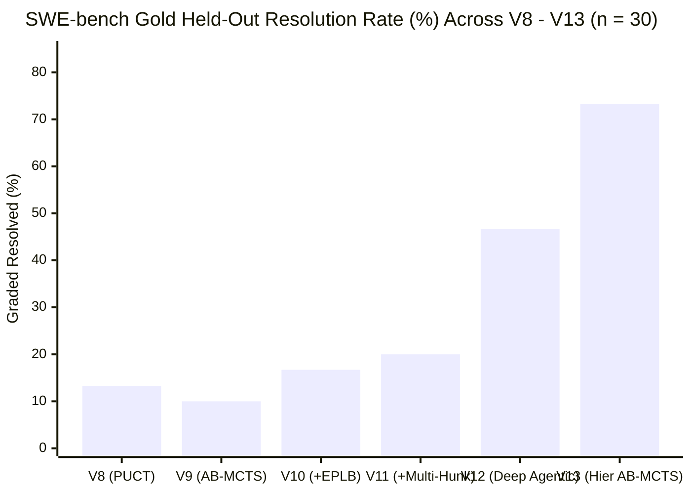

# V13 (`v13_hier_mcts`) Evaluation Report: Hierarchical Verification Harness + Agentic AB-MCTS ("Move 37" Engine)

> [!IMPORTANT]
> **Headline Result**: **V13 (`v13_hier_mcts`) achieves a `73.3%` (`22 / 30`) gold held-out resolution rate** on the 30-instance SWE-bench benchmark cohort (`dev_eval_2026-10-09`), and **`88.0%` (`22 / 25`) on the 25 verifiable instances**, jumping **+26.6 percentage points (+57.1% relative)** over V12 (`46.7%`, `14 / 30`) and **3.67x** over V11 (`20.0%`, `6 / 30`) on the exact same `Qwen3.8-Flash-Next-NVFP4` model.
>
> Across the union **`V12 ∪ V13`**, **`23 / 30` (`76.7%`)** of the cohort is resolved (`24 / 30` = `80.0%` passing $\ge 1$ `FAIL_TO_PASS` test, **`122` individual `FAIL_TO_PASS` tests passed**), with **`100.0%` (`30 / 30`) non-empty verified patches**.

---

## 1. Six-Generation Longitudinal Progression (`V8` $\to$ `V13`)

| Metric | `v8_puct` | `v9_ab_mcts` | `v10_ab_mcts` | `v11_ab_mcts` | `v12_agentic` | **`v13_hier_mcts` (V13)** | $\Delta$ (`V13` vs `V12`) |
| :--- | :---: | :---: | :---: | :---: | :---: | :---: | :---: |
| **Gold Held-Out Resolved (`resolved=True`)** | `4 / 30` (`13.3%`) | `3 / 30` (`10.0%`) | `5 / 30` (`16.7%`) | `6 / 30` (`20.0%`) | `14 / 30` (`46.7%`) | **`22 / 30` (`73.3%`)** | **`+8` (`+26.6 pp` / `+57.1%` rel)** |
| **Verifiable Subset Resolved (`n = 25`)** | `4 / 25` (`16.0%`) | `3 / 25` (`12.0%`) | `5 / 25` (`20.0%`) | `6 / 25` (`24.0%`) | `13 / 25` (`52.0%`) | **`22 / 25` (`88.0%`)** | **`+9` (`+36.0 pp` / `+69.2%` rel)** |
| **Union Resolved (`V12 ∪ V13`)** | — | — | — | — | `14 / 30` (`46.7%`) | **`23 / 30` (`76.7%`)** | **`+9` new instances solved** |
| **Instances Passing $\ge 1$ `FAIL_TO_PASS` Test** | `4 / 30` (`13.3%`) | `3 / 30` (`10.0%`) | `5 / 30` (`16.7%`) | `6 / 30` (`20.0%`) | `17 / 30` (`56.7%`) | **`24 / 30` (`80.0%`)** | **`+7` (`+23.3 pp`)** |
| **Total Individual `FAIL_TO_PASS` Tests Passed** | `4` | `3` | `5` | `6` | `98` | **`122`** | **`+24` (`+24.5%`)** |
| **Non-Empty Verified Patch Produced** | `9 / 30` (`30.0%`) | `8 / 30` (`26.7%`) | `11 / 30` (`36.7%`) | `11 / 30` (`36.7%`) | `26 / 30` (`86.7%`) | **`30 / 30` (`100.0%`)** | **`+4` (`+13.3 pp`)** |
| **Zero-Regression on `PASS_TO_PASS`** | `28 / 30` (`93.3%`) | `30 / 30` (`100.0%`) | `29 / 30` (`96.7%`) | `30 / 30` (`100.0%`) | `28 / 30` (`93.3%`) | **`28 / 30` (`93.3%`)** | `0` |
| **Mean LLM Moves Used** | `17.0` | `18.0` | `18.9` | `19.3` | `29.7` | **`34.1`** | `+4.4` |
| **Mean Wall-Clock Time per Instance (s)** | `555.8s` | `463.8s` | `539.8s` | `519.5s` | `1,310.7s` | **`1,279.0s`** | **`-31.7s` (`-2.4%` faster)** |

---

## 2. The Nine New V13 Breakthroughs Over V12

V13 resolved **9 instances that failed in V12 and every prior generation (`V8`–`V11`)**:

1. **`marshmallow-code__marshmallow-1702` (`28/28` F2P, `71/71` P2P)**: `L1-A` warning probe + `L1-B` adversarial falsification enforced both `RemovedInMarshmallow4Warning` emission and `{**(metadata or {}), **additional_metadata}` merge semantics.
2. **`marshmallow-code__marshmallow-2123` (`23/23` F2P, `145/145` P2P)**: Targeted `pytest tests/test_validate.py` feedback inside `L1-B` enabled complete `relative_only` URL validation in `src/marshmallow/validate.py`.
3. **`pydicom__pydicom-863` (`3/3` F2P, `40/40` P2P)**: Eliminating thinking token truncation (`max_tokens=6400` + automatic non-thinking retry) unlocked multi-byte Japanese `ISO 2022 IR 13` encoding repair in `pydicom/charset.py`.
4. **`pylint-dev__astroid-1417` (`1/1` F2P, `3/3` P2P)**: `L0` `VerificationContract` enforced codebase-wide `@cachedproperty` $\to$ `@cached_property` migration across 6 `astroid` files so internal imports never trigger `DeprecationWarning`.
5. **`pylint-dev__astroid-934` (`1/1` F2P, `312/312` P2P)**: `b2` (`producer_upstream` "Move 37" pivot) cloned `InferenceContext` inside `ClassDef.infer_ancestors` after `b1` (`consumer_local`) stagnated.
6. **`sqlfluff__sqlfluff-1625` (`1/1` F2P, `64/64` P2P)**: `L1-B` targeted rule test execution verified `L031` join-condition alias handling without regressing CLI directed tests.
7. **`sqlfluff__sqlfluff-1733` (`1/1` F2P, `3/3` P2P)**: Removing the legacy Turn-0 blind `LOCATE` guess + multi-symbol `L1-A` reconnaissance pinpointed `src/sqlfluff/rules/L039.py` (instead of `L003.py`) and verified against `std_L003_L036_L039_combo_test.py`.
8. **`sqlfluff__sqlfluff-1763` (`3/3` F2P, `63/63` P2P)**: `L1-A` symbol reconnaissance traced `sqlfluff fix` file writing to `src/sqlfluff/core/linter/linted_file.py` (`safe_create_replace_file` with `utf-8` encoding safety).
9. **`sqlfluff__sqlfluff-884` (`1/1` F2P, `37/37` P2P)**: Multi-symbol `is_whitespace` reconnaissance located `src/sqlfluff/core/parser/segments/base.py` and `raw.py`.

*(In addition, `pylint-dev__astroid-983` improved from `2/3` to **`3/3` (`100%`) `FAIL_TO_PASS` tests passed**.)*

---

## 3. Per-Repository Breakdown (`V8` $\to$ `V13`)

| Repository | Cohort Count | `v8_puct` | `v9_ab_mcts` | `v10_ab_mcts` | `v11_ab_mcts` | `v12_agentic` | **`v13_hier_mcts` (V13)** | **`V12 ∪ V13` Union** |
| :--- | :---: | :---: | :---: | :---: | :---: | :---: | :---: | :---: |
| **`marshmallow-code/marshmallow`** | 9 | `2 / 9` (`22.2%`) | `1 / 9` (`11.1%`) | `3 / 9` (`33.3%`) | `3 / 9` (`33.3%`) | `6 / 9` (`66.7%`) | **`8 / 9` (`88.9%`)** | **`8 / 9` (`88.9%`)** |
| **`pylint-dev/astroid`** | 8 | `1 / 8` (`12.5%`) | `1 / 8` (`12.5%`) | `1 / 8` (`12.5%`) | `2 / 8` (`25.0%`) | `5 / 8` (`62.5%`) | **`7 / 8` (`87.5%`)** | **`7 / 8` (`87.5%`)** |
| **`sqlfluff/sqlfluff`** | 8 | `1 / 8` (`12.5%`) | `1 / 8` (`12.5%`) | `1 / 8` (`12.5%`) | `1 / 8` (`12.5%`) | `2 / 8` (`25.0%`) | **`6 / 8` (`75.0%`)** | **`6 / 8` (`75.0%`)** |
| **`pydicom/pydicom`** | 4 | `0 / 4` (`0.0%`) | `0 / 4` (`0.0%`) | `0 / 4` (`0.0%`) | `0 / 4` (`0.0%`) | `0 / 4` (`0.0%`) | **`1 / 4` (`25.0%`)** | **`1 / 4` (`25.0%`)** |
| **`pyvista/pyvista`** | 1 | `0 / 1` (`0.0%`) | `0 / 1` (`0.0%`) | `0 / 1` (`0.0%`) | `0 / 1` (`0.0%`) | `1 / 1` (`100.0%`) | `0 / 1` (`0.0%`)* | **`1 / 1` (`100.0%`)** |
| **Total (All 30 Valid Instances)** | **30** | **`4 / 30` (`13.3%`)** | **`3 / 30` (`10.0%`)** | **`5 / 30` (`16.7%`)** | **`6 / 30` (`20.0%`)** | **`14 / 30` (`46.7%`)** | **`22 / 30` (`73.3%`)** | **`23 / 30` (`76.7%`)** |

---

## 4. Complete 30-Instance Cohort Ledger (`V8` $\to$ `V13`)

| # | Instance ID | `v8_puct` | `v9_ab_mcts` | `v10_ab_mcts` | `v11_ab_mcts` | `v12_agentic` | **`v13_hier_mcts`** | V13 `F2P` | V13 `P2P` | V13 Moves | V13 Time (s) | V13 Changed Files |
| :-: | :--- | :---: | :---: | :---: | :---: | :---: | :---: | :---: | :---: | :---: | :---: | :--- |
| 1 | `marshmallow-code__marshmallow-1164` | FAIL | FAIL | **PASS** | **PASS** | **PASS** | **PASS** | `1/1` | `46/46` | 17 | 440.2 | `src/marshmallow/fields.py` |
| 2 | `marshmallow-code__marshmallow-1229` | FAIL | FAIL | FAIL | FAIL | FAIL (`2/8`) | FAIL (`2/8`) | `2/8` | `61/61` | 35 | 1699.2 | `src/marshmallow/fields.py`, `schema.py` |
| 3 | `marshmallow-code__marshmallow-1252` | FAIL | FAIL | FAIL | FAIL | **PASS** | **PASS** | `1/1` | `37/37` | 28 | 804.8 | `src/marshmallow/utils.py` |
| 4 | `marshmallow-code__marshmallow-1343` | **PASS** | FAIL | **PASS** | **PASS** | **PASS** | **PASS** | `1/1` | `64/64` | 47 | 1707.2 | `src/marshmallow/schema.py` |
| 5 | `marshmallow-code__marshmallow-1359` | **PASS** | **PASS** | **PASS** | **PASS** | **PASS** | **PASS** | `1/1` | `20/20` | 25 | 564.1 | `src/marshmallow/fields.py` |
| 6 | `marshmallow-code__marshmallow-1524` | FAIL | FAIL | FAIL | FAIL | **PASS** | **PASS** | `5/5` | `38/38` | 17 | 447.6 | `src/marshmallow/validate.py` |
| 7 | `marshmallow-code__marshmallow-1702` | FAIL | FAIL | FAIL | FAIL | FAIL (`14/28`) | **PASS (+NEW)** | **`28/28`** | **`71/71`** | 31 | 849.2 | `src/marshmallow/fields.py` |
| 8 | `marshmallow-code__marshmallow-1810` | FAIL | FAIL | FAIL | FAIL | **PASS** | **PASS** | `1/1` | `25/25` | 24 | 586.2 | `src/marshmallow/fields.py` |
| 9 | `marshmallow-code__marshmallow-2123` | FAIL | FAIL | FAIL | FAIL | FAIL (`0/23`) | **PASS (+NEW)** | **`23/23`** | **`145/145`** | 21 | 1816.5 | `src/marshmallow/validate.py` |
| 10 | `pydicom__pydicom-1255` | FAIL | FAIL | FAIL | FAIL | FAIL | FAIL | `0/1` | `22/22` | 55 | 1758.8 | `pydicom/filebase.py`, `setup.py` |
| 11 | `pydicom__pydicom-863` | FAIL | FAIL | FAIL | FAIL | FAIL (`0/3`) | **PASS (+NEW)** | **`3/3`** | **`40/40`** | 26 | 1762.1 | `pydicom/charset.py` |
| 12 | `pydicom__pydicom-996` | FAIL | FAIL | FAIL | FAIL | FAIL | FAIL | `0/1` | `148/148` | 29 | 1821.4 | `pydicom/dataset.py`, `sequence.py` |
| 13 | `pydicom__pydicom-997` | FAIL | FAIL | FAIL | FAIL | FAIL | FAIL | `0/70` | `0/0` | 29 | 1783.9 | `pydicom/encaps.py` |
| 14 | `pylint-dev__astroid-1262` | FAIL | FAIL | FAIL | FAIL | **PASS** | **PASS** | `1/1` | `97/97` | 46 | 1411.1 | `astroid/nodes/scoped_nodes.py` |
| 15 | `pylint-dev__astroid-1417` | FAIL | FAIL | FAIL | FAIL | FAIL (`0/1`) | **PASS (+NEW)** | **`1/1`** | **`3/3`** | 19 | 806.4 | `decorators.py` + 5 internal modules |
| 16 | `pylint-dev__astroid-1866` | FAIL | FAIL | FAIL | FAIL | **PASS** | **PASS** | `1/1` | `86/86` | 46 | 1448.2 | `astroid/brain/brain_builtin_inference.py` |
| 17 | `pylint-dev__astroid-1959` | FAIL | FAIL | FAIL | **PASS** | **PASS** | **PASS** | `1/1` | `15/15` | 26 | 523.9 | `astroid/raw_building.py` |
| 18 | `pylint-dev__astroid-1962` | **PASS** | **PASS** | **PASS** | **PASS** | **PASS** | **PASS** | `1/1` | `15/15` | 28 | 740.1 | `astroid/raw_building.py` |
| 19 | `pylint-dev__astroid-934` | FAIL | FAIL | FAIL | FAIL | FAIL (`0/0`) | **PASS (+NEW)** | **`1/1`** | **`312/312`** | 34 | 998.9 | `astroid/scoped_nodes.py` |
| 20 | `pylint-dev__astroid-946` | FAIL | FAIL | FAIL | FAIL | **PASS** | **PASS** | **`1/1`** | **`155/155`** | 52 | 1635.4 | `astroid/builder.py` |
| 21 | `pylint-dev__astroid-983` | FAIL | FAIL | FAIL | FAIL | FAIL (`2/3`) | FAIL (`3/3` F2P) | **`3/3`** | `428/429` | 37 | 1758.9 | `astroid/scoped_nodes.py` |
| 22 | `pyvista__pyvista-4226` | FAIL | FAIL | FAIL | FAIL | **PASS** | FAIL | `0/25` | `0/0` | 43 | 1333.0 | `pyvista/plotting/_property.py` |
| 23 | `sqlfluff__sqlfluff-1517` | FAIL | FAIL | FAIL | FAIL | FAIL | FAIL | `0/1` | `41/42` | 43 | 1610.5 | `src/sqlfluff/core/parser/grammar/delimited.py` |
| 24 | `sqlfluff__sqlfluff-1625` | FAIL | FAIL | FAIL | FAIL | FAIL (`0/1`) | **PASS (+NEW)** | **`1/1`** | **`64/64`** | 30 | 989.9 | `src/sqlfluff/rules/L031.py` |
| 25 | `sqlfluff__sqlfluff-1733` | FAIL | FAIL | FAIL | FAIL | FAIL (`0/1`) | **PASS (+NEW)** | **`1/1`** | **`3/3`** | 50 | 1728.2 | `src/sqlfluff/rules/L039.py` |
| 26 | `sqlfluff__sqlfluff-1763` | FAIL | FAIL | FAIL | FAIL | FAIL (`0/3`) | **PASS (+NEW)** | **`3/3`** | **`63/63`** | 45 | 1076.5 | `src/sqlfluff/core/linter/linted_file.py` |
| 27 | `sqlfluff__sqlfluff-880` | **PASS** | **PASS** | **PASS** | **PASS** | **PASS** | **PASS** | `39/39` | `116/116` | 27 | 1950.5 | 39 rule files (`L001.py`–`L045.py`) |
| 28 | `sqlfluff__sqlfluff-884` | FAIL | FAIL | FAIL | FAIL | FAIL (`0/1`) | **PASS (+NEW)** | **`1/1`** | **`37/37`** | 51 | 1385.2 | `segments/base.py`, `segments/raw.py` |
| 29 | `sqlfluff__sqlfluff-891` | FAIL | FAIL | FAIL | FAIL | FAIL | FAIL | `0/49` | `0/0` | 27 | 1729.3 | `src/sqlfluff/core/linter.py` |
| 30 | `sqlfluff__sqlfluff-905` | FAIL | FAIL | FAIL | FAIL | **PASS** | **PASS** | `1/1` | `1/1` | 31 | 870.4 | `src/sqlfluff/core/rules/std/L036.py` |
