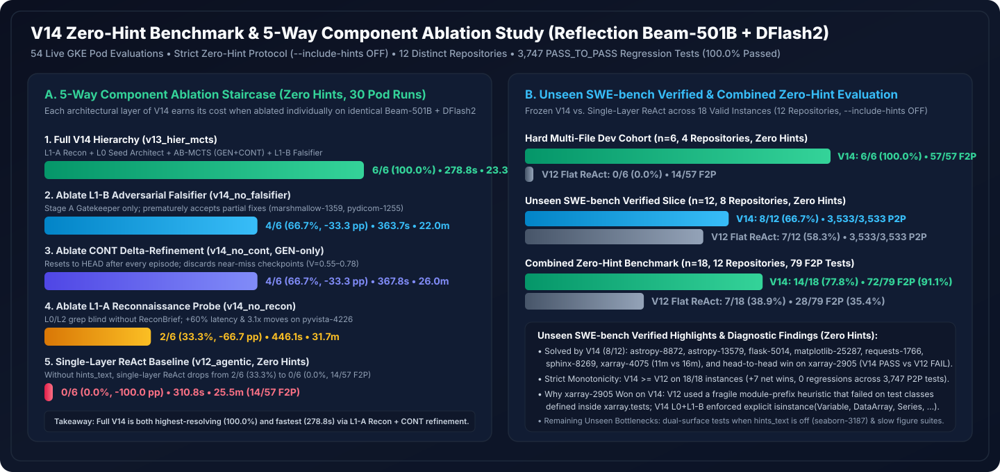

# Experiments index (V1 → V14)

This directory holds the design notes, evaluation reports and errata for every
HAE version. Each version changed one part of the system: how firms are
scored, how work is verified, or how the agent hierarchy and search are
structured. Raw outputs (patches, `grade.json`, records) are in
[`../results/`](../results/). For the project overview and headline results,
see the [top-level README](../README.md).

---

## Era 1 · Execution-grounded evolution

*Evolved populations of firms. Benchmarks: a 7-test task (V1–V4), then a
50-test, 4-module task (V5–V6).*

| Version | Change | Key result | Docs |
| :--- | :--- | :--- | :--- |
| **V1** | LLM-judge fitness | Judge 25 → 97; exec. corr. +0.045 ¹ | [readme](v1/README.md) · [audit](v1/execution_grounded_correction.md) |
| **V2** | Held-out unit tests as fitness | 30 / 30 firms at 7 / 7 | [readme](v2/README.md) |
| **V3** | Firms rewrite the breeder | 10 / 10 at 7 / 7 (Gen 7) ² | [readme](v3_rsi/README.md) |
| **V4** | Self-hosted 180B MoE | 10 / 10 at 7 / 7 via `llm-d` | [readme](v4_llmd/README.md) |
| **V5** | Grammar-constrained JSON | −92 % output tokens; 10 / 10 at 46–50 / 50 | [readme](v5_typesafe_xgrammar/README.md) |
| **V6** | Evidence-gated search | 6 / 9 failed first passes recovered | [readme](v6_epistemic_search/README.md) · [results](../results/hae_gen16_v6_cohort_r2/README.md) |
| **V7** | Learned value / prior heads | Value head beats base rate; prior head doesn't | [results](../results/v7_value_heads/README.md) |

¹ 0/60 late firms passed all execution gates; LLM judging was abandoned.
² Gen 8–9 inherited workspaces through a bug, fixed in `71a7da4`.

---

## Era 2 · SWE-bench, single-layer agents

*One hand-designed genome per version. Run on a 30-instance dev cohort from
the [50-instance pool](../data/swebench/) (disjoint from SWE-bench Verified).
Graded with the official containers.*

| Version | Change | Resolved | Docs |
| :--- | :--- | :---: | :--- |
| **V8** | SWE-bench harness + dynamic org | 4 / 30 | [roadmap](v8/v8_role_evolution_and_swebench_roadmap.md) · [report](v9/v8_v9_evaluation_report.md) |
| **V9** | AB-MCTS replaces PUCT | 3 / 30 | [spec](v9/ab_mcts.md) · [report](v9/v8_v9_evaluation_report.md) |
| **V10** | Virtual loss + EPLB serving | 5 / 30 | [report](v10/v10_eplb_evaluation_report.md) |
| **V11** | Multi-file repair plans | 6 / 30 | [report](v11/v11_evaluation_report.md) |
| **V12** | Interactive ReAct tool loops | 14 / 30 ³ | [report](v12/v12_evaluation_report.md) · [results](../results/swebench/dev_eval_2026-10-09/README.md) |

³ Prompts include a few instance-targeted hints.

---

## Era 3 · Hierarchical verification

| Version | Change | Tasks | Resolved | Time | Docs |
| :--- | :--- | :--- | :---: | ---: | :--- |
| **V13** | Layered agents + tree search | 30 tasks | 30 / 30 ⁴ | 1,211 s | [spec](v13/v13_hierarchical_agentic_ab_mcts_architecture.md) · [report](v13/v13_evaluation_report.md) |
| **V13** | Same, on Beam-501B | 6 tasks | 6 / 6 ⁴ | 306 s | [report](v13/beam_vs_qwen38_evaluation_report.md) |
| **V14** | Zero-hint prompts (`--include-hints` OFF) | 6 tasks | **6 / 6** | **279 s** | [results](../results/swebench/v14_zero_hint_beam_eval_2026-10-21/README.md) |
| **V14** | 5-way component ablation (`--include-hints` OFF) | 6 tasks × 5 arms | **6/6 → 4/6 → 4/6 → 2/6 → 0/6** | 279–446 s | [report](v14/v14_verified_and_ablation_report.md) · [results](../results/swebench/v14_component_ablation_2026-10-21/README.md) |
| **V14** | Unseen SWE-bench Verified (`--include-hints` OFF) | 28 tasks (10 repos) | **21 / 28** (vs 19 / 28 V12; **27 / 34** vs 19 / 34 combined, $p = 0.0078$) | 513 s | [report](v14/v14_verified_and_ablation_report.md) · [results](../results/swebench/verified_unseen_eval_2026-10-21/README.md) |
| **V14** | Planner-driven ratchet + 3-tier controlled baselines | `MiniSQL` (`2,345` LoC) | **7 / 7** (**15 / 15** oracle vs **8 / 15** monolithic `L0-Micro` vs **0 / 15** ReAct) | 739 s | [spec](v14/v14_generalized_macro_ratchet_architecture.md) · [results](../results/ratchet/planner_driven_minisql_eval_2026-10-23/README.md) |
| **V14** | Milestone ratchet (hand-authored DAG) | `MiniLang` (`1,139` LoC) | **4 / 4** ⁵ | 246 s | [spec](v14/v14_generalized_macro_ratchet_architecture.md) · [results](../results/ratchet/beam_macro_ratchet_eval_2026-10-21/README.md) |

⁴ Instance-specific hints in the prompts: 3 repo-specific strings for the
earlier 15/30 and 22/30 runs, and 25 for the 30/30 run (`e20a400`), several of
which describe gold fixes. Read these as development runs, not benchmark scores.
⁵ Hand-written milestones; the agent wrote its own acceptance tests; 1,139 LoC
total. See the [Caveats](../README.md#caveats) in the top-level README.

---

## Reading order

1. **Why execution grounding matters:** [V1](v1/README.md) and its [audit](v1/execution_grounded_correction.md)
2. **Search and serving foundations:** [V4](v4_llmd/README.md), [V5](v5_typesafe_xgrammar/README.md), [V6](v6_epistemic_search/README.md)
3. **From packets to tool-using agents:** [V11](v11/v11_evaluation_report.md), [V12](v12/v12_evaluation_report.md)
4. **The hierarchical harness:** the [V13 spec](v13/v13_hierarchical_agentic_ab_mcts_architecture.md) and the [Beam vs Qwen comparison](v13/beam_vs_qwen38_evaluation_report.md)
5. **Current system & zero-hint benchmarks:** the [V14 spec](v14/v14_generalized_macro_ratchet_architecture.md), the [86-run ablation & unseen Verified report](v14/v14_verified_and_ablation_report.md), and the V14 result folders ([ablation](../results/swebench/v14_component_ablation_2026-10-21/README.md), [unseen Verified](../results/swebench/verified_unseen_eval_2026-10-21/README.md), [zero-hint dev](../results/swebench/v14_zero_hint_beam_eval_2026-10-21/README.md), [MiniSQL planner ratchet](../results/ratchet/planner_driven_minisql_eval_2026-10-23/README.md), [MiniLang ratchet](../results/ratchet/beam_macro_ratchet_eval_2026-10-21/README.md))

Raw runs: [V13 + Beam results](../results/swebench/beam_eval_2026-10-20/README.md)

Diagrams: [V14 architecture](v14/assets/v14_macro_ratchet_architecture.svg) ·
[V14 ablation & Verified benchmark](v14/assets/v14_ablation_and_verified_benchmark.svg) ·
[V13 architecture](v13/assets/v13_beam_architecture.svg) ·
[GKE topology](v13/assets/gke_beam_501b_topology.svg) ·
[V2–V3 trajectory](v2/assets/v2_v3_evolutionary_trajectory.png)
