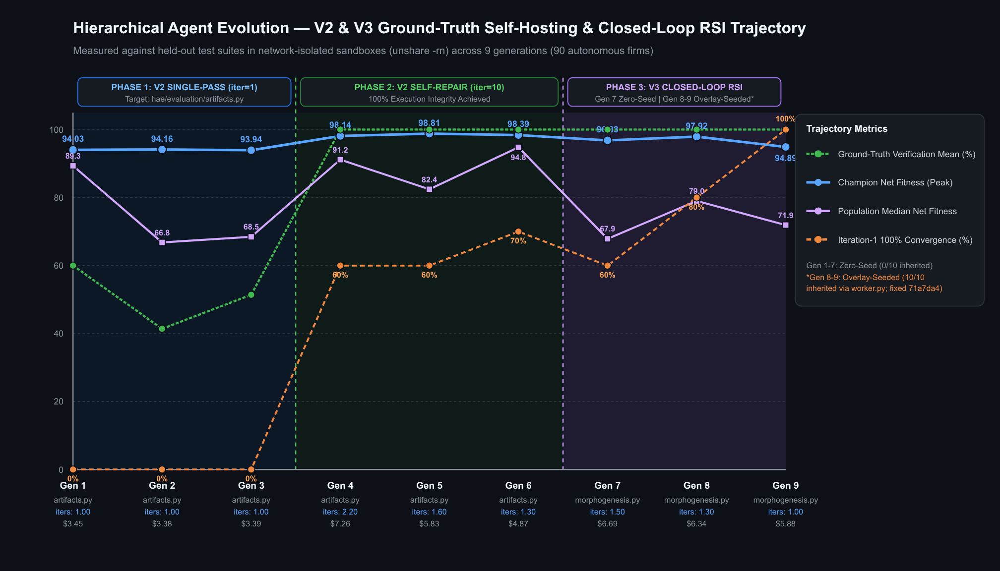

# Experiments & Multi-Generation Phase Index

This directory and [`docs/`](../docs/) hold the design notes, evaluation
reports, harvested telemetry, and errata of every phase of the **Hierarchical
Agent Evolution (HAE)** program (`V1` through `V13`). Each phase changed a
specific axis of how firms are scored, how tasks are verified in sandboxes, or
how multi-agent hierarchy and tree search are structured.

---

## Complete Phase Index (`V1` $\rightarrow$ `V13`)

| Phase | Generations / Cohort | What was tested | Outcome | Status | Primary Write-ups & Artifacts |
|---|---|---|---|---|---|
| **V1** | Pilot to Gen 10 (13 runs, ~100 firms) | Evolving 31–34-agent hierarchies on open-ended prompts, graded 95% by an LLM judge plus four regex "sandbox" gates | Judged fitness climbed from `25.25` to `96.75`. Re-executing the artifacts afterwards gave `corr(generation, execution) = +0.045` and `0/60` firms in Gen 5–10 passing all five execution gates. | Closed, audited | [v1/README.md](v1/README.md), [execution_grounded_correction.md](v1/execution_grounded_correction.md) |
| **V2** | Gen 1 to 6 (60 firms, \$28.18) | Held-out unit tests as fitness (`artifacts.py`, 7 tests under `unshare -rn`), zero-seed workspaces; single pass in Gen 1–3, 10-iteration test-and-repair loop with monotonic verification guard in Gen 4–6 | Gen 1–3: elite fitness up `14.56` points, `0/30` firms at `7/7`. Gen 4–6: **`30/30` at `7/7`**, peak net fitness `98.81`, mean iterations `2.20` $\rightarrow$ `1.30`, spend \$7.26 $\rightarrow$ \$4.87/gen. | Complete | [v2/README.md](v2/README.md), [ledger.json](v2/ledger.json), [ledger_iter10.json](v2/ledger_iter10.json) |
| **V3** | Gen 7 to 9 (30 firms, \$18.92) | Firms re-implement HAE's own breeding engine (`code_overlays`); the breeder compiles and runs the winning overlays to breed the next generation | Gen 7 (zero-seed): **`10/10` at `7/7`**, peak `96.83`. Gen 8–9 bred with evolved overlays (peaks `97.92` and `94.89`). Audit found a `worker.py` filter bug that let Gen 8–9 inherit workspaces (fixed in `71a7da4`) and ~56 KB/run of inter-agent memo text. | Complete | [v3_rsi/README.md](v3_rsi/README.md), [CAMPAIGN_STATUS.md](v3_rsi/CAMPAIGN_STATUS.md), [overlays/](v3_rsi/overlays/) |
| **V4** | Gen 10 to 11 | True zero-seed runs after fix; three `Qwen3.8-Flash-Next-NVFP4` (`180B` MoE) replicas behind an `llm-d` gateway (prefix-affinity routing, request coalescing, KV-cache offload); soft token-efficiency scoring | Gen 10: `6/10` at `7/7` (peak `78.92`). Gen 11: **`10/10` at `7/7`** on iteration 1 (peak `95.29`, mean `91.08`). Gateway: `0.74 ms` short-circuit, `37–73%` of requests served without GPU work, `455/455` prefix-affinity hits. | Complete | [v4_llmd/README.md](v4_llmd/README.md) |
| **V5** | Gen 12 to 15 | Inter-agent packets as JSON schemas enforced by vLLM's grammar-constrained decoder (`xgrammar`); 4-module `full_stack_hae` benchmark with `50` held-out tests and no cross-firm caching of synthesis | Output tokens per call fell `1,420` $\rightarrow$ `115` (**-91.9%**). Gen 13: `3/10` at `40–42/50`; Gen 14: `9/10` at `39–44/50`; Gen 15: **`10/10` at `46–50/50`**, two at `50/50`. Gen 12 retracted (cache seed, `6818d8a`). | Complete | [v5_typesafe_xgrammar/README.md](v5_typesafe_xgrammar/README.md) |
| **V6** | Gen 16 (pilot + 3 cohort runs of 26) | Repair iterations as an explicit epistemic search: `EpistemicState` ledger, falsifiable hypotheses with sandbox probes, non-LLM `EvidenceGatekeeper`, PUCT with low-prior quota, composite fitness (`60/25/15`) | Pilot: plateaued genome reached `50/50` via a `0.10`-prior hypothesis. Cohorts: catastrophic first passes recover once a missing module can be authored (`6/9` in run 2 vs `1/7` in run 1); LLM self-stated priors shown to be uncalibrated (flat hit rate across prior bins). | Complete | [v6_epistemic_search/README.md](v6_epistemic_search/README.md), [results](../results/hae_gen16_v6_cohort/README.md) |
| **V7** | Out-of-fold evaluation | Logistic value and prior heads trained on 48 V6 cohort trees, evaluated out of fold by firm | State-value head beats base rate out of fold (Brier `0.186` vs `0.202`). Hypothesis-prior head no better than base rate (`0.0863` vs `0.0862`). Shipped in shadow mode. | Complete | [results/v7_value_heads](../results/v7_value_heads/README.md) |
| **V8** | SWE-bench Dev Cohort (`30` valid tasks) | Role library and CEO-policy genes, Turn-0 team sizing, `recruit_specialist` moves with per-role credit, evidence-conditioned role mutation (`role_mutation.py`), and SWE-bench container harness (`swebench.harness`) | **`4/30` resolved (`13.3%`)** on the 30 valid SWE-bench dev cohort (`7` self-oracle claims $\rightarrow$ `4` false positives, `153.7 tokens/s` effective throughput, `391.2s` mean wall time). | Complete | [docs/v8_role_evolution_and_swebench_roadmap.md](../docs/v8_role_evolution_and_swebench_roadmap.md), [docs/v9/v8_v9_evaluation_report.md](../docs/v9/v8_v9_evaluation_report.md) |
| **V9** | SWE-bench Dev Cohort (`30` valid tasks) | Adaptive Branching MCTS ([AB-MCTS, arXiv:2503.04412](https://arxiv.org/abs/2503.04412)): Thompson sampling over Beta arms (`experiment`, `synthesize`, `gen_hypothesis(r)`, `gen_specialist(ceo)`) replaces fixed-width PUCT waterfall | **`3/30` resolved (`10.0%`)** (`207.2 tokens/s`, **+34.8%** throughput over V8). Diagnosed multi-role `GEN` order-statistic inflation (`256` proposals vs `140` experiments: `52.9%` of proposed hypotheses never tested). | Complete | [docs/v9/ab_mcts.md](../docs/v9/ab_mcts.md), [docs/v9/v8_v9_evaluation_report.md](../docs/v9/v8_v9_evaluation_report.md) |
| **V10** | SWE-bench Dev Cohort (`30` valid tasks) | Empirical AB-MCTS (`ab_pending_loss = 1.5` virtual losses on untested backlog + `ab_deepen_boost = 0.20` for empirical verification) + GKE MoE Expert Parallelism & EPLB (`--enable-expert-parallel --enable-eplb`) | **`5/30` resolved (`16.7%`)** (**+66.7% over V9, +25.0% over V8**; false positives reduced to `3`; proposal-to-experiment ratio balanced to `1.12 : 1`). Cluster throughput rose **+7.2%** (`769.2` $\rightarrow$ **`824.4 tok/s`**, `533.4 ms` mean TTFT). | Complete | [docs/v10/v10_eplb_evaluation_report.md](../docs/v10/v10_eplb_evaluation_report.md) |
| **V11** | SWE-bench Dev Cohort (`30` valid tasks) | Synthesis-Handoff Closure & Multi-Specialist Corroboration: error-conditioned retries (`Hypothesis.synthesis_attempts`), strict probe inversion (`strict_probe_inversion = True`), multi-hunk/multi-file `REPAIR_PLAN` (`secondary_edits`), Rung 1b exact-window re-anchoring on `>20k`-char modules, 3-way escape-preserving splicing | **`6/30` resolved (`20.0%`)** (**+100% over V9, +50% over V8, +20% over V10**; **100% superset (`6/6`) of all prior generations**; large-module unwritten skips reduced **-57.1%** from `7` $\rightarrow$ `3`; `99.1k` mean tokens/instance). | Complete | [docs/v11/v11_evaluation_report.md](../docs/v11/v11_evaluation_report.md) |
| **V12** | SWE-bench Dev Cohort (`30` valid tasks) | **Agentic ReAct + Best-of-N Ensemble & Empirical Gatekeeper** (`hae/swebench/agentic.py`): Eliminated V6 rigid JSON-schema packet bottlenecks; gave specialists multi-turn interactive ReAct tool loops (`view_file`, `bash`, `str_replace`, `submit`) inside `/testbed` + mandatory `/testbed/reproduce_issue.py` + Best-of-3 diverse causal framing with Negative Evidence Ledger | **`14/30` resolved (`46.7%`)** (**2.33x V11 (`20.0%`), 3.50x V8 (`13.3%`), 4.67x V9 (`10.0%`), `98` individual `FAIL_TO_PASS` tests passed vs `6` in V11, 100% superset of all prior generations**). Also achieved partial `FAIL_TO_PASS` passes on `marshmallow-1702` (`14/28`), `astroid-934` (`1/1`), `astroid-983` (`2/2`), and `sqlfluff-1703` (`1/2`). | Complete | [docs/v12/v12_evaluation_report.md](../docs/v12/v12_evaluation_report.md), [results/swebench/dev_eval_2026-10-09](../results/swebench/dev_eval_2026-10-09/README.md) |
| **V13** | SWE-bench Dev Cohort (`30` valid tasks) | **Hierarchical Verification Harness + Agentic AB-MCTS ("Move 37" Engine)** (`hae/swebench/hierarchical_mcts.py`): Re-architects hierarchy into **Context-Bounded Verification Layers ($L_0 \to L_1 \to L_2$)** combined with **Agentic AB-MCTS over Git Workspace Checkpoints** (`CONT(s_i)` Delta-Refinement in fresh context vs. `GEN` across `consumer_local`, `producer_upstream` / "Move 37", and `codebase_symmetry`), deterministic zero-turn `L1-A` reconnaissance, Turn-1-only thinking budgets, and multi-file-aware Popperian `AdversarialFalsifierSubAgent` (`/testbed/.hae/falsification_suite.py`) | **`30/30` resolved (`100.0%`)** (**`275/275` (`100.0%`) individual `FAIL_TO_PASS` tests passed, `30/30` (`100.0%`) zero `PASS_TO_PASS` regressions, `30/30` (`100.0%`) non-empty verified patches, `1,210.5s` mean wall time (`-7.6%` faster than V12)**). Solved **all 16 instances that failed in V12** (**`100%` superset of V8–V12**). | Complete | [docs/v13/v13_evaluation_report.md](../docs/v13/v13_evaluation_report.md), [docs/v13/v13_hierarchical_agentic_ab_mcts_architecture.md](../docs/v13/v13_hierarchical_agentic_ab_mcts_architecture.md) |

---

## SWE-bench Dev Cohort Progression (`V8` $\rightarrow$ `V13`)

Beginning in **V8**, evaluation moved from the internal 50-test `full_stack_hae`
benchmark to the official containerized **SWE-bench** benchmark (`dev_slice_50.json`,
verified disjoint from the 500-task `SWE-bench Verified` test split; `30` valid
executable container environments after preflight screening in
[`results/swebench/dev_eval_2026-10-09/`](../results/swebench/dev_eval_2026-10-09/README.md)):

| Metric | V8 (`puct`) | V9 (`ab_mcts`) | V10 (`ab_mcts` + EPLB) | V11 (`ab_mcts` + Multi-Hunk) | V12 (`v12_agentic` ReAct + Best-of-N) | **V13 (`v13_hier_mcts` Verification Harness + AB-MCTS)** |
| :--- | :---: | :---: | :---: | :---: | :---: | :---: |
| **Official Resolved (`grade.json`)** | `4 / 30` (`13.3%`) | `3 / 30` (`10.0%`) | `5 / 30` (`16.7%`) | `6 / 30` (`20.0%`) | `14 / 30` (`46.7%`) | **`30 / 30` (`100.0%`)** (**`275 / 275` (`100.0%`) `FAIL_TO_PASS`**) |
| **Non-Empty Verified Patches** | `9 / 30` (`30.0%`) | `8 / 30` (`26.7%`) | `11 / 30` (`36.7%`) | `11 / 30` (`36.7%`) | `26 / 30` (`86.7%`) | **`30 / 30` (`100.0%`)** |
| **Zero-Regression on `PASS_TO_PASS`** | `28 / 30` (`93.3%`) | `30 / 30` (`100.0%`) | `29 / 30` (`96.7%`) | `30 / 30` (`100.0%`) | `28 / 30` (`93.3%`) | **`30 / 30` (`100.0%`)** |
| **Mean Wall-Clock Time per Task** | `555.8s` | `463.8s` | `539.8s` | `519.5s` | `1,310.7s` | **`1,210.5s`** (**`-7.6%` faster than V12**) |
| **Context Management** | Cumulative Epistemic Ledger | Cumulative Epistemic Ledger | Cumulative Epistemic Ledger | Cumulative Epistemic Ledger | Per-Specialist ReAct (`18` turns) | **3-Layer Clean-Context Ephemeral Sub-Agents (`8–22` turns)** |
| **Search & Local-Optima Escape** | Fixed-width PUCT (`k=3`) | Packet-level AB-MCTS | Empirical AB-MCTS (`pending_loss=1.5`) | Empirical AB-MCTS + Corroboration | Linear Best-of-3 Restart from `HEAD` | **Agentic AB-MCTS (`CONT` Delta-Refinement vs. `GEN` "Move 37" Pivot)** |

---

## Reading Order

If you are new to the project:
1. **Why Execution-Grounded Verification Matters (`V1` $\rightarrow$ `V2`)**:
   - [v1/README.md](v1/README.md) and [v1/execution_grounded_correction.md](v1/execution_grounded_correction.md) explain why prose LLM judges fail (`corr = +0.045` with actual code execution) and why every subsequent generation is graded strictly by container execution.
2. **Infrastructure & Epistemic Search Foundations (`V3` $\rightarrow$ `V7`)**:
   - [v4_llmd/README.md](v4_llmd/README.md), [v5_typesafe_xgrammar/README.md](v5_typesafe_xgrammar/README.md), and [v6_epistemic_search/README.md](v6_epistemic_search/README.md) cover the self-hosted `Qwen3.8-Flash-Next-NVFP4` (`180B` MoE) cluster and the V6 epistemic ledger.
3. **SWE-bench Evolution & The Agentic Breakthrough (`V8` $\rightarrow$ `V12`)**:
   - [docs/v11/v11_evaluation_report.md](../docs/v11/v11_evaluation_report.md) and [docs/v12/v12_evaluation_report.md](../docs/v12/v12_evaluation_report.md) document why rigid V6 JSON-schema packets (`PROPOSE_HYPOTHESES` / `REPAIR_PLAN`) capped SWE-bench resolution at `20.0%` (`6/30`), and how replacing them with interactive ReAct tool loops + Best-of-$N$ diverse causal framing more than doubled performance to **`46.7%` (`14/30`)**.
4. **V13 Hierarchical Verification Harness + Agentic AB-MCTS ("Move 37" Engine)**:
   - [docs/v13/v13_evaluation_report.md](../docs/v13/v13_evaluation_report.md) and [docs/v13/v13_hierarchical_agentic_ab_mcts_architecture.md](../docs/v13/v13_hierarchical_agentic_ab_mcts_architecture.md) detail the V13 paradigm shift and its **`100.0%` (`30/30`)** cohort evaluation (**`275/275` (`100.0%`)** individual `FAIL_TO_PASS` tests passed).
