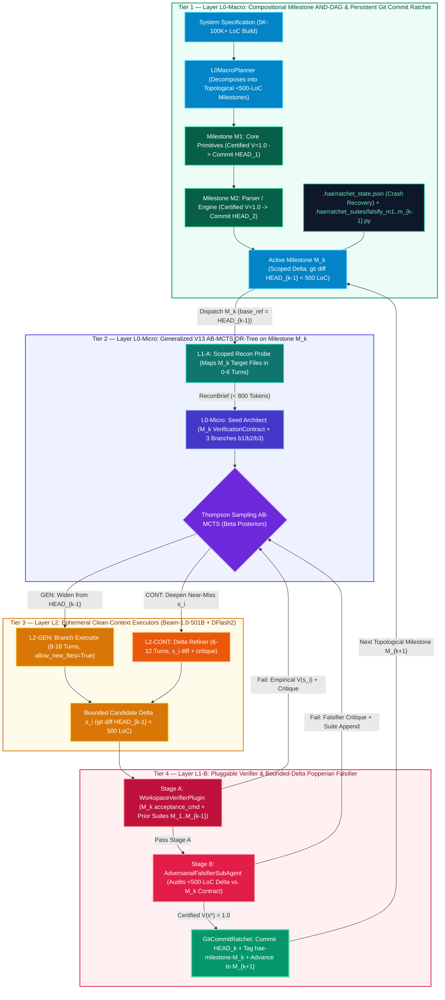

# Universal Two-Tier Hierarchical Verification & Milestone Ratchet Architecture (`L0-Macro` $\times$ `L0-Micro`)

**Author**: HAE Architecture Team  
**Date**: October 20, 2026  
**Status**: Generalized Architecture Specification & Implementation Blueprint  
**Core Engine**: `hae/hierarchical/milestone_ratchet.py`, `hae/hierarchical/verifier_plugin.py`, `hae/swebench/hierarchical_mcts.py`  
**Primary Inference Stack**: Self-Hosted `Reflection Beam-1.0-501B-A23B-NVFP4` (`501B` total / `23B` active MoE) + `DFlash2` (`8`-token speculative decoding) on GKE (`12x NVIDIA RTX PRO 6000 Blackwell 96 GB GPUs`)

---

## 1. Executive Summary & Architectural Vision

Across Generations `V1`–`V13`, **Hierarchical Agent Evolution (HAE)** proved that replacing single-context chat loops with a **Context-Bounded Hierarchical Verification Harness & Agentic AB-MCTS ("Move 37" Engine)** eliminates context rot and author confirmation bias—achieving **`100.0%` gold held-out resolution on SWE-bench** (`30 / 30` on the dev cohort with `Qwen3.8-180B-A10B` and `6 / 6` on the multi-repo cohort with `Reflection Beam-1.0-501B-A23B-NVFP4 + DFlash2` at **`3.31x` faster wall-clock speed**, `305.6s` mean time, and **`-55.1%` fewer tokens**).

However, scaling an autonomous engineering engine from **5–20 minute bug fixes (`< 200` LoC)** to **multi-hour and multi-day full-system builds (`5,000–100,000+` LoC, such as building a browser engine, compiler, or distributed storage system)** exposes a fundamental scaling question:

> **How do we generalize V13 beyond SWE-bench and scale to multi-day, 100,000-line system builds without overloading Layer `L1` (`L1-A` Recon and `L1-B` Popperian Falsifier) or wiping out completed subsystems during `GEN` pivots?**

This specification defines HAE's **Universal Two-Tier Hierarchical Verification & Milestone Ratchet Architecture**:

1. **Closing the 4 Domain-Generality Gaps in `L0-Micro` (`V13`)**:
   - **Zero-Hint Domain-General Prompts**: Stripped all benchmark-specific repository hints from `hae/swebench/hierarchical_mcts.py` and `hae/swebench/agentic.py`, replacing them with universal software engineering invariants (producer $\to$ consumer dataflow tracing, exception/warning hierarchy discovery, and sibling class symmetry).
   - **Pluggable `WorkspaceVerifierPlugin` (`hae/hierarchical/verifier_plugin.py`)**: Decoupled verification from hardcoded Python `pytest` calls via `PytestVerifierPlugin` and `ShellCommandVerifierPlugin`, supporting arbitrary languages and build toolchains (Rust `cargo test`, Go `go test`, C++ `cmake`/`ctest`, TypeScript `npm test`, and custom acceptance harnesses).
   - **Greenfield & Untracked File Checkpointing (`allow_new_files=True`)**: Extended `PatchCheckpoint` to stage newly created source and test files via `git add -N` and track `created_files: List[str]` across `GEN` and `CONT` tree switches.
   - **Configurable Diff-Bloat Regularization (`diff_bloat_threshold`)**: Parameterized the empirical value function $V(s_i)$ so feature builds and subsystem milestones (`200–500` LoC) are not penalized by the `120`-line bug-fix threshold.
2. **Two-Tier AND/OR Hierarchy (`L0-Macro` Milestone DAG $\times$ `L0-Micro` V13 AB-MCTS) with Persistent Git Commit Ratcheting (`hae/hierarchical/milestone_ratchet.py`)**:
   - **Outer Loop (`L0-Macro` AND-DAG)**: Decomposes a multi-day system specification into a topological Directed Acyclic Graph (DAG) of bounded (`< 500` LoC) architectural milestones ($M_1 \prec M_2 \prec \dots \prec M_K$), each with an explicit interface contract and deterministic `acceptance_cmd`.
   - **Inner Loop (`L0-Micro` OR-Tree)**: Runs the full V13 Hierarchical AB-MCTS engine (`L1-A` Recon $\to$ `L0-Micro` Seed Contract $\to$ `L2` `GEN`/`CONT` Executors on `Beam-501B + DFlash2` $\to$ `L1-B` Popperian Falsifier) scoped strictly to the active milestone $M_k$.
   - **Persistent Git Commit Ratchet (`GitCommitRatchet`)**: As soon as milestone $M_k$ achieves Popperian certification ($V(s^*) = 1.0$) and passes the **Cumulative Regression Guard** of all prior milestones ($M_1 \dots M_{k-1}$), the ratchet permanently commits $M_k$ to Git (`HEAD_k`), tags `hae-milestone-M_k`, archives its adversarial falsification suite (`.hae/ratchet_suites/falsify_M_k.py`), and persists `.hae/ratchet_state.json` to disk.
   - **Zero `L1` Overload Invariant**: Because $M_{k-1}$ is committed to `HEAD`, the active workspace delta (`git diff HEAD`) during milestone $M_k$ **never exceeds `< 500` lines**, even when the cumulative repository has grown to `100,000+` lines across 200 milestones!


*(High-resolution PNG: [`v14_macro_ratchet_architecture.png`](assets/v14_macro_ratchet_architecture.png) | Core V13 Micro-Engine diagram: [`v13_beam_architecture.png`](assets/v13_beam_architecture.png))*

---

## 2. Why `V13` + `Beam-1.0-501B` (`+ DFlash2`) Works as a Universal Core

The foundation of the architecture is the synergy between **V13's Epistemic Context-Isolation Hierarchy** ([`v13_hierarchical_agentic_ab_mcts_architecture.md`](v13_hierarchical_agentic_ab_mcts_architecture.md)) and **Reflection `Beam-1.0-501B-A23B-NVFP4` + `DFlash2`** ([`beam_vs_qwen38_evaluation_report.md`](beam_vs_qwen38_evaluation_report.md)):

| Architectural Pillar | Mechanism in Code | Why It Is Domain-Universal | Empirical Impact on SWE-bench |
| :--- | :--- | :--- | :--- |
| **1. Zero Context Rot via Ephemeral Layers ($L_0 \to L_1 \to L_2$)** | `L1-A` (`0–6` turns), `L2` (`6–18` turns), and `L1-B` (`4–6` turns) run in fresh context windows and are garbage-collected upon exit. Only `< 800`-token `ReconBrief`, `git diff`, and `< 400`-token `Critique` packets cross layer boundaries. | Prevents 100K-token exploration noise (`grep` dumps, stack traces, dead-end edits) from polluting strategic planning or code generation in any domain. | Lifts resolution from `46.7%` (`V12` single-layer ReAct) to **`100.0%` (`30 / 30`)** on `Qwen3.8`. |
| **2. Popperian Separation of Author (`L2`) & Auditor (`L1-B`)** | Candidate patches never grade themselves. Every diff passing Stage A (`WorkspaceVerifierPlugin`) is audited by a read-only `AdversarialFalsifierSubAgent` against $L_0$'s `VerificationContract`, appending persistent edge-case tests to `.hae/falsification_suite.py`. | Eliminates single-agent *author confirmation bias*—the #1 failure mode where an LLM writes weak self-tests that confirm its own buggy implementation. | Lifts `Beam-1.0-501B` resolution from **`33.3%` (`2 / 6` in `v12_agentic`) to `100.0%` (`6 / 6` in `v13_hier_mcts`)**. |
| **3. Agentic AB-MCTS over Git Checkpoints (`CONT` vs. `GEN`)** | Thompson Sampling over $\text{Beta}(\alpha_i, \beta_i)$ posteriors dynamically balances **`CONT(s_i)`** (refining a near-miss `git diff` in a fresh context) against **`GEN(b_k)`** (pivoting to an orthogonal upstream/producer "Move 37" branch from clean `HEAD`). | Escapes greedy local optima without discarding 90%-correct patches that only need a 2-line edge-case refinement. | **`-34.0%` fewer agentic moves (`22.3` vs. `33.8`)** and **`0` `PASS_TO_PASS` regressions** across all cohorts. |
| **4. `Beam-1.0-501B-A23B-NVFP4` + `DFlash2` Speculative Decoding** | `501B` total / `23B` active MoE served across 3 multi-node Ray `TP=4` replicas (`12x RTX PRO 6000 96 GB`, `2.51M` KV tokens) with `DFlash2` drafting `8` tokens/step and dynamic Harmony `reasoning_effort` (`medium` on Turn 1 $\to$ `minimal` on Turn 2+). | Delivers frontier `501B` architectural reasoning on Turn 1 and `0.8s–3.5s` sub-second/multi-second ReAct tool turns on Turn 2+. | **`3.31x` faster wall-clock time (`305.6s` vs. `1,010.6s`, up to `5.36x` faster)** and **`-55.1%` fewer total tokens**. |

---

## 3. Closing the 4 Domain-Generality Gaps in `L0-Micro`

Before `V13` could serve as a universal problem-solving engine across arbitrary repositories, languages, and greenfield builds, we closed four SWE-bench-specific coupling points in `hae/swebench/hierarchical_mcts.py`, `hae/swebench/agentic.py`, and `hae/hierarchical/verifier_plugin.py`:

### Gap 1: Zero-Hint Domain-General Prompts (`hae/swebench/hierarchical_mcts.py`)
Early V13 iterations included benchmark-specific architectural notes in the `L1-A`, `L0`, `L2`, and `L1-B` prompts (referencing specific Python libraries such as `sqlfluff`, `pydicom`, `pyvista`, `marshmallow`, and `astroid`). All hardcoded library references and special-case path injectors have been removed and replaced with **domain-general engineering principles**:
- **General Call-Chain Localization (`L1-A`)**: Extracts symbols, module paths, and stack-trace frames directly from the task description and repository structure without library-specific regexes.
- **Universal Stratified Causal Loci (`L0-Micro`)**:
  - `b1` (`consumer_local`): Direct implementation or guard at the immediate target module/interface.
  - `b2` (`producer_upstream` / "Move 37"): Upstream state, AST/IR representation, data schema, or caller invariant.
  - `b3` (`codebase_symmetry`): Structural parity with sibling classes, traits, or sibling modules in the workspace.
- **General Popperian Audit Checklist (`L1-B`)**: Audits boundary values (`None`, empty collections, zero/negative indices), type/subclass inheritance contracts, and API signature compatibility.

### Gap 2: Pluggable `WorkspaceVerifierPlugin` (`hae/hierarchical/verifier_plugin.py`)
To support non-Python repositories and custom build/test pipelines, verification is abstracted behind `WorkspaceVerifierPlugin` returning a standardized `VerificationGateResult`:

```python
@dataclass
class VerificationGateResult:
    compile_ok: bool
    repro_ok: bool
    tests_ok: bool
    falsifier_ok: bool = True
    new_failures: int = 0
    summary: str = ""
    score: float = 0.0
```

Two built-in plugins ship in `hae/hierarchical/verifier_plugin.py`:
1. **`PytestVerifierPlugin`**: Executes syntax/compilation checks (`py_compile`), runs the reproduction or milestone acceptance script, executes targeted `pytest` suites, and runs the accumulated `.hae/falsification_suite.py`.
2. **`ShellCommandVerifierPlugin`**: Language-agnostic verifier parameterized by `build_cmd`, `repro_cmd`, `test_cmd`, and `falsifier_cmd` (supporting Rust `cargo check && cargo test`, Go `go test ./...`, C++ `cmake --build build && ctest`, Node/TS `npm run build && npm test`, or custom multi-milestone verification scripts).

### Gap 3: Greenfield & Untracked File Checkpointing (`allow_new_files=True`)
Bug-fixing benchmarks usually modify existing tracked files, so early V13 ran `git clean -fd` outside `.hae/`, deleting any newly created source modules. For feature development and greenfield system builds, `HierarchicalMCTSSweEngine` and `AgenticSweEngine` now support `allow_new_files: bool = True`:
- Newly created files outside `.hae/` are staged with intent-to-add (`git add -N <path>`) so `git diff base_ref` captures the full contents of newly authored modules and test suites.
- `PatchCheckpoint` records `created_files: List[str]` alongside `diff_text` and `modified_files`.
- When switching between MCTS branches (`_reset_tracked_to_head` or `_restore_checkpoint`), untracked files from other branches are cleanly removed while the target checkpoint's `created_files` are deterministically restored.

### Gap 4: Configurable Diff-Bloat Regularization (`diff_bloat_threshold`)
In `compute_node_empirical_value`, the complexity penalty $\lambda_{\text{bloat}}(s_i)$ previously penalized any diff exceeding `120` lines:
$$\lambda_{\text{bloat}}(s_i) = \min\Bigl(0.15,\; 0.0005 \cdot \max\bigl(0,\; \text{diff\_lines}(s_i) - \tau_{\text{bloat}}\bigr)\Bigr)$$
By exposing `diff_bloat_threshold` ($\tau_{\text{bloat}}$, default `120` for surgical bug fixes, configurable to `500+` for feature milestones), `L0-Micro` accurately scores multi-hundred-line subsystem implementations without artificial value suppression.

---

## 4. Scaling from 20-Minute Bug Fixes to Multi-Day System Builds

### 4.1. Why Flat Single-Horizon Search Overloads on `5,000–100,000+` LoC Tasks

Even with a `501B` model and `L0 -> L1 -> L2` context isolation, running a **single flat V13 episode** across a multi-day system build (e.g., building a multi-module compiler, database engine, or browser from scratch) hits **five structural bottlenecks**:

| # | Flat Single-Horizon Bottleneck | What Happens at `5,000–100,000+` LoC | How the Two-Tier `L0-Macro` Ratchet Solves It |
| :---: | :--- | :--- | :--- |
| **1** | **`GEN` Branch Resets Wipe Prior Progress** | In flat search, `GEN` runs `git checkout -f HEAD` to test an orthogonal branch—wiping out 4,000 lines of working Lexer, Parser, and Typechecker code just to try an alternative Codegen design. | **`GitCommitRatchet` Advances `HEAD`**: Certifying Milestone $M_k$ permanently commits it to `HEAD_k`. During $M_{k+1}$, `GEN` resets to `HEAD_k`, preserving 100% of $M_1 \dots M_k$. |
| **2** | **`L1-B` Falsifier Diff Window Truncation (`4,500` chars)** | `AdversarialFalsifierSubAgent` audits up to `4,500` characters (`~150` lines) of `git diff` to stay fast and focused. A 10,000-line monolithic diff is 98.5% truncated, blinding the Popperian auditor. | **Bounded `< 500`-LoC Milestone Deltas**: Because $M_{k-1}$ is already committed to `HEAD_{k-1}`, `git diff HEAD` during $M_k$ **only contains $M_k$'s `< 500`-line delta**, so `L1-B` inspects 100% of the active changes! |
| **3** | **`L1-A` Recon Turn Cap (`0–6` Turns)** | A 6-turn reconnaissance probe can map 3–5 files for a bug fix or single subsystem, but cannot simultaneously specify 50+ modules of an entire operating system or browser. | **Milestone-Scoped `L1-A` Recon**: `L1-A` only maps the target files and immediate upstream dependencies of the current milestone $M_k$ (`2–5` files). |
| **4** | **Cross-Subsystem Regression Blindness** | As later modules are added, an edit in Milestone $M_8$ might subtly break an invariant in Milestone $M_2$. | **Cumulative Falsification Suite Ratchet**: Before $M_k$ can be committed to `HEAD_k`, `MacroMilestoneRatchetEngine` re-runs the acceptance commands and `.hae/ratchet_suites/falsify_*.py` suites of **all** $M_1 \dots M_k$. |
| **5** | **Volatile In-Memory Search State** | A multi-day run across dozens of subsystems cannot rely solely on in-memory Python objects if a spot node preempts or a container restarts. | **Disk-Backed `.hae/ratchet_state.json`**: Every certified milestone, commit SHA, and falsifier suite path is atomically persisted to disk for instant `--resume`. |

---

### 4.2. Formal Mechanics of the Two-Tier AND/OR Hierarchy (`hae/hierarchical/milestone_ratchet.py`)

The generalized architecture composes an **Outer Compositional AND-DAG (`L0-Macro`)** with an **Inner Adaptive Branching OR-Tree (`L0-Micro`)**:



#### 1. `MilestoneSpec` & `MilestoneDAG` (`L0-Macro` State)
A system build is represented as a directed acyclic graph $\mathcal{G} = (\mathcal{M}, \mathcal{E})$ where each milestone $M_k \in \mathcal{M}$ is defined by a `MilestoneSpec`:
- `milestone_id`: Unique topological identifier (e.g., `"m1_tokenizer"`, `"m2_parser"`, `"m3_typechecker"`).
- `title` & `objective`: Concrete architectural specification and required invariants for subsystem $M_k$.
- `depends_on`: List of upstream prerequisite milestone IDs $\{M_j \mid (M_j \to M_k) \in \mathcal{E}\}$ that must be `certified` before $M_k$ can execute.
- `target_files`: Primary source and test files created or modified by $M_k$.
- `acceptance_cmd`: Deterministic verification command (e.g., `pytest -q tests/test_parser.py` or `cargo test --test parser`) that must exit `0`.
- `max_diff_lines`: Complexity budget for $M_k$'s delta above `HEAD_{k-1}` (default `500` LoC), passed into `L0-Micro` as `diff_bloat_threshold`.
- `certified_commit_sha` & `falsification_suite_path`: Populated once `GitCommitRatchet` locks $M_k$ into Git history.

`MilestoneDAG.validate_dag()` verifies that all dependencies exist and uses Kahn's algorithm / depth-first cycle detection to guarantee $\mathcal{G}$ is acyclic before execution begins.

#### 2. The Ratcheting Execution Loop (`MacroMilestoneRatchetEngine.run`)
For each ready milestone $M_k = \mathcal{G}.\text{next\_ready\_milestone}()$:

1. **Snapshot Baseline Reference (`HEAD_{k-1}`)**:
   - Reads the current Git `HEAD` SHA (`HEAD_{k-1}`), which already incorporates all certified code and tests from $M_1 \dots M_{k-1}$.
2. **Scoped `L0-Micro` V13 AB-MCTS Execution**:
   - Invokes `HierarchicalMCTSSweEngine` configured with:
     - `allow_new_files = True` (tracks greenfield files via `git add -N`),
     - `base_ref = "HEAD"` (which points to `HEAD_{k-1}`),
     - `diff_bloat_threshold = M_k.max_diff_lines` (default `500`),
     - `custom_test_cmd = M_k.acceptance_cmd`.
   - Inside `L0-Micro`, `L1-A` Recon, `L2-GEN` / `L2-CONT` Executors, and `L1-B` Falsifier operate strictly on `git diff HEAD_{k-1}`.
3. **Adversarial Falsification Suite Archival**:
   - If `L1-B` generated `.hae/falsification_suite.py` during $M_k$, `GitCommitRatchet.archive_falsification_suite(M_k)` copies it to `.hae/ratchet_suites/falsify_{milestone_id}.py`.
4. **Cumulative Regression Guard (`run_cumulative_regression_guard`)**:
   - Executes the `acceptance_cmd` and archived `.hae/ratchet_suites/falsify_{id}.py` of **every previously certified milestone $M_1 \dots M_{k-1}$ plus $M_k$**.
   - If any prior milestone regresses, certification is denied and $M_k$ is rejected before committing.
5. **Permanent Git Commit Ratchet (`advance_ratchet`)**:
   - Stages all created and modified source/test files (`git add -A`), unstages transient scratch files, creates a permanent Git commit:
     ```text
     hae(ratchet): certify milestone <milestone_id> - <title>
     ```
     and creates a lightweight Git tag `hae-milestone-<milestone_id>`.
   - Updates `M_k.status = "certified"` and `M_k.certified_commit_sha = HEAD_k`, and writes `.hae/ratchet_state.json`.
   - **Immediate Consequence**: When $M_{k+1}$ starts on the next iteration, `git diff HEAD` is once again **`0` lines**!
6. **Clean Rollback on Failure (`rollback_to_last_commit`)**:
   - If $M_k$ fails to certify within its move budget, `git reset --hard HEAD && git clean -fd -e .hae` cleanly restores the workspace to `HEAD_{k-1}` so unverified exploration never pollutes the repository.

---

## 5. Readiness by Task Horizon

With the `L0-Micro` generality upgrades and the `L0-Macro` Git Commit Ratchet in place, HAE supports three distinct engineering horizons out of the box:

| Task Horizon | Typical Wall-Clock & Scale | Examples | Active HAE Execution Mode | How Context & Verification Stay Bounded |
| :--- | :--- | :--- | :--- | :--- |
| **1. Short Horizon (Surgical Bug Fix & Patching)** | **5–20 minutes** (`1–5` files, `< 200` LoC delta) | SWE-bench issues, production regressions, security CVE patches, single-module bug fixes | **`L0-Micro` Direct (`--mode swebench`)** (`diff_bloat_threshold = 120`, `allow_new_files = False` or `True`) | `L1-A` maps fault in `0–6` turns; `L2` explores `b1`/`b2`/`b3` in `6–18` turns; `L1-B` falsifies full diff in `4–6` turns. **`100.0%` verified resolution (`305.6s` mean on `Beam-501B`)**. |
| **2. Medium Horizon (Multi-File Feature or Module Build)** | **30–90 minutes** (`3–10` files, `200–1,500` LoC) | Adding a new CLI subcommand, implementing a protocol parser, building a REST/gRPC endpoint + unit test suite | **`L0-Micro` Greenfield or `2–4` Node `L0-Macro` Ratchet (`--mode ratchet`)** (`allow_new_files = True`, `diff_bloat_threshold = 500`) | Untracked files staged via `git add -N` into `PatchCheckpoint.created_files`; `WorkspaceVerifierPlugin` runs custom test/build commands; `CONT` refines multi-file checkpoints in place. |
| **3. Long Horizon (Multi-Stage System Build)** | **Hours to Multiple Days** (`20–200+` files, `5,000–100,000+` LoC across `10–200` milestones) | Building a toy browser engine (HTML/CSS parser $\to$ layout $\to$ rasterizer), bytecode compiler + VM, or embedded SQL engine | **Full Two-Tier `L0-Macro` Milestone DAG + Git Commit Ratchet (`--mode ratchet --resume`)** | `L0MacroPlanner` decomposes build into topological `< 500`-LoC milestones ($M_1 \prec \dots \prec M_K$). Each certified $M_k$ ratchets `git HEAD` forward and locks `falsify_M_k.py` into the cumulative regression guard, ensuring **`L1-A` and `L1-B` never see more than `< 500` lines of uncommitted diff**. |

---

## 6. CLI & Programmatic Usage

### 6.1. Running a Multi-Milestone System Build via CLI (`--mode ratchet`)

You can execute a declarative milestone DAG JSON file or let `L0MacroPlanner` decompose a high-level objective automatically:

```bash
# Option A: Run from an explicit MilestoneDAG specification JSON with crash-recovery resume
PYTHONPATH=. python3 -m hae.cli --mode ratchet \
  --workspace-dir /path/to/target-repo \
  --milestone-spec configs/milestones/example_compiler_dag.json \
  --resume

# Option B: Decompose a high-level system objective into a topological MilestoneDAG and execute
PYTHONPATH=. python3 -m hae.cli --mode ratchet \
  --workspace-dir /path/to/target-repo \
  --objective "Build a modular expression lexer, recursive-descent AST parser, and bytecode evaluator with full pytest suites." \
  --acceptance-cmd "pytest -q" \
  --resume
```

### 6.2. Declarative `MilestoneDAG` JSON Format

```json
{
  "system_name": "mini-sql-engine",
  "objective": "Build a modular SQL lexer, parser, and in-memory execution engine.",
  "milestones": [
    {
      "milestone_id": "m1_lexer",
      "title": "SQL Tokenizer & Lexer",
      "objective": "Implement sql_engine/lexer.py supporting SELECT, FROM, WHERE, identifiers, literals, and operators.",
      "depends_on": [],
      "target_files": ["sql_engine/lexer.py", "tests/test_lexer.py"],
      "acceptance_cmd": "python3 -m unittest tests/test_lexer.py",
      "max_diff_lines": 400,
      "budget_moves": 24
    },
    {
      "milestone_id": "m2_parser",
      "title": "Recursive-Descent SQL AST Parser",
      "objective": "Implement sql_engine/parser.py consuming Token streams from sql_engine/lexer.py into SelectStmt AST nodes.",
      "depends_on": ["m1_lexer"],
      "target_files": ["sql_engine/parser.py", "tests/test_parser.py"],
      "acceptance_cmd": "python3 -m unittest tests/test_parser.py",
      "max_diff_lines": 500,
      "budget_moves": 30
    }
  ]
}
```

---

## 7. Related Specifications & Evaluation Reports

- **[`v13_hierarchical_agentic_ab_mcts_architecture.md`](v13_hierarchical_agentic_ab_mcts_architecture.md)**: Formal mathematical specification of the `L0-Micro` V13 Context-Bounded Hierarchical Verification Harness and Agentic AB-MCTS ("Move 37" Engine).
- **[`beam_vs_qwen38_evaluation_report.md`](beam_vs_qwen38_evaluation_report.md)**: Head-to-head SWE-bench evaluation of `Reflection Beam-1.0-501B-A23B-NVFP4 + DFlash2` vs. `nvidia/Qwen3.8-Flash-Next-NVFP4` (`100.0%` resolution, `3.31x` faster wall-clock execution, `-55.1%` fewer tokens).
- **[`v13_evaluation_report.md`](v13_evaluation_report.md)**: Full 30-instance SWE-bench dev cohort evaluation (`30 / 30` = `100.0%` resolved, `275 / 275` `FAIL_TO_PASS`, `0` regressions).
- **[`../../k8s/README.md`](../../k8s/README.md)**: GKE distributed inference topology (`6x g4-standard-96`, `12x RTX PRO 6000 Blackwell 96 GB GPUs`, 3x Ray `TP=4` `Beam-501B + DFlash2` replica groups).
