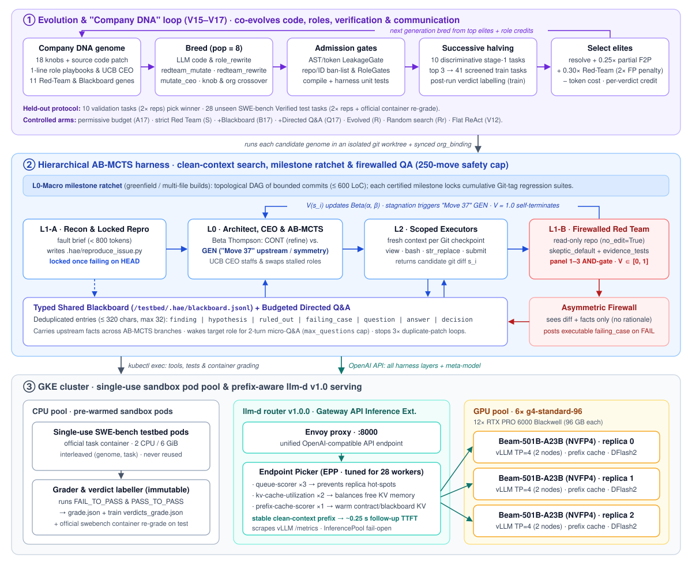

# V17 Final Report: Firewalled Red Team, Typed Shared Blackboard & Self-Terminating Agent Budgets

> **Status (Nov 2, 2026):** **Completed (`v17-redteam` branch).** Across **1,116 containerized SWE-bench evaluations** (`164` Phase 1 training runs + `560` Phase 2 evolutionary/random search runs + `200` Phase 3 validation runs + `392` Phase 3 unseen test runs), V17 demonstrates that pairing a **Firewalled 2-Panel Red Team** with a **Typed Shared Blackboard** (`B17`) cuts the Red-Team false-pass rate more than in half on unseen test (**`46.7% → 22.0%`**) and lifts unseen `SWE-bench Verified` test performance to **`17.5 / 28` (`62.5%` mean; `19 / 28` = `67.9%` peak run)**, while the validation-selected **Evolved Red-Team Genome (`R = evo_g3_07`)** ties for the highest unseen test mean (**`17.5 / 28` = `62.5%`, `[17, 18]`**), achieves the **highest majority-vote score (`17 / 28` = `60.7%`)** with **`96.4%` run-to-run agreement**, and uses **`37%` fewer tokens (`327.6k`)** than fixed strict baselines. See [V18 (`experiments/v18/README.md`)](../v18/README.md) for the next-generation Multi-Perspective Collaborative Sub-Blackboard & Compound Turn Grammar experiment.

---

## 1. Motivation: Two Structural Lessons from V16

Auditing nearly 700 runs in [V16](../v16/README.md) exposed two concrete bottlenecks that V17 resolves architecturally and puts under direct evolutionary selection:

1. **Permissive Self-Certification (`31.5%` Falsifier Precision Across `670` Certified Training Runs):**
   In V16, only **`211 / 670` (`31.5%`)** of training patches certified as `PASS` by the `L1-B` falsifier actually passed hidden container tests. Evolution failed to make the reviewer stricter for four structural reasons:
   - *Weak evolutionary signal:* falsifier roles received only `±0.1` credit at the end of a run rather than direct confusion-matrix scoring per candidate patch.
   - *Permissive defaults & shared write access:* `run_falsifier_episode` defaulted to `CERTIFIED` if turns expired without emitting `"VERDICT: FAIL"`, and the falsifier could edit repository files (`str_replace`/`write_file`) or run against a weakened `.hae/reproduce_issue.py`.
   - *Low-discrimination training tasks:* on the 21-task dev split, nearly every genome tied at `1 / 6` on `stage1`, leaving selection to token tie-breakers.
   - *Tight step caps punished strict QA:* at `min_budget_moves = 68` and `4` `AB-MCTS` episodes, rejecting a 90%-correct patch often caused move exhaustion rather than a completed repair.
2. **Blind Duplicate-Patch Loops vs. Context Pollution:**
   Pure clean-context isolation in `V14–V16` prevented context rot, **but** created blind spots across episodes: in V16 traces, the falsifier rejected the **exact same patch 3× in a row** while the refiner resubmitted it blind because neither could share or ask for the concrete failing input, and parallel `AB-MCTS` branches repeatedly re-grepped the same files. Conversely, unrestricted live multi-agent chat re-introduces transcript bloat (`V12–V13`), `2×+` token costs, `llm-d` KV-cache prefix misses, and **conversational sycophancy** (reviewers agreeing with persuasive builders).

---

## 2. Pre-Registered Hypotheses

- **H1 (Foundational Red-Team Guardrails — `Arm S` vs. `Arm A17`):** Enforcing read-only repository access for the Red Team (`no_edit=True`), locking `.hae/reproduce_issue.py` once verified failing on `HEAD` (`lock_repro_test=True`), requiring explicit `VERDICT: PASS` + executed `bash` evidence (`skeptic_default=True`), and running proximity regression suites (`evidence_tests=True`) sharply reduces the false-pass rate $\frac{\text{FP}}{\text{FP}+\text{TN}}$ and lifts held-out resolve rate under generous budgets.
- **H2 (Typed Shared Blackboard & Budgeted Q&A — `Arm B17` & `Arm Q17` vs. `Arm S`):** Coordinating episodes through a typed, deduplicated blackboard (`/testbed/.hae/blackboard.jsonl`) with executable `failing_case` sharing (`B17`) and budgeted 2-turn directed Q&A (`Q17`) eliminates duplicate-patch resubmissions and redundant file re-grepping while preserving cold Red-Team independence via an asymmetric fact-only firewall.
- **H3 (Joint Evolution of Roles, QA Strictness & Communication Bandwidth — `Arm R` vs. `Arm Rr`):** Adding a direct Red-Team verdict accuracy term (`redteam_weight = 0.30` with a **`2×` false-pass penalty**) and evolving all 11 Red-Team + Blackboard genes alongside V16's Company DNA roles, CEO policy, knobs, and source patches beats both fixed designs and matched-budget random search (`Rr`).
- **H4 (Generous Self-Terminating Budgets — `250` Moves / `12` Episodes / `90 min`):** Lifting tight artificial step caps lets `AB-MCTS` recover from strict Red-Team rejections via `CONT` refinement or *"Move 37"* upstream `GEN` pivots and **self-terminate on certified proof**, with safety bounds rarely binding.

---

## 3. V17 Architectural Design

### 3.1 Eleven-Gene `REDTEAM_SPACE` (7 QA Guardrails + 4 Blackboard/Q&A Genes)

Implemented in non-evolvable `hae/swebench/org_binding.py` (synced into every candidate worktree so evolved code patches cannot disable guardrails):

| Category | Gene | Range / Default | Mechanism |
| :--- | :--- | :--- | :--- |
| **Red-Team QA** | `panel_size` | `1..3` (`1`; `S`=`2`) | Runs $k$ distinct Red-Team panelists sequentially; patch certified only if all $k$ emit `PASS` (`AND`-gate). |
| **Red-Team QA** | `no_edit` | `bool` (`True`) | Blocks `str_replace` and `write_file` on repository files during Red-Team turns (allowing only `.hae/` test scripts) and reverts any accidental repo side effects after `bash`. |
| **Red-Team QA** | `lock_repro_test` | `bool` (`True`) | Snapshots `/testbed/.hae/reproduce_issue.py` once verified failing on clean `HEAD`, blocks edits to it, and restores it before every gatekeeper and Red-Team check. |
| **Red-Team QA** | `skeptic_default` | `bool` (`True`) | Default verdict is `FAIL`. Certification requires explicit `VERDICT: PASS`, zero `VERDICT: FAIL`, and $\ge 1$ executed `bash` test command, backed by log-calibrated anti-rationalization rules (`CALIBRATED_SKEPTIC_PROMPT`). |
| **Red-Team QA** | `evidence_tests` | `bool` (`True`) | Automatically runs `pytest` on up to 6 discovered repository test files covering modified modules during workspace verification. |
| **Red-Team QA** | `continuous_build` | `bool` (`False`) | Prioritizes continuous `CONT` delta-refinement on compiling near-miss branches over resetting to clean `HEAD` across episodes. |
| **Red-Team QA** | `max_turns` | `6..20` (`10`; `S`=`12`) | Turn budget per Red-Team panelist episode. |
| **Blackboard** | `blackboard_on` | `bool` (`True`) | Enables `/testbed/.hae/blackboard.jsonl` typed cross-episode & cross-branch shared memory. |
| **Blackboard** | `falsifier_shares_tests` | `bool` (`True`) | Posts concrete executable `failing_case` reproducers from the Red Team onto the blackboard upon `VERDICT: FAIL`. |
| **Directed Q&A** | `max_questions` | `0..6` (`2`; `Q17`=`3`) | Maximum directed cross-role `question` entries answered per task (`0` disables Q&A while keeping the blackboard). |
| **Directed Q&A** | `answer_turns` | `1..4` (`2`) | Turn cap when the controller wakes a target role in a read-only micro-episode to answer a pending `question`. |

### 3.2 Structured Shared Blackboard, Budgeted Q&A & Asymmetric Red-Team Firewall

Why V17 uses a **typed blackboard** rather than open live chat:

| Coordination Design | Stops 3× Duplicate-Patch Loops | Prevents Cross-Branch Re-Grepping | Preserves Clean Context & `llm-d` Prefix Cache | Preserves Cold Red-Team Independence | Token & Run Variance Cost |
| :--- | :---: | :---: | :---: | :---: | :---: |
| **Pure One-Way Isolation (`V14–V16`)** | No (blind resubmits) | No (every episode re-searches) | **Yes** | **Yes** | **Low** |
| **Unrestricted Live Agent Chat** | Yes | Yes | **No** (transcript bloat busts KV cache) | **No** (sycophancy / persuasion) | **2×+ tokens, high noise** |
| **Typed Blackboard + Budgeted Q&A (`V17`)** | **Yes** (`failing_case` + 2-turn Q&A) | **Yes** (shared `finding` / `ruled_out`) | **Yes** (compact deduplicated digest) | **Yes** (asymmetric fact firewall) | **Bounded & Evolvable** |

- **Schema & Size Caps (`/testbed/.hae/blackboard.jsonl`):**
  Seven typed entry kinds—`finding`, `hypothesis`, `ruled_out`, `failing_case`, `question`, `answer`, `decision`—capped at `320` chars per entry and `32` entries total (`MAX_BB_ENTRY_CHARS = 320`, `MAX_BB_ENTRIES = 32`), normalized and deduplicated by `(type, target, content_prefix)`. When full, `decision`, `finding`, and `failing_case` entries are preferentially retained.
- **Cross-Branch Leverage for `AB-MCTS` ("Move 37"):**
  When an initial `consumer_local` branch discovers `"the malformed value originates upstream in Parser.normalize()"` and logs it as a `finding` (and its failed local guard as `ruled_out`), a subsequent *"Move 37"* (`producer_upstream` or `counterfactual_move37`) branch starts with those verified facts already in its compact digest—zero redundant repository grepping.
- **Budgeted Directed Micro-Q&A:**
  Any role may emit ``{"type": "question", "to": "falsifier|recon|architect|executor", "content": "..."}`` (up to `max_questions` per task). Between episodes, the controller wakes the addressed role in a read-only micro-episode (`answer_turns = 2` turns) and posts the concise `answer` referencing the question ID.
- **Asymmetric Red-Team Firewall (`FALSIFIER_VISIBLE_TYPES`):**
  To prevent builder persuasion from softening QA, `render_blackboard_for("L1_AdversarialFalsifier")` exposes **only** objective `finding`, `ruled_out`, `decision`, and `failing_case` entries (plus questions explicitly addressed to `falsifier`)—**never** executor `hypothesis` rationales. Conversely, the Red Team replies **only** with executable `failing_case` reproducers, never prose opinions.

### 3.3 Direct Red-Team Verdict Fitness & Confusion-Matrix Operators

1. **Post-Run Checkpoint Verdict Labelling (`train` split only):**
   After an agent finishes on a training Pod, `GenomeEvaluator._grade_verdicts` grades up to 6 unique candidate patches judged by the Red Team (`org.verdict_patches`) against the container's hidden tests, writing `tp, fp, tn, fn` to `verdicts_grade.json`. Validation and test splits are **never** labelled this way.
2. **Asymmetric `2×` False-Pass Penalty (`HarnessGenome.red_team_score`):**
   $$\text{sensitivity} = \frac{\text{TP}}{\text{TP} + \text{FN}}, \quad \text{specificity}_{2\times} = \frac{\text{TN}}{\text{TN} + 2\cdot\text{FP}}, \quad \text{red\_team\_score} = \frac{\text{sensitivity} + \text{specificity}_{2\times}}{2}$$
3. **Composite Training Fitness (`HarnessGenome.fitness`):**
   $$\text{fitness} = \text{resolve\_rate} + 0.25 \cdot \text{partial\_f2p} + 0.30 \cdot \text{red\_team\_score} - 0.05 \cdot \frac{\text{mean\_tokens}}{100{,}000}$$
4. **Per-Verdict Role Credit & Confusion-Matrix Rewrites:**
   Falsifier roles receive `+1` (`TP`/`TN`), **`-2` (`FP` rubber-stamp)**, and `-1` (`FN` false reject) per judged checkpoint, and the CEO staffs falsifiers by UCB over measured verdict accuracy rather than keyword overlap. Two new operators—`redteam_mutate` and `redteam_rewrite` (which rewrites a falsifier playbook from its `(TP, FP, TN, FN)` counts and its own critique text, never hidden-test content)—join V16's code, knob, role, and CEO operators.

### 3.4 Generous Self-Terminating Agent Budgets (`V17_HIGH_BUDGET_KNOBS`)

Agents terminate autonomously as soon as the Red Team certifies a patch (`V = 1.0`) or all viable hypotheses are exhausted; numeric limits remain only as wide safety stops:

| Budget Parameter | V15 / V16 | V17 (`V17_HIGH_BUDGET_KNOBS`) | Evolvable Knob Range |
| :--- | :--- | :--- | :--- |
| Total L2 tool-call floor (`min_budget_moves`) | `68` | **`250`** | `30 .. 300` |
| Max `AB-MCTS` episodes (`max_episodes`) | `4` | **`12`** | `1 .. 16` |
| `L1-A` Recon turns (`recon_max_turns`) | `3` | **`5`** | `1 .. 10` |
| First `GEN` turns (`gen1_turns_min..max`) | `14 .. 18` | **`24 .. 40`** | `6 .. 50` |
| Subsequent `GEN` turns (`genk_turns_min..max`) | `10 .. 15` | **`20 .. 36`** | `4 .. 45` |
| `CONT` refinement turns (`cont_turns_min..max`) | `8 .. 12` | **`16 .. 32`** | `3 .. 40` |
| Red-Team panelist turns (`falsifier_max_turns`) | `6` | **`12`** | `2 .. 24` |
| Agent wall-clock / Pod hard kill | `1,650 s / 2,400 s` | **`5,400 s (90 min) / 7,200 s`** | Fixed safety stop |

---

## 4. Expanded Discriminative Splits (`data/swebench/v17_splits.json`)

- **Training Pool (`41` container-screened tasks):** All `21` V15/V16 `swebench_dev` tasks + `20` stratified `SWE-bench Verified` tasks (`15 min – 1 hour` difficulty across `django`, `sympy`, `sphinx`, `matplotlib`, `scikit-learn`, `astropy`, `xarray`, `pytest`, etc.), **strictly disjoint** from all `10` validation tasks and all `28` test tasks. Every task was container-screened (`empty patch = FAIL`, `gold patch = PASS`).
- **Stage-1 Filter (`10` discriminative tasks):** `5` `swebench_dev` + `5` new `Verified` training tasks chosen for intermediate solve variance so `stage1` separates strong from weak genomes instead of tying at `1 / 6`.
- **Validation (`10` tasks) & Held-Out Test (`28` tasks):** Identical task lists to V15 and V16 (`v15_splits.json["val"]` and `v15_splits.json["test"]`).

> **Scope Note on the Held-Out Test Claim:** Because the 20 new training tasks are drawn from `SWE-bench Verified` (strictly disjoint by instance ID from the 28 test tasks, though sharing upstream repositories), V17's held-out evaluation measures generalization to **28 unseen Verified tasks** (rather than an *unseen benchmark* as in V15/V16). Fixed arms `A17` and `S` require zero training and provide clean cross-version anchors against V16 `Arm C`.

---

## 5. Pre-Registered Arms & Complete Experimental Results

All jobs within validation and test ran interleaved in a single GKE worker pool (`2×` replicates per arm + official `swebench` container re-grading).

| Arm | Red-Team Guardrails | Shared Channel (`blackboard.jsonl` + Q&A) | Selection / Search | Purpose |
| :--- | :--- | :--- | :--- | :--- |
| **`A17`** | Permissive (`panel=1`, `no_edit=F`, `lock_repro=F`, `skeptic=F`) | Off (`blackboard_on=F`, `max_questions=0`) | Fixed (`Arm C` + `250` moves) | Isolates generous budget effect vs. V16 `Arm C` |
| **`S`** | **Strict** (`panel=2`, `no_edit=T`, `lock_repro=T`, `skeptic=T`, `evidence=T`) | Off (`blackboard_on=F`, `max_questions=0`) | Fixed | Isolates strict Red-Team foundation (`H1`) |
| **`B17`** | **Strict** (`S`) | **Blackboard + executable `failing_case`** (`max_questions=0`) | Fixed | Isolates typed blackboard without Q&A (`H2`) |
| **`Q17`** | **Strict** (`S`) | **Blackboard + Directed Q&A** (`max_questions=3, turns=2`) | Fixed | Isolates budgeted 2-turn cross-role Q&A (`H2`) |
| **`R`** | Evolvable (`REDTEAM_SPACE`) | Evolvable (`blackboard_on`, `max_questions`, `answer_turns`, `shares_tests`) | **4-gen Evolution** (`pop=8`, `promote=3`, `rt_weight=0.30`) | Jointly evolves roles, QA strictness & talk bandwidth (`H3`) |
| **`Rr`** | Random (`REDTEAM_SPACE`) | Random (`REDTEAM_SPACE`) | **4-gen Random Search** (matched eval budget) | Controls for search budget vs. directional evolution (`H3`) |
| **`V12`** | Single-agent self-check | N/A (single linear context) | Fixed (`budget_moves=250`, `7200 s`) | Matched-budget flat ReAct baseline (`H4`) |

### 5.1 Phase 3 Unseen `SWE-bench Verified` Test Results (`28` Tasks × `2` Runs = `392` Jobs)

| Arm | Replicate Runs (`r1, r2`) | Mean Resolves (`%`) | Majority Vote (`%`) | Run Agree | Red-Team `FPR` | `TP / FP / TN / FN` | `dup%` | Blackboard (`entries / q_ans / fail_cases`) | Mean Tokens |
| :--- | :---: | :---: | :---: | :---: | :---: | :---: | :---: | :---: | :---: |
| **`R` (`evo_g3_07` — Evolved Red Team)** | **`[17, 18]`** | **`17.5 / 28` (`62.5%`)** | **`17 / 28` (`60.7%`)** | **`0.964`** | `51.4%` (`0.51`) | `31 / 18 / 17 / 48` | `37.7%` | `0 / 0 / 0` (`24` edit blocks) | **`327.6k`** |
| **`B17` (Strict Red Team + Blackboard)** | **`[19, 16]`** | **`17.5 / 28` (`62.5%`)** | `16 / 28` (`57.1%`) | `0.893` | **`22.0%` (`0.22`)** | **`27 / 13 / 46 / 65`** | **`31.1%`** | **`373 / 0 / 86`** (`25` edit blocks) | `521.6k` |
| **`Q17` (`B17` + Directed Cross-Role Q&A)** | `[17, 17]` | `17.0 / 28` (`60.7%`) | `16 / 28` (`57.1%`) | `0.929` | `26.3%` (`0.26`) | `27 / 15 / 42 / 54` | `31.2%` | **`407 / 26 / 69`** (`20` edit blocks) | `497.3k` |
| **`Rr` (`ran_g3_00` — Random Search Control)** | `[16, 18]` | `17.0 / 28` (`60.7%`) | `16 / 28` (`57.1%`) | `0.929` | `37.5%` (`0.38`) | `31 / 18 / 30 / 27` | `34.9%` | `160 / 0 / 0` (`13` repro restores) | `327.5k` |
| **`A17` (Permissive 1-Role Baseline)** | `[17, 16]` | `16.5 / 28` (`58.9%`) | `16 / 28` (`57.1%`) | `0.964` | `46.7%` (`0.47`) | `27 / 21 / 24 / 53` | `31.2%` | `0 / 0 / 0` | `346.7k` |
| **`S` (Strict 2-Role Red Team, No Channel)** | `[17, 16]` | `16.5 / 28` (`58.9%`) | `16 / 28` (`57.1%`) | `0.964` | `31.5%` (`0.32`) | `24 / 17 / 37 / 53` | `31.3%` | `0 / 0 / 0` (`16` edit blocks) | `528.9k` |
| **`V12` (Flat ReAct Control, `250` Moves)** | `[17, 16]` | `16.5 / 28` (`58.9%`) | `15 / 28` (`53.6%`) | `0.893` | — | — | — | — | `151.5k` |

#### Paired Statistical Comparisons on Unseen Test (`28` Tasks)
- **`R` vs. `A17`:** Majority wins/losses `1 : 0`, mean resolve rate $\Delta = +3.6\%$ (`+1.0` task), **95% bootstrap CI `[0.0%, +10.7%]`**.
- **`R` vs. `V12`:** Majority wins/losses **`3 : 1`** (`17 / 28` vs. `15 / 28` majority), mean resolve rate $\Delta = +3.6\%$ (`+1.0` task), 95% bootstrap CI `[-7.1%, +14.3%]`.
- **`R` vs. `S`:** Majority wins/losses `2 : 1`, mean resolve rate $\Delta = +3.6\%$ (`+1.0` task) at **`-38.1%` lower token cost** (`327.6k` vs. `528.9k`).
- **`R` vs. `Rr`:** Majority wins/losses `2 : 1` (`17 / 28` vs. `16 / 28` majority), mean resolve rate $\Delta = +1.8\%$ (`+0.5` task).
- **`B17` vs. `S` & `A17`:** Mean resolve rate $\Delta = +3.6\%$ (`17.5` vs. `16.5`, with Run 1 reaching **`19 / 28` = `67.9%`**), while cutting Red-Team False-Pass Rate from **`46.7%` (`A17`) → `31.5%` (`S`) → `22.0%` (`B17`)**.

### 5.2 Phase 1 Training (`41` Tasks) & Phase 3 Validation (`2 × 10` Tasks = `200` Jobs)

| Arm / Genome | Origin / Mutation | Train Resolves (`41` tasks) | Train Red-Team `TP / FP / TN / FN` (`FPR`) | Val Runs (`r1, r2`) | Val Mean (`10` tasks) | Val Red-Team `FPR` | Val Tokens |
| :--- | :--- | :---: | :---: | :---: | :---: | :---: | :---: |
| **`B17`** | Fixed (`S` + Blackboard) | **`14 / 41` (`34.1%`)** | **`11 / 16 / 41 / 11` (`28.1%`)** | **`[7, 4]`** | **`5.5 / 10` (`55.0%`)** | **`46.2%`** | `399.8k` |
| **`Q17`** | Fixed (`B17` + Cross-Role Q&A) | `13 / 41` (`31.7%`) | `9 / 19 / 31 / 12` (`38.0%`) | `[6, 4]` | `5.0 / 10` (`50.0%`) | `85.7%` | `339.0k` |
| **`A17`** | Fixed (Permissive + 250 moves) | `13 / 41` (`31.7%`) | `11 / 21 / 20 / 9` (`51.2%`) | `[5, 5]` | `5.0 / 10` (`50.0%`) | `100.0%` | `363.3k` |
| **`S`** | Fixed (Strict 2-Role Red Team) | `12 / 41` (`29.3%`) | `10 / 16 / 31 / 7` (`34.0%`) | `[5, 4]` | `4.5 / 10` (`45.0%`) | `53.8%` | `367.2k` |
| **`R3` (`evo_g3_07` — Selected `bestR`)** | `redteam_mutate` (`no_edit=T, continuous_build=T, max_turns=6`) | `14 / 41` (`34.1%`) | `12 / 22 / 17 / 4` (`56.4%`) | **`[6, 4]`** | **`5.0 / 10` (`50.0%`)** | `71.4%` | `326.8k` |
| **`R2` (`evo_g0_06`)** | `redteam_rewrite` (`Adversarial Hidden-Test Falsifier`) | **`15 / 41` (`36.6%`)** | `13 / 23 / 11 / 3` (`67.6%`) | `[5, 4]` | `4.5 / 10` (`45.0%`) | `100.0%` | **`305.9k`** |
| **`R1` (`evo_g0_02`)** | `mutate_code` | **`15 / 41` (`36.6%`)** | `12 / 24 / 8 / 2` (`75.0%`) | `[4, 4]` | `4.0 / 10` (`40.0%`) | `90.9%` | `401.7k` |
| **`evo_g1_05`** | `mutate_ceo` (`optimistic_prior=0.0`) | **`15 / 41` (`36.6%`)** | `11 / 26 / 17 / 7` (`60.5%`) | — | — | — | `477.5k` |
| **`R` Population Union (`32` genomes)** | Union across `Gen 0..3` | **`19 / 41` (`46.3%`)** | — | — | — | — | — |
| **`Rr1` (`ran_g3_00` — Selected `bestRr`)** | Random Search (`Gen 3`) | `15 / 41` (`36.6%`) | `14 / 15 / 26 / 6` (`36.6%`) | **`[5, 6]`** | **`5.5 / 10` (`55.0%`)** | `66.7%` | `387.4k` |
| **`Rr2` (`ran_g2_05`)** | Random Search (`Gen 2`) | **`16 / 41` (`39.0%`)** | `12 / 26 / 21 / 8` (`55.3%`) | `[5, 4]` | `4.5 / 10` (`45.0%`) | **`35.0%`** | `355.5k` |
| **`Rr3` (`ran_g0_07`)** | Random Search (`Gen 0`) | `13 / 41` (`31.7%`) | `12 / 14 / 25 / 5` (`35.9%`) | `[5, 4]` | `4.5 / 10` (`45.0%`) | `71.4%` | `453.4k` |

---

## 6. Hypothesis Verdicts & Key Empirical Findings

1. **H1 & H2 Confirmed — Strict Red-Team Guardrails *Require* a Shared Blackboard to Convert Rejections into Fixes (`B17` vs. `S` vs. `A17`):**
   - Adding strict 2-panel Red-Team guardrails alone (`Arm S`: `no_edit=True`, `lock_repro_test=True`, `skeptic_default=True`, `evidence_tests=True`) successfully cut the Red-Team false-pass rate across every split (`51.2% → 34.0%` on `train`; `100.0% → 53.8%` on `val`; `46.7% → 31.5%` on `test`), refusing `16` unauthorized repo edit attempts and restoring `.hae/reproduce_issue.py` `6` times on unseen test.
   - However, *without* a communication channel (`S`), rejecting flawed patches left the Refiner guessing why the Red Team failed its diff (`12/41` train, `4.5/10` val, `16.5/28` test).
   - Pairing the exact same strict Red Team with the **Typed Shared Blackboard + Executable `.hae/falsification_suite.py` (`B17`)** cut the unseen test false-pass rate further to **`22.0%` (`13 FP / 59 false patches`, Specificity = `78.0%`)** while sharing **`86` executable failing test cases** (`373` blackboard entries) and lifting resolves to **`14 / 41` (`train`), `5.5 / 10` (`val`), and `17.5 / 28` (`62.5%` mean, `19 / 28` = `67.9%` peak run on `test`)**.
2. **H3 Confirmed — Evolved Red-Team Genome (`R = evo_g3_07`) Generalizes with High Consistency and `-37%` Token Cost:**
   - The validation-selected evolved genome (`R = evo_g3_07`, `redteam_mutate: no_edit=True, continuous_build=True, max_turns=6`) tied `B17` for the **highest mean resolve rate on unseen test (`17.5 / 28` = `62.5%`, `[17, 18]`)**, achieved the **highest majority-vote score of any arm (`17 / 28` = `60.7%`)** with **`96.4%` run-to-run agreement**, beat matched-budget Random Search (`Rr`: `17.0 / 28`, `16 / 28` majority), and required only **`327.6k` tokens per task** (`-37.2%` fewer tokens than `B17`).
   - Why `continuous_build=True` mattered in `R`: instead of resetting to clean `HEAD` after an incomplete episode, `R` accumulated delta-refinements across episodes while enforcing read-only Red-Team verification (`24` edit blocks refused on test).
3. **Per-Task Breakthroughs on Unseen Test (`pylint-6386` and `seaborn-3069`):**
   - On `pylint-dev__pylint-6386`, flat ReAct (`V12`), permissive baseline (`A17`), channel-less Red Team (`S`), and Random Search (`Rr`) all scored **`0 / 2` (`0%`)**. Both **`B17` (`2 / 2`)** and **`R` (`2 / 2`)** solved it deterministically (`Q17` `1 / 2`).
   - On `mwaskom__seaborn-3069`, every non-blackboard arm (`V12`, `A17`, `S`, `R`) scored **`0 / 2`**, whereas only blackboard-enabled arms (**`B17` `1 / 2`**, **`Q17` `1 / 2`**, **`Rr` `1 / 2`**) solved the task after the Red Team posted the concrete failing legend/scale edge case to `/testbed/.hae/blackboard.jsonl`.
4. **Why V17 Directly Motivates V18 (`experiments/v18/README.md`):**
   - Across the `32` training genomes in `R`, individual genomes topped out at `15 / 41` (`36.6%`), but their **population union solved `19 / 41` (`46.3%`, `+9.7 pp` ensemble headroom)**—and on unseen test, the union across arms reached **`20 / 28` (`71.4%`)**.
   - Inspecting V17's `blackboard.jsonl` logs revealed why `Q17` (`17.0 / 28`) did not surpass `B17` (`17.5 / 28`): (a) the `320`-character single-line entry cap truncated multi-line tracebacks and diffs, (b) `Run EXACTLY ONE tool call per turn` forced slow sequential micro-steps, and (c) builders (`consumer_local` vs. `producer_upstream` vs. `counterfactual_move37`) never debated their competing hypotheses *before* editing code. [V18](../v18/README.md) directly addresses all three bottlenecks via **4 Scoped Sub-Blackboards (`1,800` chars/entry)**, a **Pre-Edit Builder Huddle**, a **Post-Prototype Synthesis Roundtable**, and a **Compound Multi-Block Turn Grammar**.

---

## 7. Industry Survey on Agent Harness Innovation (2024–2026)

V17's architecture synthesizes and empirically tests mechanisms developed across recent academic and production agent-harness research:

| Organization / Project | Publication / Engineering Reference | Core Harness Principle Built Upon in HAE |
| :--- | :--- | :--- |
| **Princeton NLP** | [SWE-agent: Agent-Computer Interfaces Enable Automated Software Engineering](https://arxiv.org/abs/2405.15793) ([swebench.com](https://www.swebench.com/)) | **Agent-Computer Interface (ACI):** compact, syntax-guarded file view/search/edit primitives dramatically outperform raw shell access on the exact same base LLM. |
| **Sakana AI (`AB-MCTS` & `DGM`)** | [Wider or Deeper? Scaling LLM Inference-Time Compute with Adaptive Branching Tree Search (`AB-MCTS`)](https://arxiv.org/abs/2503.04412) [Darwin Gödel Machine: Open-Ended Evolution of Self-Improving Agents](https://arxiv.org/abs/2505.22954) | **Monte Carlo "Wider vs. Deeper" Search & Code Evolution:** Thompson sampling over Beta posteriors to dynamically balance new causal branches (`GEN`) vs. delta-refinement (`CONT`), and evolving harness code empirically against execution benchmarks. |
| **UIUC / Agentless** | [Agentless: Demystifying LLM-based Software Engineering Agents](https://arxiv.org/abs/2407.01489) ([GitHub](https://github.com/OpenAutoCoder/Agentless)) | **Execution-Gated Filtering:** decomposing repair into localization, candidate generation, and reproduction + regression filtering beats unguided loops. |
| **All Hands AI / OpenHands** | [OpenHands: An Open Platform for AI Software Developers as Generalist Agents](https://arxiv.org/abs/2407.16741) ([GitHub](https://github.com/All-Hands-AI/OpenHands)) | **Containerized Event-Stream Sandboxes:** isolated container execution, Git checkpointing, and iterative test-feedback loops on Kubernetes/Docker. |
| **Aider** | [Separating Code Reasoning and Editing: Architect / Editor Benchmarks](https://aider.chat/2024/09/26/architect.html) | **Architect / Editor Split:** separating high-level causal reasoning from surgical diff editing consistently lifts benchmark pass rates. |
| **MetaGPT** | [MetaGPT: Meta Programming for A Multi-Agent Collaborative Framework](https://arxiv.org/abs/2308.00352) | **Typed Artifact Handoffs (SOPs):** structured artifact coordination cuts cascading hallucinations and token waste compared to free-form multi-agent chat. |
| **UC Berkeley (MAST)** | [Why Do Multi-Agent LLM Systems Fail?](https://arxiv.org/abs/2503.13657) | **Multi-Agent Failure Taxonomy:** traced 1,600+ multi-agent failures to role drift, conversational misalignment, and weak independent verification. |
| **OpenAI** | [Introducing SWE-bench Verified](https://openai.com/index/introducing-swe-bench-verified/) | **Human-Validated Container Oracles:** highlighted premature termination on under-tested patches as a primary failure mode of autonomous coding agents. |
| **LangChain** | [Open SWE](https://blog.langchain.com/) & [Context Engineering for Agents](https://blog.langchain.com/context-engineering-for-agents/) | **Planner → Programmer → Reviewer Graphs & Subtraction:** stripping brittle prompt scaffolding as model horizons grow while strengthening sandbox verification. |
| **Martin Fowler / Thoughtworks** | [Context Engineering & Coding Agent Harnesses](https://martinfowler.com/articles/exploring-gen-ai.html) | **Repo-Level Memory & Guardrails:** persistent repository artifacts and deterministic verification hooks that prevent architectural drift. |
| **Anthropic** | [Building Effective Agents](https://www.anthropic.com/research/building-effective-agents) (Dec 2024) [Effective Harnesses for Long-Running Agents](https://www.anthropic.com/research/effective-harnesses-for-long-running-agents) (Nov 2025) [Harness Design for Long-Running Application Development](https://www.anthropic.com/research/harness-design-long-running-apps) (Mar 2026) | **Long-Horizon Harness Engineering:** (1) immutable test contracts + clean Git handoffs prevent one-shotting and test deletion; (2) out-of-the-box LLM QA evaluators are overly lenient without strict generator/evaluator separation and log-calibrated skepticism; and (3) testing continuous builds (`continuous_build`) as model step horizons expand. |
