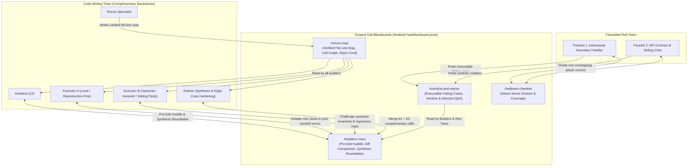

# V18 Plan: Collaborative Builder Roundtables, Scoped Sub-Blackboards & Compound Multi-Block Turns

> **Status (Nov 2, 2026):** **Active / Ready for Implementation (`experiments/v18/README.md`).** V17 (`1,116` container runs across train, evolution, validation, and unseen test) is now **100% complete** ([V17 Final Report](../v17/README.md)): `B17` (Strict Red Team + Blackboard) and `R` (`evo_g3_07`) lifted unseen `SWE-bench Verified` test resolves to **`17.5 / 28` (`62.5%` mean; `19 / 28` = `67.9%` peak run)** and cut Red-Team false-pass rates from **`46.7%` → `22.0%`**, while uncovering a **`19 / 41` (`46.3%`) training union** and **`20 / 28` (`71.4%`) unseen test union** across complementary agent trajectories that V18 is designed to capture within a single collaborative team.

---

## 1. Empirical Motivation from V17 (`1,240+` Runs)

Auditing the completed V17 Phase 1 (`A17, S, B17, Q17` across 41 tasks) and Phase 2 (`R` 4-generation evolution across 651 runs) surfaced four concrete findings that directly motivate V18:

1. **Huge Multi-Perspective Headroom (`19 / 41` = `46.3%` Union of Solved Tasks vs. `15 / 41` = `36.6%` Best Single Genome):**
   Across the evolved genomes in V17 `R`, **`19 / 41` (`46.3%`)** distinct training tasks were solved by at least one genome (`+6` tasks above the `13 / 41` seed, including `sqlfluff-884`, `sqlfluff-905`, `astroid-946`, `astroid-1959`, `marshmallow-1252`, and `requests-2931`), whereas any individual genome peaked at **`15 / 41` (`36.6%`)** (`evo_g0_02`, `evo_g0_06`, `evo_g1_05`). Different genomes bias their single Executor toward different engineering priors (e.g., local crash-site guard vs. upstream AST/caller invariant vs. sibling parity). Putting **complementary Builder personas inside the same run** and letting them debate before and after prototyping targets capturing that **`46.3%` union** within a single team.
2. **Single-Tool Turn Lockout (`0` Agent-Authored Blackboard Blocks in V17):**
   In V17 `B17` and `Q17`, `hierarchical_mcts.py` instructed agents to *"Emit EXACTLY ONE markdown fenced tool block per turn (`bash`, `view_file`, `str_replace`, or `submit`)."* Because agents could not run a shell/file command and post a `blackboard` entry in the same turn, **100% of V17 blackboard entries were controller-generated episode summaries or Red-Team `FAILING_CASE` exports** (`questions_asked = 0`).
3. **320-Character Truncation Caused 4× Redundant Re-Grepping:**
   `MAX_BB_ENTRY_CHARS = 320` clipped controller episode summaries mid-sentence before reaching exact file paths, line ranges, or traceback assertions. In `pylint-dev__astroid-983`, branches `b1`, `b1.1`, `b2`, and `b2.1` executed the exact same `grep -rn "def isinstance" astroid/brain/` command **4 times from scratch** because prior branches' localization findings were truncated.
4. **One-Way Red-Team-to-Builder Traffic Only (Zero Peer Builder Collaboration):**
   While Red-Team `FAILING_CASE` entries on `/testbed/.hae/blackboard.jsonl` lifted fixed-arm resolves from `12 / 41` (`S`) to **`14 / 41` (`B17`)** and cut the Red-Team false-positive rate from `51.2%` (`A17`) to **`28.1%` (`B17`)**, code-writing roles (`Architect`, `Executor b1`, `Executor b2`, `Refiner`) never conversed with each other to compare partial fixes or merge complementary insights.

---

## 2. Pre-Registered Hypotheses

- **H1 (Compound Turn Grammar + Scoped `#recon-map` & `1,800`-Char Entries — `Arm B18` vs. `Arm B17`):** Allowing agents to emit ` ```blackboard ` blocks alongside `bash` / `view_file` / `str_replace` in the same turn (`multi_tool_turns=True`), expanding entry caps from `320` to `1,800` chars, and auto-indexing inspected `file:line_start-line_end` ranges into `#recon-map` eliminates redundant cross-branch `grep` calls and increases direct agent-authored blackboard participation from `0` to `> 3` entries/task.
- **H2 (Pre-Edit Builder Huddle Among Distinct Backstories — `Arm H18` vs. `Arm B18`):** Convening a short pre-edit roundtable in `#builders-room` between an *Architect*, a *Consumer/Local-First Executor*, and an *Upstream-Invariant/Parity Executor* produces non-overlapping `b1`/`b2` branch charters and explicit regression traps, increasing first-pass `GEN` solve rate.
- **H3 (Post-Prototype Synthesis Roundtable — `Arm S18` vs. `Arm H18`):** When parallel branches `b1` and `b2` each solve part of an issue or hit Red-Team rejection, convening the *Architect*, *Executors*, and *Refiner* in `#builders-room` over `b1` and `b2`'s structured handoff memos + diffs synthesizes merged fixes that neither branch achieved alone.
- **H4 (Evolution of Collaboration & Sub-Blackboard Policy — `Arm C18` vs. `Arm Cr18`):** Jointly evolving the 6 collaboration genes (`COLLAB_SPACE`) alongside Company DNA roles, Red-Team guardrails, and harness code outperforms both fixed collaboration settings and matched-budget random search (`Cr18`).

---

## 3. V18 Architecture

### 3.1 Four Scoped Sub-Blackboards (`channel` Routing in `/testbed/.hae/blackboard.jsonl`)

Rather than a single flat channel where every role reads everything (which Either wastes tokens or forces `320`-char truncation), `/testbed/.hae/blackboard.jsonl` is partitioned into **four scoped channels** with a **`1,800`-character per-entry budget**:



| Sub-Blackboard (`channel`) | Writers | Readers | Purpose & Visibility Firewall |
| :--- | :--- | :--- | :--- |
| **`#recon-map`** | `recon`, `executors` (auto + manual) | All Builders (`architect`, `executors`, `refiner`) | **Eliminates re-grepping.** Stores verified `file:line_start-line_end` ranges, symbol definitions, call-graph notes, and exact reproduction commands. |
| **`#builders-room`** | `architect`, `executor_a`, `executor_b`, `refiner` | Builders only (**Hidden from Red Team**) | **Peer engineering discussion.** Builders with distinct backstories debate root causes, post why an edit broke a test, compare `b1` vs. `b2` diffs, and agree on a merged repair plan without contaminating Red-Team independence. |
| **`#redteam-chamber`** | `falsifier_1`, `falsifier_2` | Red Team only (**Hidden from Builders**) | **Attack coordination.** Panelists 1 and 2 divide adversarial coverage (e.g., boundary/None/empty inputs vs. subclassing/round-trip invariants) so they never duplicate the same test. |
| **`#verdicts-and-repros`** | `falsifier_1`, `falsifier_2`, `controller`, any role (`question`/`answer`) | Everyone | **Strict Bridge Channel.** Carries candidate patch SHAs, exact failing assertions from `/testbed/.hae/falsification_suite.py`, and budgeted factual Q&A across the builder/verifier boundary. |

### 3.2 Compound Multi-Block Turn Grammar (`multi_tool_turns=True`)

In V18, the inner ReAct turn parser in `hae/swebench/agentic.py` and `hae/swebench/hierarchical_mcts.py` natively supports **compound turns**:
- **Primary Action Block (`0` or `1` per turn):** ` ```bash `, ` ```view_file `, ` ```str_replace `, or ` ```submit `
- **Blackboard Communication Block(s) (`0`, `1`, or more per turn, executed alongside the primary tool in the same turn):**
  ````markdown
  ```blackboard
  {"channel": "#recon-map", "type": "finding", "content": "astroid/brain/brain_builtin_inference.py:705-760 defines infer_isinstance(), which catches InferenceError on builtins.isinstance. Empty functions in builtins MUST still raise InferenceError."}
  {"channel": "#builders-room", "type": "hypothesis", "content": "Guarding empty FunctionDef inference on node.root().name != 'builtins' preserves unittest_brain while fixing issue #983."}
  ```
  ````
- **Automatic `#recon-map` Indexing:** Whenever any builder executes `view_file` or `str_replace` on `path` (`start_line..end_line`), the harness automatically records/updates the compact touched range in `#recon-map` so downstream branches immediately see which files and lines were already inspected.

### 3.3 Two Peer Discussion Phases Among Builders with Complementary Backstories

To emulate a human engineering team where specialists with different technical priors challenge and refine each other's designs:

1. **Phase A — Pre-Edit Builder Huddle (`pre_huddle_rounds = 1` on `#builders-room`):**
   Immediately after `Recon` populates `#recon-map`:
   - **Lead Executor (*Reproduction-First / Local-Site Specialist*)** proposes the direct fix at the crash/symptom locus and identifies which existing tests cover it.
   - **Counter-Perspective Executor (*Upstream-Invariant / Multi-File Parity Specialist*)** challenges whether the bad state originates upstream (producer/parser/AST builder) or requires symmetric changes in sibling classes.
   - **Architect (`L0`)** reads both positions in `#builders-room` and synthesizes non-overlapping branch charters (`b1` and `b2`) with explicit regression traps to avoid.
2. **Phase B — Post-Prototype Synthesis Roundtable (`synthesis_roundtable = True` on `#builders-room`):**
   When an episode (`b1` or `b2`) finishes or is rejected by the Red Team:
   - The Executor writes a structured **Engineering Handoff Memo (`<= 1,800` chars)** to `#builders-room` recording: (a) exact `file:line` diff summary, (b) tests passed vs. exact failing assertion, and (c) what invariant blocked full resolution.
   - Before launching `CONT` refinement, the **Architect** and **Refiner** read `#builders-room` (both `b1` and `b2` memos + diffs) alongside `#verdicts-and-repros` (the Red Team's executable `/testbed/.hae/falsification_suite.py` failure) to synthesize a merged repair plan combining the best elements of `b1` and `b2`.

### 3.4 Six-Gene Evolvable Collaboration Space (`COLLAB_SPACE`)

| Gene | Range / Default | Mechanism |
| :--- | :--- | :--- |
| `sub_blackboards_on` | `bool` (`True`) | Enables channel-scoped routing (`#recon-map`, `#builders-room`, `#redteam-chamber`, `#verdicts-and-repros`). |
| `multi_tool_turns` | `bool` (`True`) | Allows agents to emit ` ```blackboard ` blocks in the same turn as `bash`, `view_file`, `str_replace`, or `submit`. |
| `entry_char_limit` | `600 .. 2400` (`1800`) | Character cap per blackboard entry (`5.6×` larger than V17's `320`-char cap). |
| `auto_index_views` | `bool` (`True`) | Automatically logs inspected `file:line_start-line_end` ranges from `view_file`/`str_replace` into `#recon-map`. |
| `pre_huddle_rounds` | `0 .. 2` (`1`) | Number of multi-role Builder Huddle rounds in `#builders-room` before branch execution (`0` disables pre-huddle). |
| `synthesis_roundtable` | `bool` (`True`) | Convenes Architect + Executors + Refiner in `#builders-room` to merge `b1`/`b2` handoff memos before `CONT` refinement. |

---

## 4. Pre-Registered Experimental Arms (`V18`)

Evaluated on the container-screened splits (`41` train, `2×10` validation, `2×28` unseen `SWE-bench Verified` test):

| Arm | Sub-Blackboards & Multi-Tool Turns | Pre-Edit Builder Huddle | Post-Prototype Synthesis Roundtable | Selection / Search | Purpose |
| :--- | :--- | :--- | :--- | :--- | :--- |
| **`A18`** (`V17` Best Anchor) | Flat `320`-char blackboard, single-tool turns | Off (`0`) | Off (`False`) | Fixed (`B17` / `bestR` from V17) | Baseline anchor from V17 |
| **`B18`** | **4 Scoped Channels + `1,800` chars + Compound Turns + Auto-Index** | Off (`0`) | Off (`False`) | Fixed | Isolates scoped sub-blackboards & multi-block turn grammar (`H1`) |
| **`H18`** | **On (`B18`)** | **On (`pre_huddle_rounds=1`)** | Off (`False`) | Fixed | Isolates Pre-Edit Builder Huddle among distinct backstories (`H2`) |
| **`S18`** | **On (`B18`)** | **On (`pre_huddle_rounds=1`)** | **On (`synthesis_roundtable=True`)** | Fixed | Isolates full peer Builder Huddle + Post-Prototype Synthesis Roundtable (`H3`) |
| **`C18`** | Evolvable (`COLLAB_SPACE`) | Evolvable (`0..2`) | Evolvable (`bool`) | **Evolution** (`pop=8`, `promote=3`) | Jointly evolves collaboration topology, Company DNA roles & Red Team (`H4`) |
| **`Cr18`** | Random (`COLLAB_SPACE`) | Random (`0..2`) | Random (`bool`) | **Matched Random Search** | Controls for search budget vs. directional evolution (`H4`) |
