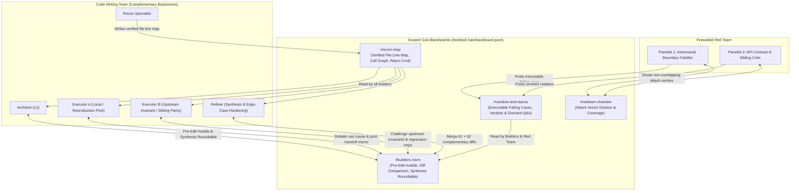

# V18 Plan: Compute-Matched Collaborative Synthesis vs. Parallel Sampling, Candidate-Pool Red-Team Ranking & Expanded Benchmark

> **Status (Nov 2, 2026):** **Active Redesign (`experiments/v18/README.md`).** Incorporating the complete [V17 post-mortem (`1,116` container runs)](../v17/README.md), V18 makes five structural upgrades: (1) retires the saturated 28-task split to the dev pool and evaluates on a **fresh, offline-screened `N = 80` `SWE-bench Verified` benchmark** powered to detect `+8–10 pp` effects; (2) fixes the V17 substrate bugs (**compound multi-block turns**, `eng.executor.run_bash` in Q&A, `</rfl:parameter>` fence normalization) across all baselines; (3) replaces destructive binary Red-Team gating (`50%` train recall) with a **Candidate-Pool Red-Team Ranker** calibrated on V16–V17's `>300` container-graded checkpoints; (4) gives the **Pre-Edit Builder Huddle** authority to override flawed `L0` Architect contracts and enables `continuous_build=True`; and (5) tests **`V18-Collab`** directly against **compute-matched `3× Flat ReAct + Selector` (`Flat-3x-Select`, `~450k` tokens)**.

---

## 1. Empirical Motivation from the V17 Post-Mortem (`1,116` Container Runs)

Auditing all 1,116 V17 runs (`train`, `evolve`, `random`, `val`, and `test`) surfaced five concrete lessons that shape V18:

1. **Test-Set Saturation (`n = 28`) & Statistical Power:**
   In V15 (`17/28`), V16 (`16.5/28`), and V17 (`17.5/28`), every arm—including flat ReAct `V12` (`16.5/28`)—landed within a 2-task band on the same 28 tasks. Per-task inspection showed that `15 / 28` tasks are solved `2/2` by all arms, `6 / 28` are `0/14` across all arms, and `2 / 28` (`psf__requests-1724`, `psf__requests-1766`) had exact gold fixes produced by `B17` (`f2p = 6/6`) but failed 3 live external `httpbin.org` calls in `PASS_TO_PASS`—leaving only `~5` active frontier tasks. In V18, the 28-task set is **retired to the development pool**, and held-out evaluation moves to a **fresh, offline-verified `N = 80` `SWE-bench Verified` benchmark** (`~15%` discordant pair rate gives `~80%` power to detect a `+9 pp` / `7-task` difference at $\alpha = 0.05$).
2. **Compute-Matched Test-Time Scaling (`Flat-3x-Select` vs. Hierarchy):**
   On V17 `test`, `B17` (`17.5 / 28`, `521.6k` tokens) and `R` (`17.5 / 28`, `327.6k` tokens) used `2.2×–3.4×` the tokens of a single `V12` flat ReAct run (`16.5 / 28`, `151.5k` tokens). Even with an oracle selector across both V17 replicates (`pass@2`), `2× V12` reached `18 / 28` (`64.3%`) and failed `0 / 2` on `pylint-6386` and `seaborn-3069` (where `B17` Run 1 scored `19 / 28` = `67.9%` and solved both), because identical flat rollouts collapse into the same local attractor. V18 makes **`Flat-3x-Select` (`3×` independent flat ReAct rollouts + Red-Team / pairwise selector at matched `~450k` tokens)** the primary baseline.
3. **Binary Red-Team Gating Traded False Passes for False Rejections (`50%` Recall on `train`):**
   On `train` (`verdicts_grade.json`), `B17` cut the checkpoint false-pass rate from `51.2%` (`A17`) to `28.1%` (`Specificity = 71.9%`), and on `test` raised final-patch precision from `56.2%` to `67.5%`. However, using the Red Team as a **hard binary gate** rejected `50.0%` of valid candidate patches on `train` (`11 TP, 11 FN`) and `22.9%` on `test` (`27 TP, 8 FN`). V18 retains every candidate patch that passes `.hae/reproduce_issue.py` + local `pytest` in a **Candidate Pool** and uses the Red Team as a **continuous Ranker / Selector** (reporting Precision, Recall, Specificity, and AUROC).
4. **Two Concrete Substrate Bugs Crippled V17's Communication Layer (`Q17`):**
   - *Single-tool turn lockout:* `hierarchical_mcts.py` instructed agents to *"Emit EXACTLY ONE markdown fenced tool block per turn"*, resulting in `0` agent-authored ` ```blackboard ` blocks during normal episodes.
   - *Unexecuted Q&A bash calls:* `org_binding.py:534` checked `hasattr(eng, "execute_bash_tool")` (which is `False` on `InteractiveReActEngine`, whose method is `eng.executor.run_bash`), so all `26` Q&A answers on `test` posted raw unexecuted ` ```bash grep ... ` strings as answers.
   - *Truncation:* `MAX_BB_ENTRY_CHARS = 320` clipped tracebacks and file ranges mid-sentence, causing 4× redundant `grep` calls across branches (`astroid-983`).
5. **Top-Down Architect Lock-In (`astropy-13236`) & Token-Penalty Distortion (`token_lambda = 0.05`):**
   On `astropy-13236`, `V12` scored `2 / 2` while every hierarchical arm scored `0 / 2` because a flawed Turn-1 `L0` Architect contract locked all executors into the wrong hypothesis. Meanwhile, `token_lambda = 0.05` penalized `+200k` tokens by `-0.10` fitness (`4.1 / 41` train tasks), forcing `R` (`evo_g3_07`) to disable the blackboard while discovering `continuous_build=True`.

---

## 2. Pre-Registered Hypotheses (`N = 80` Fresh Offline-Verified Benchmark)

- **H1 (Substrate Calibration — `Flat-1x-V18` vs. `V12`):** Enabling compound multi-block turns (`multi_tool_turns=True` so agents can batch multiple `view_file`s or pair `bash`/`str_replace` with notes), stripping `</rfl:parameter>` fence artifacts, and screening out live external network dependencies (`httpbin.org`) improves single-run flat ReAct resolve rate and token efficiency.
- **H2 (Compute-Matched Collaborative Synthesis vs. Parallel Sampling — `V18-Collab` vs. `Flat-3x-Select` at `~450k` Tokens):** At matched token budget (`~450k` tokens/task), sharing a `1,800`-char `#recon-map` (eliminating `3×` redundant repo grepping), convening a **Pre-Edit Builder Huddle** with distinct priors (and contract-override authority) to launch non-overlapping causal branches (`b1`, `b2` with `continuous_build=True`), and merging/selecting via a **Post-Prototype Synthesis Roundtable + Candidate-Pool Red-Team Ranker** achieves a higher resolve rate than `3×` independent flat ReAct rollouts + selector (`Flat-3x-Select`).
- **H3 (Offline-Evolved Verifier & Ranker on Dense Checkpoint Labels — `V18-Evolved` vs. Fixed Ranker):** Evolving the Red-Team Verifier/Ranker against the offline archive of `>300` container-graded `(TP, FP, TN, FN)` candidate patches from V16–V17 improves verifier AUROC / F1 and lifts downstream selection accuracy over both `Flat-3x` and `V18-Collab` candidate pools.

---

## 3. V18 Architecture

### 3.1 Four Scoped Sub-Blackboards (`channel` Routing in `/testbed/.hae/blackboard.jsonl`)

Rather than a single flat channel where every role reads everything (which Either wastes tokens or forces `320`-char truncation), `/testbed/.hae/blackboard.jsonl` is partitioned into **four scoped channels** with a **`1,800`-character per-entry budget**:



| Sub-Blackboard (`channel`) | Writers | Readers | Purpose & Visibility Firewall |
| :--- | :--- | :--- | :--- |
| **`#recon-map`** | `recon`, `executors` (auto + manual) | All Builders (`architect`, `executors`, `refiner`) | **Eliminates re-grepping.** Stores verified `file:line_start-line_end` ranges, symbol definitions, call-graph notes, and exact reproduction commands. |
| **`#builders-room`** | `architect`, `executor_a`, `executor_b`, `refiner` | Builders only (**Hidden from Red Team**) | **Peer engineering discussion.** Builders with distinct backstories debate root causes, post why an edit broke a test, compare `b1` vs. `b2` diffs, and agree on a merged repair plan without contaminating Red-Team independence. |
| **`#redteam-chamber`** | `falsifier_1`, `falsifier_2` | Red Team only (**Hidden from Builders**) | **Attack coordination.** Panelists 1 and 2 divide adversarial coverage (e.g., boundary/None/empty inputs vs. subclassing/round-trip invariants) so they never duplicate the same test. |
| **`#verdicts-and-repros`** | `falsifier_1`, `falsifier_2`, `controller`, any role (`question`/`answer`) | Everyone | **Strict Bridge Channel.** Carries candidate patch SHAs, exact failing assertions from `/testbed/.hae/falsification_suite.py`, and budgeted factual Q&A across the builder/verifier boundary. |

### 3.2 Compound Multi-Block Turn Grammar (`multi_tool_turns=True`)

In V18, the inner ReAct turn parser in `hae/swebench/agentic.py` and `hae/swebench/hierarchical_mcts.py` natively supports **compound turns**:
- **Primary Action Block (`0` or `1` per turn):** ` ```bash `, ` ```view_file `, ` ```str_replace `, or ` ```submit `
- **Blackboard Communication Block(s) (`0`, `1`, or more per turn, executed alongside the primary tool in the same turn):**
  ````markdown
  ```blackboard
  {"channel": "#recon-map", "type": "finding", "content": "astroid/brain/brain_builtin_inference.py:705-760 defines infer_isinstance(), which catches InferenceError on builtins.isinstance. Empty functions in builtins MUST still raise InferenceError."}
  {"channel": "#builders-room", "type": "hypothesis", "content": "Guarding empty FunctionDef inference on node.root().name != 'builtins' preserves unittest_brain while fixing issue #983."}
  ```
  ````
- **Automatic `#recon-map` Indexing:** Whenever any builder executes `view_file` or `str_replace` on `path` (`start_line..end_line`), the harness automatically records/updates the compact touched range in `#recon-map` so downstream branches immediately see which files and lines were already inspected.

### 3.3 Two Peer Discussion Phases + Non-Destructive Candidate-Pool Ranking

To emulate a human engineering team where specialists with different technical priors challenge and refine each other's designs—without throwing away valid patches when a strict reviewer over-rejects:

1. **Phase A — Pre-Edit Builder Huddle with Contract-Override Authority (`pre_huddle_rounds = 1` on `#builders-room`):**
   Immediately after `Recon` populates `#recon-map`:
   - **Lead Executor (*Reproduction-First / Local-Site Specialist*)** proposes the direct fix at the crash/symptom locus and identifies which existing tests cover it.
   - **Counter-Perspective Executor (*Upstream-Invariant / Multi-File Parity Specialist*)** challenges whether the bad state originates upstream (producer/parser/AST builder) or requires symmetric changes in sibling classes.
   - **Contract-Override Guard (Fixing the `astropy-13236` Trap):** If either Executor demonstrates from `#recon-map` that the `L0` Architect's initial contract targets the wrong symbol or forbids the necessary invariant, the Huddle's `DECISION` entry on `#builders-room` explicitly **amends the Architect contract** and assigns non-overlapping branch charters (`b1` and `b2`, with `continuous_build=True`).
2. **Phase B — Candidate-Pool Red-Team Ranker & Post-Prototype Synthesis Roundtable (`synthesis_roundtable = True`):**
   - **Non-Destructive Candidate Pool (`candidate_pool`):** Every candidate patch that passes `.hae/reproduce_issue.py` + local `pytest` is stored in the run's candidate pool along with its Red-Team continuous score $S_{\text{RT}} \in [0, 1]$ (fraction of panelists passing + `evidence_tests` pass rate + diff minimality bonus) and structured **Engineering Handoff Memo (`<= 1,800` chars)** in `#builders-room`.
   - **Synthesis vs. Selection:** When `b1` and `b2` finish (or hit a Red-Team critique), the **Post-Prototype Synthesis Roundtable** reads `#builders-room` (`b1` and `b2` memos + diffs) and `#verdicts-and-repros` (exact failing assertions from `/testbed/.hae/falsification_suite.py`) to synthesize a merged candidate `b_synth`. Finally, the **Candidate-Pool Red-Team Ranker** selects the highest-ranked candidate across `{b1, b2, b_synth}`—ensuring a false-negative Red-Team critique never destroys a working patch.

### 3.4 Seven-Gene Collaboration & Ranking Space (`COLLAB_SPACE`)

| Gene | Range / Default | Mechanism |
| :--- | :--- | :--- |
| `sub_blackboards_on` | `bool` (`True`) | Enables channel-scoped routing (`#recon-map`, `#builders-room`, `#redteam-chamber`, `#verdicts-and-repros`). |
| `multi_tool_turns` | `bool` (`True`) | Allows agents to emit ` ```blackboard ` blocks in the same turn as `bash`, `view_file`, `str_replace`, or `submit` (and normalizes `</rfl:parameter>`). |
| `entry_char_limit` | `600 .. 2400` (`1800`) | Character cap per blackboard entry (`5.6×` larger than V17's `320`-char cap). |
| `auto_index_views` | `bool` (`True`) | Automatically logs inspected `file:line_start-line_end` ranges from `view_file`/`str_replace` into `#recon-map`. |
| `pre_huddle_rounds` | `0 .. 2` (`1`) | Number of multi-role Builder Huddle rounds in `#builders-room` before branch execution (with Architect contract-override authority). |
| `synthesis_roundtable` | `bool` (`True`) | Convenes Architect + Executors + Refiner in `#builders-room` to merge `b1`/`b2` handoff memos into `b_synth`. |
| `ranker_mode` | `"pool_ranker" \| "hard_gate"` (`"pool_ranker"`) | Uses Red Team as a continuous candidate-pool ranker/selector rather than a destructive binary gate. |

---

## 4. Pre-Registered Compute-Matched Arms (`V18`)

- **Development / Archive Pool (`69` tasks):** The `41` V17 training tasks + the retired `28` V14–V17 tasks (with `>300` container-graded candidate patches in `verdicts_grade.json` used to train/evolve the Red-Team Ranker offline by maximizing AUROC and $F_1$).
- **Fresh Held-Out Evaluation Set (`N = 80` tasks):** `80` container-screened `SWE-bench Verified` tasks never touched in V1–V17 and verified free of external live-network calls (`httpbin.org`).

| Arm | Architecture & Coordination | Compute Budget (Target Tokens / Task) | Candidate Selection Mechanism | Purpose |
| :--- | :--- | :---: | :--- | :--- |
| **`Flat-1x-V18`** | Single-agent flat ReAct + V18 substrate fixes (`multi_tool_turns=T`, `250` moves) | `~150k` (`1×`) | Self-check + final patch | Calibrated single-rollout substrate baseline (`H1`) |
| **`Flat-3x-Select`** | **`3×` independent `Flat-1x-V18` rollouts** (parallel sampling) | **`~450k` (`3×`, Compute-Matched)** | **Red-Team Ranker + Pairwise Tournament** over the 3 candidate patches | Primary test-time-scaling baseline (`H2`) |
| **`V18-Collab`** | **Shared `#recon-map` + Pre-Edit Builder Huddle (`b1, b2`, `continuous_build=T`) + Post-Prototype Synthesis Roundtable** | **`~450k` (`3×`, Compute-Matched)** | **Candidate-Pool Red-Team Ranker** over `{b1, b2, b_synth}` | Tests whether structured collaboration & synthesis beats blind parallel sampling at matched tokens (`H2`) |
| **`V18-Evolved`** | **`V18-Collab` + Offline-Evolved Red-Team Ranker & Collaboration Policy** (`token_lambda = 0.01`) | **`~450k` (`3×`, Compute-Matched)** | **Evolved Red-Team Ranker** (selected on offline `TP/FP/TN/FN` AUROC + cascaded dev) | Tests dense-signal verifier evolution + collaboration evolution (`H3`) |
